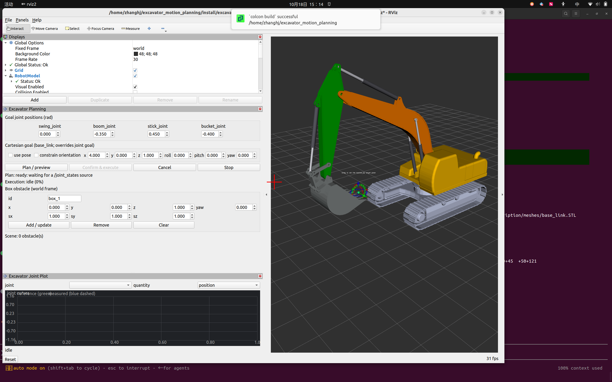
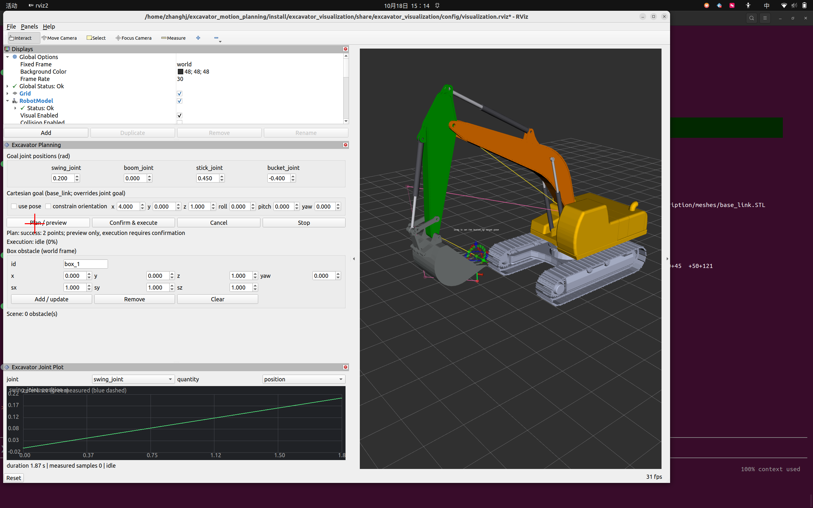
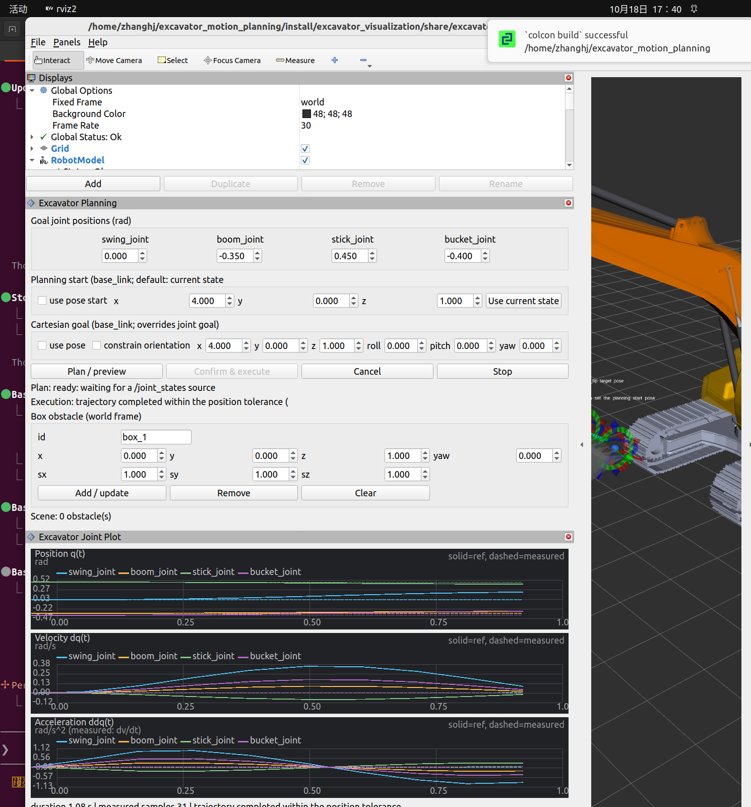
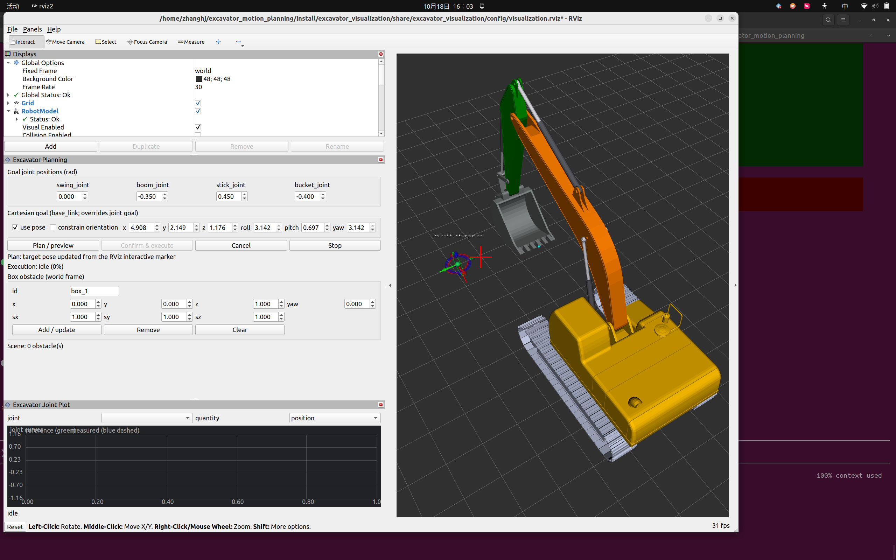
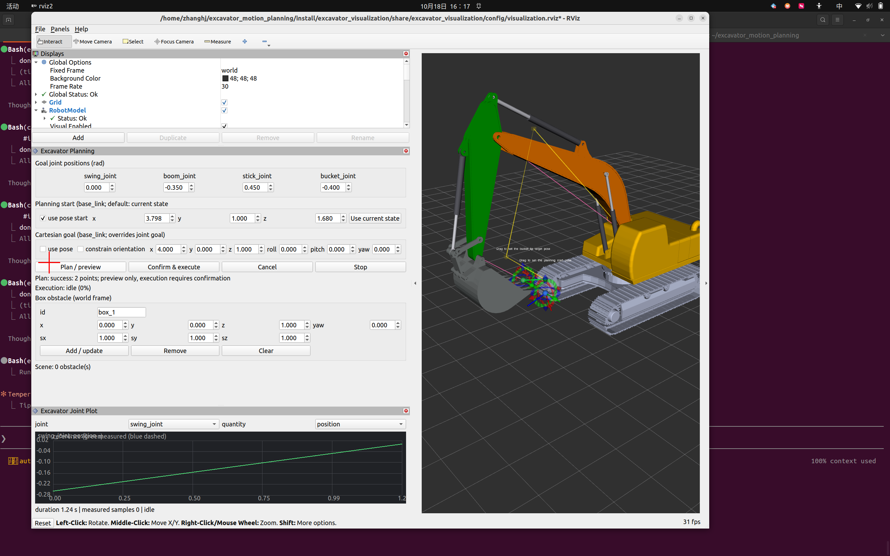
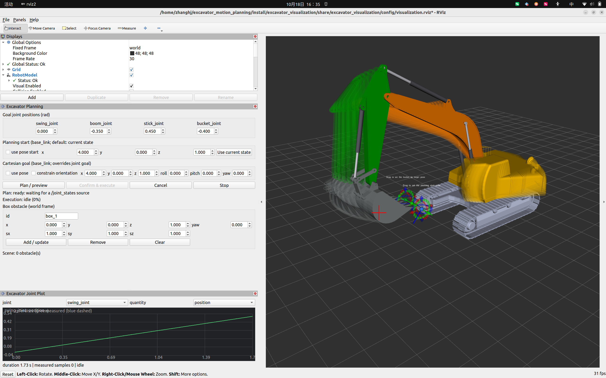
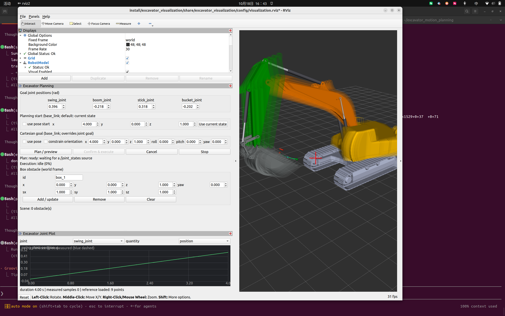
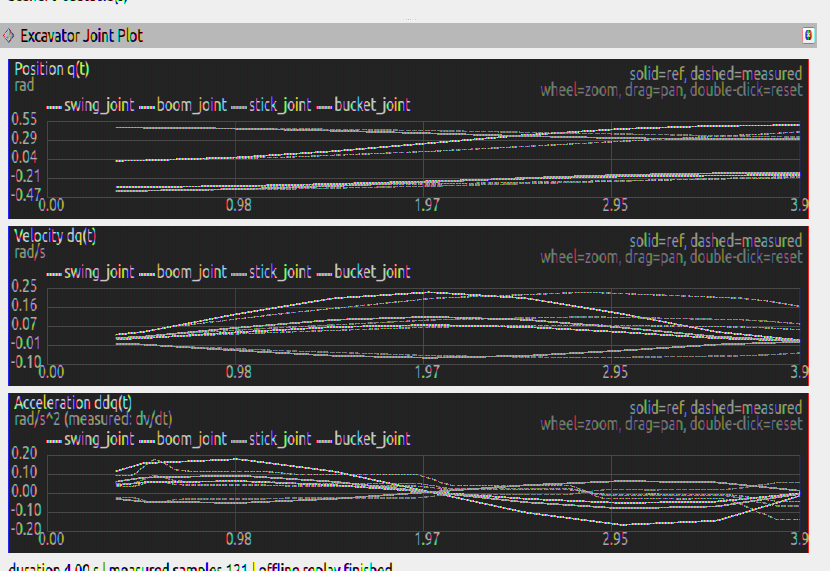
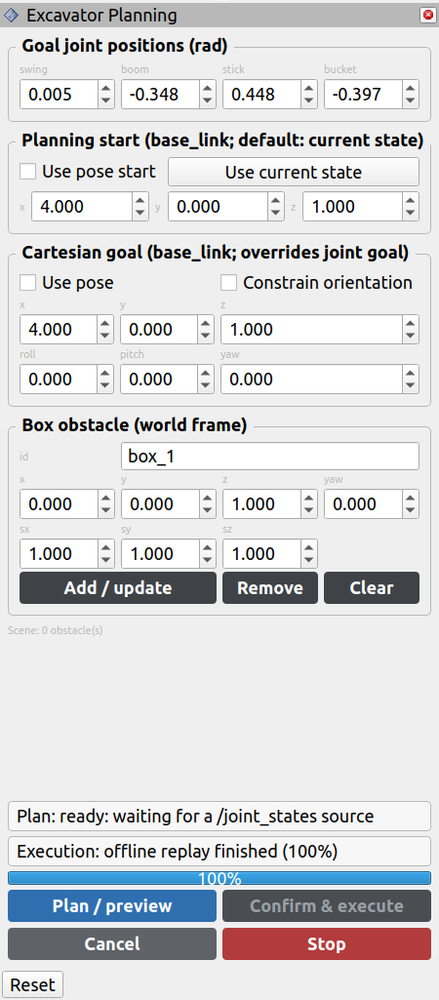

# 挖机轨迹规划与仿真框架

本项目基于 **ROS 2 Humble、C++17**，提供挖掘机模型、关节空间轨迹规划、运动学、FCL 碰撞检查、轨迹控制器、运动学仿真、独立 RViz 可视化与离线回放。代码遵循 Google C++ Style，运行时不依赖 MoveIt 2。

当前实现是**运动学仿真**，不是液压或刚体动力学仿真。液压压力/流量、重力、惯性、土壤接触与真实设备安全控制不在当前范围内。

## 1. 模型说明

模型描述包位于 `src/excavator_description/`，包含 URDF/Xacro 和网格资源。当前规划使用四个主要关节：

- `swing_joint`：回转关节
- `boom_joint`：动臂关节
- `stick_joint`：斗杆关节
- `bucket_joint`：铲斗关节

Xacro 同时定义了末端参考坐标系 `bucket_tip`，可用于末端位姿查询。模型根坐标系为 `world`，`base_link` 位于 `world` 上方 0.397 m。

模型来源及许可信息见[模型归属与许可说明](src/excavator_description/NOTICE.md)。全部网格资源（包括 `base_link.STL` 原始底盘/履带 CAD 网格）来自 [Polaris-zhj/ws_excavator](https://github.com/Polaris-zhj/ws_excavator)。如需与本地上游仓库重新同步底盘网格：

```bash
bash scripts/replace_base_link_mesh.sh /path/to/ws_excavator
# 若上游文件是 ASCII STL，RViz 需要转换为二进制：
python3 scripts/convert_ascii_stl_to_binary.py src/excavator_description/meshes/base_link.STL
```

请遵守上游许可并核对 CAD 资源的再分发条款。

## 2. 软件包结构

| 软件包 | 职责 |
| --- | --- |
| `excavator_description` | 挖机 URDF/Xacro 与网格模型 |
| `excavator_interfaces` | ROS 2 消息与 `PlanTrajectory`、`ExecuteTrajectory` Action 定义 |
| `excavator_common` | `JointPath`、`JointTrajectory`、`RobotState`、执行状态枚举、关节限位与轨迹结构校验、可替换规划接口 |
| `kinematics` | 基于 URDF 的正运动学（FK）、几何雅可比、阻尼最小二乘逆运动学（IK）及奇异性指标 |
| `excavator_collision` | 基于 FCL 的 URDF 碰撞几何加载、自碰撞/环境碰撞与路径采样检测（Box、Sphere、Cylinder、STL） |
| `excavator_planning` | 规划器插件基类与 pluginlib 加载、直线基线规划器、分段时间参数化、轨迹插值、碰撞校验与 `/plan_trajectory` Action Server |
| `excavator_planner_rrtstar` | 独立存放的 RRT* 规划算法插件，通过 `planner_class` 参数替换启用 |
| `excavator_sim_viz` | `TrajectoryController`、可替换 `ControllerInterface`、速度跟踪控制器、`KinematicSimulator`、执行 Action 与 `/joint_states` 发布 |
| `excavator_visualization` | 独立可视化包：轨迹 Marker/末端路径/占用预览、两个 RViz Panel 插件、场景与曲线数据处理、离线回放 |

规划算法通过接口解耦，后续可替换为 RRT、RRT*、PRM 或自定义算法，而不必改变上层调用方式。

## 3. 环境要求与编译

- Ubuntu 22.04
- ROS 2 Humble
- C++17、Eigen、URDF、FCL、RViz、Qt5、colcon

安装依赖并编译：

```bash
sudo apt update
sudo apt install ros-humble-desktop ros-humble-urdf ros-humble-xacro \
  ros-humble-robot-state-publisher ros-humble-rviz2 libeigen3-dev libfcl-dev
source /opt/ros/humble/setup.bash
colcon build --symlink-install
source install/setup.bash
```

如果系统同时启用了 Conda，`colcon build` 可能因 `ModuleNotFoundError: No module named 'em'` 失败。构建前先退出 Conda，确保 `python3` 指向 `/usr/bin/python3`。

## 4. 启动仿真、控制器与可视化

```bash
# 终端 1：模型、TF、100 Hz 轨迹控制器、可视化节点与 RViz
ros2 launch excavator_sim_viz model_view.launch.py

# 终端 2：独立规划服务
ros2 launch excavator_planning planning_server.launch.py
```

一键启动完整演示（仿真 + 控制器 + 可视化 + RViz + 规划服务）：

```bash
ros2 launch excavator_sim_viz demo.launch.py
# 使用 RRT*
ros2 launch excavator_sim_viz demo.launch.py \
  planner_class:=excavator_planner_rrtstar/RrtStarPlanner
```

`model_view.launch.py` 不会启动规划模块；规划模块也不会启动控制器或仿真器。无 RViz 的纯仿真闭环可改用：

```bash
ros2 launch excavator_sim_viz simulation.launch.py
```

> **ROS 域隔离（重要）**：所有 launch 在 shell 未显式设置 `ROS_DOMAIN_ID` 时默认使用
> **域 77**，避免与同一局域网内其他 ROS 2 系统（MoveIt 等）的 `/robot_description`、
> `/joint_states` 冲突。需要与手动启动的节点/脚本通信时，在那些终端也执行
> `export ROS_DOMAIN_ID=77`；想让 launch 回到默认域，可传 `domain_id:=0`。

### 仿真时可视化项的显示条件

如果运行时“有些可视化看不到”，通常不是显示开关问题，而是对应的数据尚未产生：

| 可视化项 | 出现条件 |
| --- | --- |
| RobotModel / TF | `robot_state_publisher` 收到权威 `/joint_states`（`model_view`/`demo`/回放/独立可视化默认均满足） |
| 当前刀尖（青色点） | `trajectory_visualizer_node` 收到 `/joint_states` |
| 绿色目标球 / 蓝色起始球 | `target_marker_node` 运行（`model_view`、`demo`、`visualization.launch` 均包含） |
| 规划路径、末端路径、轨迹占用预览 | **必须成功完成一次规划**；需要 `planning_server` 运行并在面板点击 `Plan / preview`（或调用 `/plan_trajectory`） |
| 参考关节曲线 | 成功规划后由 `/excavator/planned_trajectory` 加载 |
| 实测关节曲线 | 执行轨迹时由 `/excavator/execution_status` + `/joint_states` 提供 |
| 障碍物 Marker | 在规划面板添加/更新 Box 后 |
| 碰撞高亮 | 规划或执行前复核检测到碰撞时 |
| 场景/Marker 列表本身 | RViz `Displays` 面板需要向下滚动查看，所有显示项默认已启用 |

注意：

- `simulation.launch.py` 是**无界面**闭环，不启动 RViz/可视化节点；需要界面请用 `model_view.launch.py` 或 `demo.launch.py`。
- 只启动 `model_view.launch.py` 时不会启动规划服务，点击 Plan 会提示 action server 不可用，因此规划路径/占用预览不会出现。请使用 `demo.launch.py` 或另起 `planning_server.launch.py`。
- 独立可视化模式 `visualization.launch.py` 默认启动静态 `joint_state_publisher`，无仿真器也能显示模型；与仿真同时运行时需关闭重复状态源：

```bash
ros2 launch excavator_visualization visualization.launch.py \
  start_robot_state_publisher:=false start_static_joint_states:=false
```

### 执行链路与安全边界

`Planner → TrajectoryController → ControllerInterface → KinematicSimulator → /joint_states`

- `TrajectoryController` 以 100 Hz 控制循环运行，区分 `IDLE / VALIDATING / READY / RUNNING / PAUSED / COMPLETED / CANCELLED / SAFETY_STOP / ERROR`。
- 轨迹提交（`/joint_trajectory` 或 `/excavator/trajectory_update`）只接收并验证为候选轨迹，**不会自动执行**。
- 只有 `/excavator/execute_trajectory` Action（RViz 面板“确认执行”按钮）才进行最终复核：控制器/状态源就绪、起点连续、最新场景下的碰撞复采样，全部通过后才启动。
- 控制器命令经过关节速度、加速度和软/硬位置限位检查；跟踪误差超阈值进入 `SAFETY_STOP`，不继续输出不安全命令。

### 规划一条轨迹

```bash
ros2 action send_goal /plan_trajectory excavator_interfaces/action/PlanTrajectory \
"{start_state: {name: [swing_joint, boom_joint, stick_joint, bucket_joint], position: [0.0, -0.35, 0.45, -0.4]}, goal_state: {name: [swing_joint, boom_joint, stick_joint, bucket_joint], position: [0.2, -0.3, 0.4, -0.3]}, target_link: bucket_tip, allowed_planning_time: {sec: 2, nanosec: 0}, planning_scene: {is_diff: false, objects: []}}"
```

规划服务会对路径采样点和时间参数化后的轨迹采样点做 FCL 自碰撞/环境碰撞检查，成功后把结果发布到 `/excavator/planned_trajectory`，供可视化显示。规划器通过 **pluginlib** 动态加载，使用 `planner_class` 参数选择，默认 `excavator_planning/LinearPlannerPlugin`；另有 `excavator_planner_rrtstar/RrtStarPlanner`。直线基线规划器在路径被阻挡时最多尝试 `max_detour_attempts` 个单关节中间点绕行候选；RRT* 使用规划管线提供的状态/线段有效性回调和取消/超时钩子。两者都会在执行前后经过统一的路径简化（`simplify_path`）、可选平滑、时间参数化和最终碰撞/限位/工作空间校验。

规划模块还订阅 `/excavator/scene` 并保存完整场景快照；当请求里没有显式场景对象时使用最新快照。可通过参数启用末端工作空间检查：

```bash
ros2 launch excavator_planning planning_server.launch.py \
  # 或在节点参数文件中设置：
  # workspace_min: [0.0, -3.0, 0.0]
  # workspace_max: [8.0, 3.0, 6.0]
  # workspace_margin: 0.05
  # workspace_link: bucket_tip
```

超出允许 Box 或进入禁入区域时，规划会返回 `workspace validation failed at t=...`。碰撞失败时规划服务同时发布 `/excavator/collision_result` MarkerArray，高亮碰撞连杆、障碍物和错误文本。

为提高规划搜索速度，`base_link`、`swing_link`、`stick_link` 的碰撞几何使用由 CAD 网格包围盒生成的简化 Box，`boom_link` 与 `bucket_link` 仍使用原始网格；RViz 视觉始终显示完整 CAD 网格。`allowed_collision_pairs` 参数用于排除结构上不会发生的远端连杆自碰撞对（默认包含基座/回转平台与 boom/stick/bucket 的组合）。碰撞 Box 是保守近似，不能替代精确几何和连续碰撞安全认证。

### 规划器插件与 RRT*

规划器基类 `tramcar::planning::PlannerPlugin` 位于 `excavator_planning`，规划服务通过 pluginlib 动态加载，可用 `planner_class` 参数切换：

- `excavator_planning/LinearPlannerPlugin`：默认直线基线（有限绕行候选）；
- `excavator_planner_rrtstar/RrtStarPlanner`：独立包中的 RRT* 算法。

启动时选择 RRT*：

```bash
ros2 launch excavator_planning planning_server.launch.py \
  planner_class:=excavator_planner_rrtstar/RrtStarPlanner \
  planner_max_iterations:=4000 \
  planner_step_size:=0.3 \
  planner_goal_bias:=0.15 \
  planner_rewire_radius:=0.8 \
  planner_goal_tolerance:=0.15 \
  planner_random_seed:=42
```

RRT* 特性：

- 关节空间均匀采样 + 目标偏置；
- 最近邻扩展、邻域最优父节点选择与 rewiring；
- 通过规划管线的 `state_validity_check` 按 `max_collision_joint_step` 分辨率检查节点和线段；
- 尊重取消/超时钩子；
- 固定随机种子可复现，找到解后继续优化直到迭代或时间预算；
- 算法实现、插件声明和单元测试均独立存放在 `src/excavator_planner_rrtstar`。

新增自定义算法无需修改规划流程、控制器或可视化：

1. 新建独立 ROS 2 包并依赖 `excavator_planning`、`pluginlib`；
2. 继承 `PlannerPlugin` 实现 `Configure()` 和 `Plan()`；
3. 使用 `PLUGINLIB_EXPORT_CLASS` 导出，并以 `excavator_planning` 为 plugin category：
   `pluginlib_export_plugin_description_file(excavator_planning planner_plugins.xml)`；
4. 启动时设置 `planner_class:=<package>/<YourPlanner>` 即可替换。

`PlanTrajectory` 同时支持笛卡尔目标：设置 `use_pose_goal: true`，并把目标位姿写入 `target_pose`（参考坐标系为 URDF `base_link`）。规划服务先用 `kinematics` 的阻尼最小二乘 IK 求目标关节配置，IK 失败会返回 `IK failed: ...`，不会进入执行流程。RViz 规划面板的 “Cartesian goal” 区域对应这一入口。四自由度挖机默认只求解位置（`constrain_orientation: false`）；设置 `constrain_orientation: true` 时同时求解姿态，无法同时满足时返回 IK 失败。IK 带信赖域与回溯线搜索，并对停滞、迭代上限和 wall-clock 预算分别报告失败原因。

### 确认执行

把上一步规划结果通过执行 Action 提交（真实使用时由 RViz 规划面板自动完成）：

```bash
ros2 action send_goal /excavator/execute_trajectory excavator_interfaces/action/ExecuteTrajectory \
"{require_confirmation: true, trajectory: {
  joint_names: [swing_joint, boom_joint, stick_joint, bucket_joint],
  points: [
    {positions: [0.0, -0.35, 0.45, -0.4], time_from_start: {sec: 0, nanosec: 0}},
    {positions: [0.2, -0.3, 0.4, -0.3], time_from_start: {sec: 3, nanosec: 0}}
  ]
}}"
```

Action 反馈包含状态与进度；执行状态同时发布到 `/excavator/execution_status`。

## 5. 主要 ROS 2 接口

| 名称 | 类型 | 用途 |
| --- | --- | --- |
| `/joint_states` | `sensor_msgs/msg/JointState` | 唯一权威关节状态源（仿真器或回放器发布） |
| `/plan_trajectory` | `excavator_interfaces/action/PlanTrajectory` | 规划请求、反馈、取消 |
| `/excavator/planned_trajectory` | `trajectory_msgs/msg/JointTrajectory` | 规划结果，供可视化/离线记录 |
| `/excavator/execute_trajectory` | `excavator_interfaces/action/ExecuteTrajectory` | 最终复核并启动执行（需 `require_confirmation: true`） |
| `/excavator/execution_status` | `excavator_interfaces/msg/ExecutionStatus` | 统一执行状态、进度与跟踪误差 |
| `/excavator/trajectory_update` | `excavator_interfaces/msg/TrajectoryUpdate` | 在线轨迹更新；第一版仅支持整条替换 |
| `/excavator/scene` | `excavator_interfaces/msg/PlanningScene` | 完整场景快照；控制器执行前使用最新快照复核 |
| `/excavator/planned_path` | `visualization_msgs/msg/MarkerArray` | 规划末端路径、起终点与目标标记 |
| `/excavator/end_effector_path` | `nav_msgs/msg/Path` | 经 FK 计算的铲斗刀尖路径 |
| `/excavator/trajectory_occupancy` | `visualization_msgs/msg/MarkerArray` | 多采样姿态占用预览（近似，不构成碰撞判据） |
| `/excavator/scene_markers` | `visualization_msgs/msg/MarkerArray` | Box 障碍物显示，与规划场景同源 |
| `/excavator/collision_result` | `visualization_msgs/msg/MarkerArray` | 碰撞连杆、障碍物和错误文本高亮 |
| `/excavator/target_pose` | `geometry_msgs/msg/PoseStamped` | RViz 交互标记拖动得到的目标位姿（`base_link`） |
| `/excavator_target/update`、`/excavator_obstacle/update` | `visualization_msgs/msg/InteractiveMarkerUpdate` | 目标位姿与 Box 障碍物的 6-DoF 交互标记 |
| `/excavator/pause`、`/excavator/resume`、`/excavator/stop` | `std_msgs/msg/Empty` | 暂停、恢复、立即停止 |

为兼容早期用法，控制器同时提供 `/execute_trajectory` Action 与 `/execution_status` 状态 Topic。

`TrajectoryUpdate` 只承载传输字段：`joint_names` 显式给出关节顺序，轨迹点使用相对时间 `t`，`update_mode` 第一版只支持 `REPLACE`，要求从 `t=0` 开始的整条替换；未知模式会被拒绝。

## 6. 独立可视化

可视化包可以独立启动，不依赖执行/仿真模块：

```bash
ros2 launch excavator_visualization visualization.launch.py
```

与 `model_view.launch.py` 同时使用时，避免重复状态源：

```bash
ros2 launch excavator_visualization visualization.launch.py \
  start_robot_state_publisher:=false
```

无图形环境下只启动可视化数据节点（不启动 RViz/控制器/仿真器）：

```bash
ros2 launch excavator_visualization visualizer.launch.py
```

包含两个 RViz Panel 插件：

- `ExcavatorPlanningPanel`（插件 A）：以当前 `/joint_states` 为起点、输入关节目标或笛卡尔目标、通过 RViz Interactive Marker 拖动 `bucket_tip` 目标位姿、通过 6-DoF 交互标记移动/旋转 Box 障碍物（尺寸与数值位姿也可在面板修改）、发起规划与预览、显示失败原因、点击“确认执行”触发最终复核与执行。
- `ExcavatorJointPlotPanel`（插件 B）：显示每个关节的位置/速度/加速度参考曲线，并按执行时间对齐显示实测位置/速度。

三维显示包括：规划末端路径、起终点与目标标记、当前刀尖、多采样姿态占用预览、障碍物 Marker 和规划末端路径（`nav_msgs/Path`）。没有仿真器时也能显示静态模型、规划结果或离线日志。

轨迹占用预览由 `/excavator/trajectory_occupancy` 发布：按轨迹时间均匀采样（默认 8 个姿态），使用 URDF 中 `swing_link`、`boom_link`、`stick_link`、`bucket_link` 的原始视觉网格生成半透明 MESH_RESOURCE Marker，每个采样姿态具有独立 namespace/id，替换轨迹时先发送 DELETEALL 清理旧 Marker。该预览只显示离散采样姿态，不是连续扫掠体，也不能作为碰撞判定依据。RViz 中可在 Displays 面板按连杆 namespace 单独开关显示。

### RViz 图形界面验证

已在真实 X11/RViz 会话中完成完整 GUI 闭环：设置目标 → 规划/预览 → “Confirm & execute” → 运行 → 完成，并验证模型、液压缸视觉、TF、路径、占用预览、交互标记和关节曲线同时显示。

| 界面 | 截图 |
| --- | --- |
| 完整 CAD 模型、两个 Panel 与曲线面板 |  |
| 规划预览（路径、起终点、占用预览、参考曲线） |  |
| 执行完成（参考/实测曲线与完整履带底盘） |  |
| 自由拖动 `bucket_tip` 目标球并回填 Cartesian goal |  |
| 自由拖动蓝色起始球并使用自定义起点规划 |  |
| 轨迹占用预览（按时间采样 8 个整臂半透明姿态） |  |
| 离线回放（无规划器/控制器/仿真器，含轨迹与占用预览） |  |
| 关节曲线：位置/速度/加速度三图同时绘制，按关节颜色区分 |  |
| 操作面板：可左右伸缩的网格布局、固定操作栏和执行进度条 |  |

`Excavator Joint Plot` 面板同时绘制位置 `q(t)`、速度 `dq(t)` 和加速度 `ddq(t)` 三幅曲线图。每个关节在所有图中使用同一种固定颜色（`swing_joint` 蓝、`boom_joint` 橙、`stick_joint` 绿、`bucket_joint` 紫），图例带对应颜色的线段标记；实线为规划参考值，虚线为实测值。`JointState` 不含加速度，因此实测加速度先在相邻速度样本间做中心差分 `dv/dt`，再用 5 点零相位滑动平均抑制 100 Hz 速度信号中的跟踪噪声（`rad/s^2`）；这样保留真实加速度轮廓，参考与实测曲线基本重合，仅在启停阶段因控制器加速度限幅存在短暂偏差。

三幅图都支持鼠标交互：

- **滚轮**：以鼠标位置为中心同时缩放时间轴和数值轴；
- **Ctrl + 滚轮**：只缩放时间轴；
- **Shift + 滚轮**：只缩放数值轴；
- **左键拖动**：平移时间轴和数值轴；
- **双击**：恢复自动数据范围（加载新的规划轨迹时也会自动复位）。

`Excavator Planning` 操作面板采用随停靠宽度伸缩的网格布局：拖动 RViz 面板分隔条即可左右调整宽度，输入框会随列宽自动伸缩；配置区超出高度时可滚动，`Plan / preview`、`Confirm & execute`、`Cancel`、`Stop` 以及状态和执行进度条固定在面板底部，始终可见。目标关节、规划起点、笛卡尔目标和盒状障碍物分别放在带边框的分组中，操作按钮按优先级配色。

曲线时间基准与执行器一致：面板用 `ExecutionStatus.elapsed_time` 加上 `/joint_states` 的 `header.stamp` 相对状态消息时间的偏移来还原轨迹时刻。这样即使状态消息只有 10 Hz、关节状态为 100 Hz，采样时间也不会重复或抖动，差分得到的加速度不会失真。离线回放器同样发布 `/excavator/execution_status`（`RUNNING`/`COMPLETED`），因此离线曲线与参考轨迹使用同一时间轴；`loop:=true` 时每圈会清空上一圈实测数据重新采集。路径处理把直线路径简化为两个点时，时间参数化会生成五次多项式（S 曲线）速度剖面，首尾速度和加速度均为零，因此参考速度不再恒为零，实际执行也没有速度阶跃。

`bucket_tip` 目标位姿通过 `/excavator_target/update` 的 6-DoF Interactive Marker 设置。直接拖动标记中心的绿色球即可在任意方向自由移动（不再局限于单轴/四方向），同时保留 X/Y/Z 轴手柄用于精确微调；拖动后自动填入面板 Cartesian goal。

起始点同样支持交互设置：默认规划起点为当前 `/joint_states`；面板 “Planning start” 区域提供 `use pose start`、x/y/z 和 “Use current state” 按钮，并有一个独立的蓝色起始球（初始显示在当前刀尖侧方，避免与目标球重叠）。拖动蓝色球后，规划服务先用 `/excavator/start_pose` 作为 IK 目标、当前关节状态作为种子求解起始关节配置，再执行路径规划；对应 Action 字段为 `use_pose_start` / `start_pose`。

使用自定义起点执行时，面板在 `ExecuteTrajectory` 请求中设置 `initialize_to_start=true`：控制器在最终复核前将**运动学仿真器**移动到轨迹起点，因此不会触发“轨迹起点与当前状态不连续”的拒绝。该行为仅适用于仿真；控制器参数 `allow_simulator_initialization:=false` 时会拒绝此类请求，硬件模式必须关闭。若未启用仿真初始化，控制器仍严格检查起点连续性并拒绝不连续轨迹。

由于四自由度工作装置一般不能实现任意 6-DoF 位姿，笛卡尔目标和起始点默认只约束位置（`constrain_orientation` 未勾选）；需要同时约束姿态时可在面板中勾选该项。

`base_link.STL` 已转换为二进制 STL（RViz 内置 STL 加载器只支持二进制）。如替换网格后可执行：

```bash
python3 scripts/convert_ascii_stl_to_binary.py src/excavator_description/meshes/base_link.STL
```

### 离线回放

轨迹/状态日志使用 CSV（`joint_names,...` 头 + `t,positions...,velocities...,accelerations...` 列）。仓库自带示例轨迹：

```bash
src/excavator_visualization/config/sample_trajectory.csv
```

**带 RViz 的离线回放**（只启动 `robot_state_publisher`、回放器和可视化节点，不启动规划器、控制器或仿真器）：

```bash
ros2 launch excavator_visualization replay.launch.py \
  trajectory_file:=install/excavator_visualization/share/excavator_visualization/config/sample_trajectory.csv \
  replay_rate:=1.0 loop:=true start_rviz:=true
```

**自动化离线可视化测试**（默认无 RViz，自动启动并清理 replay launch，验证轨迹、`/joint_states`、规划路径 Marker、末端路径和轨迹占用 Marker）：

```bash
python3 scripts/offline_visualization_test.py
```

默认是**无界面模式**，不会启动 RViz，因此看不到曲线是正常的。需要在测试同时查看 RViz 曲线时使用：

```bash
python3 scripts/offline_visualization_test.py --start-rviz
```

该模式会启动 RViz，并在测试通过后保持回放/RViz 运行 20 秒供观察；可用 `--hold-seconds 60` 延长。

验证内容：

- 回放轨迹 9 个点、4 个关节；
- `/joint_states` 持续发布；
- `/excavator/execution_status` 的 `duration` 与轨迹时长一致；
- 按状态中的 `elapsed_time` 反查参考轨迹，关节位置/速度与回放状态一致（同时验证曲线时间对齐）；
- `/excavator/planned_path` 包含 DELETEALL 和路径/起终点 Marker；
- `/excavator/end_effector_path` 的位姿数量与轨迹点一致；
- `/excavator/trajectory_occupancy` 包含 8 个时间采样 × 4 个连杆的网格 Marker（默认 33 个 Marker，其中 32 个 `MESH_RESOURCE`）。

回放器是离线模式的权威 `/joint_states` 源，同时把轨迹发布到 `/excavator/planned_trajectory`。`ReplayManager` 的保存/加载接口也有单元测试覆盖。

### 独立 CSV 轨迹发布脚本

`scripts/publish_sample_trajectory.py` 不依赖 C++ 回放节点，直接读取 `sample_trajectory.csv` 并发布：

- `/excavator/planned_trajectory`（transient local，参考曲线、路径和占用预览的输入）；
- `/joint_states`（4 个主动关节 + 11 个被动液压/连杆关节）；
- `/excavator/execution_status`（`IDLE`/`RUNNING`/`COMPLETED`、轨迹时刻、进度）。

终端 1 启动可视化（关闭静态关节源，避免和脚本冲突）：

```bash
ros2 launch excavator_visualization visualization.launch.py \
  start_static_joint_states:=false
```

终端 2 循环发布轨迹：

```bash
python3 scripts/publish_sample_trajectory.py --loop
```

常用参数：

```bash
python3 scripts/publish_sample_trajectory.py \
  --trajectory-file src/excavator_visualization/config/sample_trajectory.csv \
  --rate 50 --replay-rate 1.0 --start-delay 2.0 --loop
```

自动校验可视化输出（需要可视化节点已启动）：

```bash
python3 scripts/publish_sample_trajectory.py --check
```

校验内容与离线测试一致：`/excavator/planned_path` 的 DELETEALL/路径 Marker、`/excavator/end_effector_path` 位姿数、`/excavator/trajectory_occupancy` 的网格 Marker 和连杆命名空间。通过时输出：

```text
VISUALIZATION CHECK: PASS
```

如果机器或局域网内同时运行其他 ROS 2 系统（例如另一台电脑上的 MoveIt），默认域里的 `/joint_states` 和 `/robot_description` 会互相冲突，典型表现为 RViz 的 RobotModel 报 `Errors loading geometries`（它收到了别的机器人的 URDF，找不到对应的 mesh 包）、模型不显示或曲线数据混入其他机器人。

本项目的 launch 已默认使用**域 77** 来避免该问题：

- shell 未设置 `ROS_DOMAIN_ID` 时，launch 和 `scripts/` 下的测试/发布脚本都默认使用 77；
- 手动启动其他节点（或 `ros2 topic echo` 等工具）时，需要先 `export ROS_DOMAIN_ID=77`；
- 如需换域：`export ROS_DOMAIN_ID=7`，或启动时传 `domain_id:=7`（`demo.launch.py` 会把该值传给所有子 launch）；
- 如需回到默认域：`ros2 launch ... domain_id:=0`。

```bash
# 终端 1
ros2 launch excavator_visualization visualization.launch.py \
  start_static_joint_states:=false

# 终端 2（同样默认域 77）
python3 scripts/publish_sample_trajectory.py --loop
```

脚本启动后会检查 `/joint_states` 和 `/robot_description` 的其他发布者并打印警告。

## 7. 运动学接口示例

`kinematics` 包可以从展开后的 URDF XML 或 URDF 文件加载模型。存在 `base_link` 时，FK 以 `base_link` 为参考系；运动学调用不维护可变的“当前关节状态”。

```bash
xacro src/excavator_description/urdf/excavator.urdf.xacro > /tmp/excavator.urdf
```

```cpp
#include "kinematics/urdf_kinematics_model.hpp"

tramcar::planning::UrdfKinematicsModel kinematics;
const auto load = kinematics.InitializeFromFile("/tmp/excavator.urdf");
if (!load.ok) {
  // 根据 load.message 处理错误。
}

tramcar::planning::Pose3 pose;
const auto fk = kinematics.GetLinkPose(
    {0.0, -0.35, 0.45, -0.4}, "bucket_tip", &pose);
```

## 8. 测试

```bash
source /opt/ros/humble/setup.bash
colcon build --symlink-install
source install/setup.bash
colcon test --event-handlers console_direct+
colcon test-result --verbose
```

测试覆盖：轨迹结构/时间戳/限位、URDF FK/雅可比/IK（含时间预算）、FCL 碰撞与路径采样、可替换规划器注册与 pluginlib 加载、直线有限绕行、RRT*（开阔空间、障碍绕行、可复现性、取消与无效输入）、路径简化/平滑、工作空间检查、时间参数化与插值、控制器状态机与在线更新、仿真器命令限位、可视化曲线时间对齐、场景管理、CSV 回放与 Marker/FK 生成。

无 GUI 的端到端验证可按第 4 节启动 `simulation.launch.py` 与 `planning_server.launch.py`，再发送规划与执行 Action；正常执行会发布 `RUNNING → COMPLETED` 状态并保持 `execute_trajectory` Action 成功返回。

## 9. 当前限制

- 直线基线规划器只尝试有限个单关节中间点候选，不具备完备性。
- RRT* 是概率完备的采样算法，不保证在有限时间内找到解；本实现以距离最优为代价，未实现完整的动力学约束与任意时域重规划。
- 碰撞检查采用离散采样和简化 Box 碰撞几何，不能证明采样点之间连续无碰撞；不是安全认证实现。
- 工作空间检查只验证末端 `workspace_link` 是否在允许/禁入 Box 内，不代表整机无碰撞或 IK 可达。
- 时间参数化是保守的分段时间分配，不是时间最优算法，也未完整实现 jerk 约束。
- 运动学仿真不模拟液压、重力、负载和土壤接触。
- 真实设备执行前必须接入独立硬件安全层、急停和故障处理。
- RViz GUI 需要在有图形显示的环境中验证；无显示环境只能运行节点与数据链路测试。

本项目当前定位为**可扩展的基础框架与仿真验证起点**，不是已完成安全认证的挖掘机运动控制系统。
