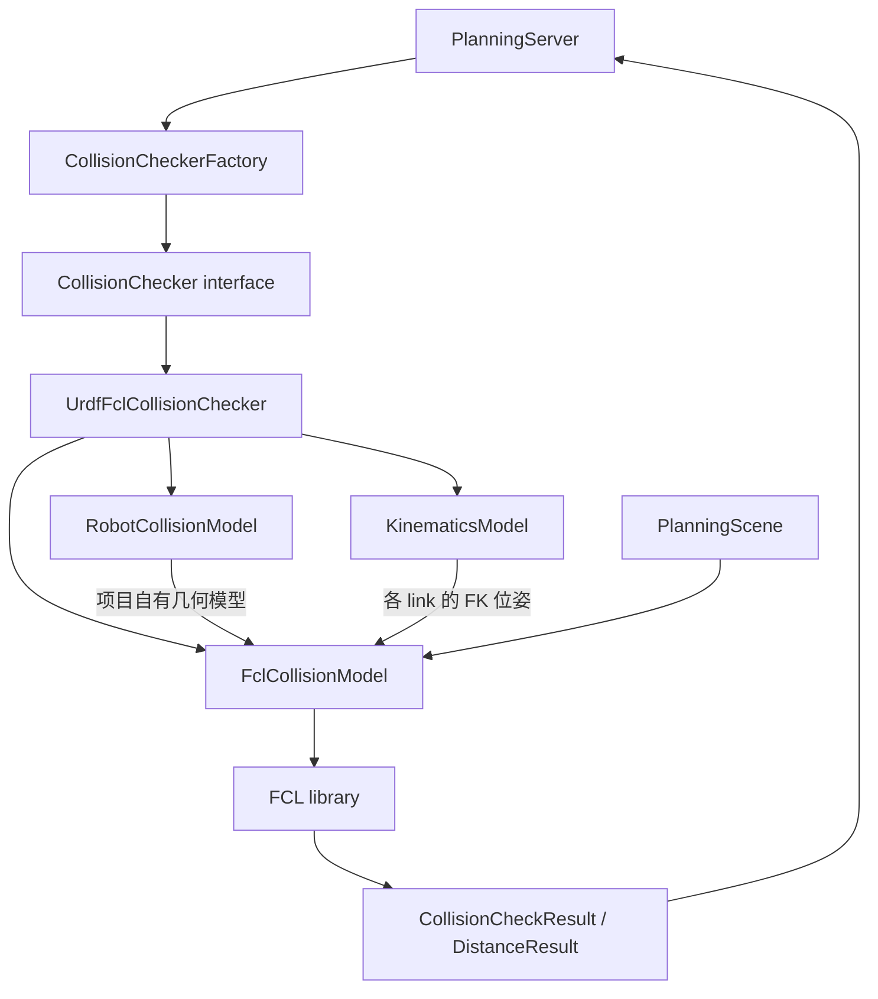
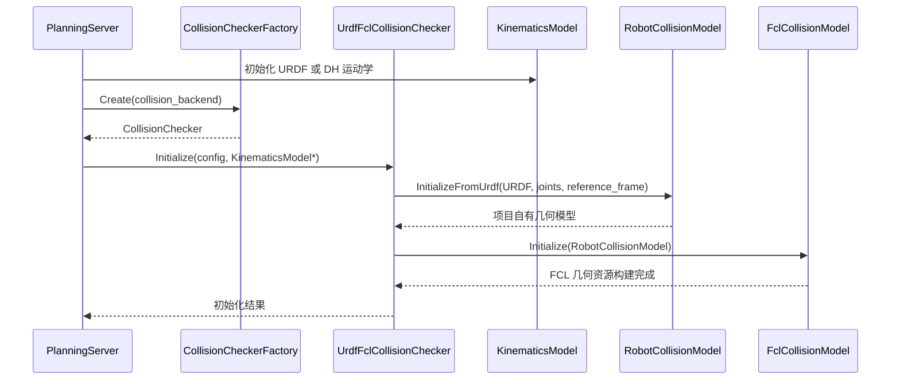
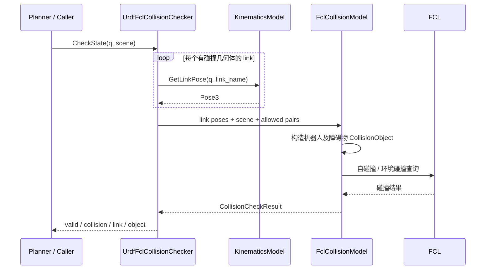
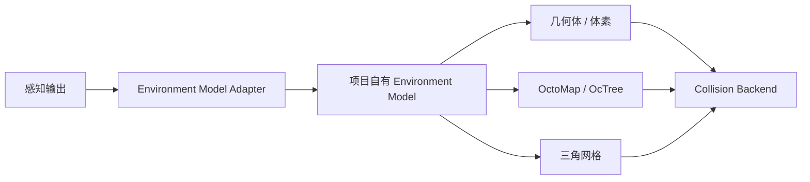

# 挖机碰撞检测方案

> 文档状态：第一版设计与当前代码实现对照  
> 所属软件包：`excavator_collision`  
> 运行环境：Ubuntu 22.04、ROS 2 Humble、C++17  
> 核心原则：项目定义稳定的碰撞检测接口和数据模型，第三方算法通过适配层接入，规划层不依赖 FCL。

## 1. 目标与范围

碰撞检测模块负责判断挖机在给定关节状态、路径或轨迹下，是否与自身结构或外部障碍物发生几何碰撞，并提供指定障碍物的距离查询能力。

第一版目标：

1. 从 URDF 中加载机器人碰撞几何体，包括 Box、Sphere、Cylinder 和 STL Mesh。
2. 与运动学模块解耦，通过统一的 `KinematicsModel` 获取连杆位姿。
3. 检测机器人自碰撞和机器人与环境障碍物之间的碰撞。
4. 支持单个关节状态、离散关节路径和关节轨迹检测。
5. 支持查询机器人与指定障碍物之间的最小距离。
6. 使用 FCL 作为第一版第三方碰撞计算后端，但不让 FCL 类型进入规划层的公共接口。
7. 为后续自研碰撞算法保留替换入口，通过工厂注册和配置选择后端，不修改规划器的调用逻辑。

第一版不承担液压动力学、接触力计算、连续时间碰撞证明或感知算法本身。碰撞检测只使用传入的几何描述和位姿。

## 2. 总体架构

### 2.1 模块关系



这里有三个必须保持的边界：

- **KinematicsModel**：只负责运动学计算，输入关节位置，输出指定连杆的位姿。
- **RobotCollisionModel**：只负责描述机器人碰撞几何体、几何体相对连杆的固定局部位姿以及连杆关系，不计算 FK，也不包含 FCL 类型。
- **FclCollisionModel**：负责把项目自己的碰撞几何描述转换为 FCL 几何对象，并执行 FCL 碰撞/距离查询。

`UrdfFclCollisionChecker` 是三者之间的协调层。规划服务只依赖 `CollisionChecker` 抽象接口，不直接调用 FCL。

### 2.2 目录结构

```text
src/excavator_collision/
├── include/excavator_collision/
│   ├── collision_checker_interface.hpp
│   ├── collision_checker.hpp
│   └── collision_checker_factory.hpp
├── collision_detection/
│   ├── README.md
│   ├── include/excavator_collision/internal/
│   │   └── robot_collision_model.hpp
│   ├── src/
│   │   ├── collision_checker.cpp
│   │   └── robot_collision_model.cpp
│   └── third_library/
│       └── fcl/
│           ├── fcl_collision_model.hpp
│           └── fcl_collision_model.cpp
├── src/
│   ├── collision_checker.cpp
│   └── collision_checker_factory.cpp
└── test/
    ├── collision_checker_test.cpp
    ├── collision_checker_factory_test.cpp
    └── collision_benchmark_test.cpp
```

目录职责：

| 文件/目录 | 职责 |
| --- | --- |
| `collision_checker_interface.hpp` | 定义项目级碰撞查询接口、输入配置和结果类型 |
| `collision_checker.hpp` | 当前 URDF + FCL 后端的公开声明 |
| `collision_checker_factory.hpp/.cpp` | 注册并创建碰撞检测后端 |
| `RobotCollisionModel` | 从 URDF 加载机器人碰撞几何描述 |
| `collision_detection/src/collision_checker.cpp` | 调用 FK、组织碰撞查询、路径离散采样 |
| `third_library/fcl` | FCL 类型转换、FCL 对象构造、碰撞和距离计算 |
| `test/` | 碰撞检测、工厂注册和性能测试 |

`third_library/fcl` 是 FCL 适配代码存放位置，不是 FCL 上游源代码副本。FCL 仍通过系统依赖 `libfcl-dev` 引入。

## 3. 模型职责与坐标变换

### 3.1 KinematicsModel

运动学模块通过统一接口提供 FK：

```cpp
ValidationResult GetLinkPose(
    const JointPositions& joint_positions,
    const std::string& link_name,
    Pose3* pose) const;
```

输入是当前规划关节组的关节位置，输出指定 `link_name` 的位姿。碰撞模块不应再次解析关节树并重复实现 FK。

当前运动学后端包括：

- `UrdfKinematicsModel`
- `DhKinematicsModel`

两者都实现项目自己的 `KinematicsModel` 接口。规划服务初始化碰撞检测器时，将已创建的运动学对象传入：

```cpp
collision_checker_->Initialize(collision_config, kinematics_.get());
```

该指针由碰撞检测器借用，不转移所有权；运动学对象必须比碰撞检测器活得更久。当前 `PlanningServer` 将二者作为成员持有，析构顺序也保证碰撞检测器先于运动学对象释放。

### 3.2 RobotCollisionModel

`RobotCollisionModel` 是项目自己的机器人碰撞模型，核心数据包括：

- `link_name`：碰撞几何体所属连杆名称；
- `parent_link_name`：URDF 中该连杆的直接父连杆；
- `CollisionGeometry`：项目自己的几何类型和参数；
- `link_to_collision`：碰撞几何体相对所属连杆的固定局部位姿。

模型层不包含 `fcl::CollisionObject`、`fcl::CollisionGeometry` 等类型。它只描述“机器人由哪些几何体构成，以及这些几何体固定在什么位置”。

第一版由 `InitializeFromUrdf()` 解析 URDF 的 collision 元素。若某个带碰撞几何体的连杆依赖未配置的可动关节，初始化会报错，避免把该关节静默固定在零位。

### 3.3 FclCollisionModel

`FclCollisionModel` 负责 FCL 相关工作：

1. 将项目几何类型转换成 `fcl::Boxd`、`fcl::Sphered`、`fcl::Cylinderd` 或三角网格 BVH。
2. 保存机器人几何资源。
3. 每次查询时结合 FK 位姿构造当前世界坐标系下的 FCL 碰撞对象。
4. 构造环境障碍物对象。
5. 调用 FCL 的碰撞或距离查询。
6. 将计算结果转换成项目自己的结果结构。

FCL 对象不暴露给 Planner 或其他业务层。

### 3.4 坐标系约定

当前挖机 URDF 的根坐标系为 `world`，运动学查询返回的连杆位姿以 `base_link` 为参考系。两者之间有固定变换：

```text
T_world_link = T_world_base_link * T_base_link_link
```

机器人碰撞几何体的最终位姿为：

```text
T_world_collision = T_world_link * T_link_collision
```

其中：

- `T_world_base_link`：从 URDF 固定关节链解析得到，在模型初始化时计算；
- `T_base_link_link`：由当前 `KinematicsModel::GetLinkPose()` 返回；
- `T_link_collision`：来自 URDF collision 元素的 origin。

当前 `CollisionModelConfig::kinematics_reference_frame` 默认是 `base_link`。初始化时，模型层会检查该 frame 是否通过固定关节连接到 URDF 根坐标系，并解析固定变换。当前不支持 reference frame 与 URDF 根坐标系之间存在可动关节的情况。

环境障碍物位姿必须与规划场景的根坐标系一致。当前模块不主动查询 TF，也不会自动执行 frame 转换；`PlanningScene.header.frame_id` 为空时允许直接使用，否则必须与 URDF 根 frame 一致。

## 4. 初始化与运行流程

### 4.1 初始化流程



当前初始化配置的含义：

| 配置项 | 当前值/用途 |
| --- | --- |
| `collision_backend` | 默认 `urdf_fcl`，选择碰撞算法实现 |
| `model_format` | 当前为 `urdf`，表示碰撞几何来源是 URDF |
| `model_source` | 由 launch 中 Xacro 展开的 URDF XML |
| `joint_names` | 当前规划使用的主动关节顺序 |
| `kinematics_reference_frame` | 当前为 `base_link`，声明 FK 位姿的参考坐标系 |
| `KinematicsModel*` | 当前选择的 FK 实现，供碰撞检查时查询连杆位姿 |

注意：即使启动时选择 `kinematics_backend:=dh`，机器人碰撞几何仍从实际 URDF 加载；DH 只负责 FK。碰撞模型和运动学模型保持独立，不要求为 DH 再生成一套 FCL 几何模型。

### 4.2 单状态碰撞查询



当前为每次查询根据 FK 位姿构造 FCL `CollisionObject`，避免在多个并发查询之间共享带可变位姿的对象。机器人静态几何资源在初始化时构建；障碍物几何和对象在查询时根据传入场景生成。

## 5. 对外接口设计

核心抽象为 `CollisionChecker`。接口返回的 `CollisionCheckResult` 中：

- `valid` 表示本次检查是否成功执行；
- `collision` 表示是否发现碰撞；
- `message` 给出成功或失败原因；
- `first_link` 与 `second_object` 描述碰撞对象；
- `collision_positions` 记录发生碰撞时的关节位置；
- `checked_states` 记录路径检测实际检查的状态数量。

调用方必须区分“检查成功且无碰撞”和“检查本身失败”。`valid == false` 时不能把结果当作无碰撞。

### 5.1 单状态接口

| 接口 | 作用 |
| --- | --- |
| `CheckState(q, scene)` | 检查机器人自碰撞和环境碰撞 |
| `CheckSelfCollision(q)` | 只检查机器人自身连杆之间的碰撞 |
| `CheckEnvironmentCollision(q, scene)` | 只检查机器人与场景障碍物的碰撞 |

### 5.2 路径与轨迹接口

| 接口 | 作用 |
| --- | --- |
| `CheckPath(path, scene, max_joint_step)` | 对关节路径分段采样，检查每个采样状态的自碰撞和环境碰撞 |
| `CheckPathCollisionWithObstacle(path, scene, obstacle_id, max_joint_step)` | 仅检查路径与指定障碍物之间的碰撞 |
| `CheckTrajectory(trajectory, scene, max_joint_step)` | 先校验轨迹结构，再按关节位置构造路径进行离散碰撞检查 |

路径的相邻路点按关节空间线性插值。对一段路径，当前采样数根据该段最大的关节变化量决定：

```text
N = max(1, ceil(max_i(abs(q_end[i] - q_start[i])) / max_joint_step))
```

每段按 `alpha = j / N` 生成中间状态，并在最后单独检查路径终点。当前 `max_joint_step` 对挖机四个转动关节以弧度解释。若未来把转动关节和移动关节混合进同一个规划组，应升级为逐关节步长或归一化距离度量，避免弧度和米使用同一个阈值。

该路径插值当前不做连续关节角的最短角差归一化；调用方需要确保路径路点已经按期望的关节角连续性表达。

### 5.3 距离查询接口

`ComputeDistanceToObstacle(q, scene, obstacle_id)` 返回给定关节状态下，机器人全部碰撞几何体到指定障碍物的最小距离，并记录对应的机器人连杆名称。

该接口面向单个障碍物。当前结果不提供距离梯度、最近点对的完整几何信息或连续轨迹安全证明。若需要用距离场做优化，应在后续接口中明确增加最近点、梯度和有效性语义。

## 6. 碰撞规则

### 6.1 自碰撞过滤

当前自碰撞检查默认跳过：

1. 同一连杆上的多个碰撞几何体之间的配对；
2. 直接父子连杆配对；
3. 用户通过 `allowed_collision_pairs` 显式配置的连杆配对。

父子关系来自 URDF 连杆树。允许碰撞对按无序连杆对处理，因此 `A:B` 与 `B:A` 等价。

允许碰撞对只应排除结构上明确不需要检测的组合。不要为了让规划通过而随意增加过滤项，否则可能把真实的自碰撞隐藏掉。

当前规划服务的默认过滤项包括：

```yaml
allowed_collision_pairs:
  - "base_link:boom_link"
  - "base_link:stick_link"
  - "base_link:bucket_link"
  - "swing_link:stick_link"
  - "swing_link:bucket_link"
```

这些默认项也应结合具体模型几何和实际运动范围复核。

### 6.2 环境碰撞

环境碰撞对为每个机器人碰撞对象和每个启用的环境对象进行查询。禁用对象（`enabled: false`）不参与检测。

场景对象 ID 必须非空且唯一。几何参数、位姿或 frame 不合法时，检查返回失败，不会静默忽略不受支持的障碍物。

## 7. 当前支持的模型与场景输入

### 7.1 机器人碰撞模型

从 URDF collision 元素加载：

| URDF 类型 | 项目模型 | FCL 表示 |
| --- | --- | --- |
| `box` | `kBox` | `fcl::Boxd` |
| `sphere` | `kSphere` | `fcl::Sphered` |
| `cylinder` | `kCylinder` | `fcl::Cylinderd` |
| `mesh` | `kTriangleMesh` | `fcl::BVHModel<fcl::OBBRSSd>` |

当前 Mesh 文件加载器支持 URDF 引用的 ASCII STL 和 Binary STL；支持 `package://` URI 和文件系统路径。当前并没有实现 DAE、OBJ 等其它网格格式的解析。

### 7.2 环境障碍物模型

当前 ROS 2 消息：

```text
# CollisionObject.msg
string id
geometry_msgs/Pose pose
shape_msgs/SolidPrimitive primitive
bool enabled

# PlanningScene.msg
std_msgs/Header header
bool is_diff
CollisionObject[] objects
```

当前环境几何支持：

| SolidPrimitive 类型 | dimensions 含义 |
| --- | --- |
| BOX | `[x, y, z]` |
| SPHERE | `[radius]` |
| CYLINDER | `[height, radius]` |

当前消息并未包含原始点云、OctoMap、体素占据数据、障碍物速度或预测轨迹。因此，当前 FCL 适配层**不能直接检测原始点云或动态障碍物**。

### 7.3 场景同步约定

规划服务订阅 `/excavator/scene` 并保存完整场景快照。当前只接受 `is_diff == false` 的完整场景；增量场景会被拒绝，不会在碰撞检查器内自动合并。

规划请求携带非空对象或非空 frame 时，使用请求中的场景；请求未携带场景内容时，规划服务尝试使用最近保存的完整场景快照。

场景的障碍物 pose 必须已在 URDF 根 frame（当前为 `world`）下表达。当前没有自动 TF 变换步骤，感知或场景适配层需要先完成坐标变换。

## 8. 点云、OctoMap 与动态障碍物的后续接入

第一版没有把感知数据类型直接写进 `CollisionChecker` 的公共接口。后续应先形成项目自己的环境模型，再由不同后端将其转换为具体算法所需的数据结构。

建议的扩展链路：



建议按输入类型逐步增加：

- **几何障碍物**：继续使用 Box、Sphere、Cylinder；适用于已有位置和尺寸估计的障碍物。
- **点云**：先进行坐标统一、去噪和体素化，再把占据体素转换为碰撞几何或构建空间索引。稀疏表面点本身不等价于完整实体体积。
- **OctoMap**：由地图构建层提供带占据语义的 OctoMap，再由对应适配器构建碰撞查询对象。不能仅凭“没有点”就把空间标记为 Free；Free、Occupied、Unknown 需要由感知/地图构建过程提供可靠语义。
- **三角网格环境**：增加环境 Mesh 输入与加载器，不能假定当前只支持 STL 的机器人模型加载器已经自动支持环境 Mesh。
- **动态障碍物**：当前接口只接收单时刻场景，不处理速度和未来轨迹。后续需要定义障碍物预测时间戳、预测轨迹/占据区域以及轨迹时刻对应的场景查询规则。

FCL 适配层可以继续扩展更多几何数据结构；但环境输入格式和占据语义应由项目自己的场景层定义，避免让感知模块直接依赖 FCL 类型。

## 9. 规划流程中的调用位置

当前规划服务在以下阶段使用碰撞检测：

1. **起点验证**：对规划起始关节状态执行 `CheckState`。
2. **目标验证**：对目标关节状态执行 `CheckState`。
3. **规划搜索**：通过状态有效性回调执行单状态碰撞检查；线段有效性回调使用 `CheckPath`。
4. **路径后处理**：简化和平滑过程使用线段有效性检查，避免后处理引入碰撞。
5. **最终路径验证**：对处理后的完整路径执行 `CheckPath`。
6. **时间参数化后验证**：对输出轨迹执行 `CheckTrajectory`。

规划服务中的 `max_collision_joint_step` 当前默认值为 `0.03`，控制路径和轨迹碰撞检查的采样密度。它不是连续碰撞检测的精度保证。

## 10. 第三方算法替换机制

### 10.1 当前工厂行为

`CollisionCheckerFactory` 是后端注册表：

- `Register(type, creator)` 注册一个实现；
- `Create(type)` 根据字符串创建一个新的 `CollisionChecker` 实例；
- `AvailableTypes()` 查询已经注册的类型。

当前实现的工厂注册表是单例，但 `Create()` 每次返回独立的 `std::unique_ptr`，不会缓存碰撞检查器实例。当前已注册的类型只有：

```yaml
collision_backend: urdf_fcl
```

### 10.2 新增自研后端

当自研碰撞算法完成后，推荐按以下顺序替换：

1. 新建自研实现类，继承 `CollisionChecker`。
2. 保持项目级输入、结果类型和接口语义一致，不把新算法的第三方类型泄漏到公共接口。
3. 实现单状态、自碰撞、环境碰撞、路径、轨迹和距离接口；不支持的操作必须明确返回失败，不能伪造“无碰撞”。
4. 在工厂注册表中注册新的类型字符串。
5. 通过启动参数或参数文件将 `collision_backend` 切换到新类型。
6. 使用同一组接口契约测试验证新旧实现的结果一致性和边界行为。

新增后端的注册形式：

```cpp
CollisionCheckerFactory::Instance().Register(
    "custom_collision",
    []() -> std::unique_ptr<CollisionChecker> {
      return std::make_unique<CustomCollisionChecker>();
    });
```

选择新实现时只需要修改类型配置：

```yaml
collision_backend: custom_collision
```

前提是新后端已经完成实现、注册、编译和测试。**仅修改字符串并不会自动产生新算法。** 替换过程中，Planner 的状态有效性回调、线段有效性回调和最终路径校验都不需要改动。

## 11. 测试策略

当前测试文件：

| 测试文件 | 覆盖内容 |
| --- | --- |
| `collision_checker_test.cpp` | 环境碰撞、自碰撞、允许碰撞对、STL 加载、路径中间采样、FK 注入、坐标系变换、距离查询 |
| `collision_checker_factory_test.cpp` | 默认后端注册、未知类型、运行时注册 |
| `collision_benchmark_test.cpp` | 可选的完整挖机模型性能基准 |

建议后续继续补充：

- 不支持 URDF 几何、损坏网格、错误维度和非法四元数的失败测试；
- 不完整规划关节组和 FK 缺失连杆的初始化/查询失败测试；
- 多碰撞几何体、多个障碍物和重复 ID 测试；
- 不同 FK 后端在相同关节状态下的碰撞结果一致性测试；
- 更密采样与较稀采样对路径检测结果及耗时的影响测试；
- 每个新后端必须复用同一套接口契约测试。

构建与测试：

```bash
source /opt/ros/humble/setup.bash
rosdep install --from-paths src --ignore-src -r -y
colcon build --symlink-install --packages-up-to excavator_collision excavator_planning
colcon test --packages-select excavator_collision
colcon test-result --verbose
```

## 12. 当前实现边界与后续优先级

| 能力 | 当前状态 |
| --- | --- |
| URDF 机器人碰撞模型加载 | 已实现 |
| Box / Sphere / Cylinder / STL Mesh 机器人几何 | 已实现 |
| URDF FK / Modified-DH FK 注入 | 已接入统一 FK 接口 |
| 自碰撞与允许碰撞对过滤 | 已实现 |
| Box / Sphere / Cylinder 环境障碍物 | 已实现 |
| 单状态、离散路径和轨迹碰撞查询 | 已实现 |
| 指定障碍物路径查询 | 已实现 |
| 指定障碍物距离查询 | 已实现 |
| OctoMap / OcTree | 未实现 |
| 原始点云和体素地图输入 | 未实现 |
| 环境三角网格 | 未实现 |
| 动态障碍物预测 | 未实现 |
| 连续碰撞检测 / 连续时间验证 | 未实现 |
| Broadphase 场景管理优化 | 尚未实现 |

推荐的下一步顺序：

1. 先在 ROS 2 Humble 环境中完成当前 FCL 版本的编译和单元测试，确认模型坐标系、碰撞过滤和路径采样行为。
2. 根据感知实际输出，定义项目自有的环境障碍物/占据地图数据模型。
3. 增加点云体素化或 OctoMap 适配，不把感知消息直接耦合到 FCL。
4. 为动态障碍物增加时间相关场景接口。
5. 再根据性能测试决定是否引入 Broadphase manager、缓存或更高效的距离查询结构。
6. 自研算法完成后，作为新的 `CollisionChecker` 后端接入，使用统一测试集完成替换。

## 13. 相关代码入口

- 碰撞检测接口：`src/excavator_collision/include/excavator_collision/collision_checker_interface.hpp`
- 当前 FCL 检查器：`src/excavator_collision/include/excavator_collision/collision_checker.hpp`
- 工厂：`src/excavator_collision/include/excavator_collision/collision_checker_factory.hpp`
- 机器人碰撞模型：`src/excavator_collision/collision_detection/include/excavator_collision/internal/robot_collision_model.hpp`
- 碰撞检查协调层：`src/excavator_collision/collision_detection/src/collision_checker.cpp`
- URDF 碰撞模型解析：`src/excavator_collision/collision_detection/src/robot_collision_model.cpp`
- FCL 适配实现：`src/excavator_collision/collision_detection/third_library/fcl/`
- 规划服务接入：`src/excavator_planning/src/planning_server.cpp`
- 当前环境消息：`src/excavator_interfaces/msg/CollisionObject.msg`、`PlanningScene.msg`
- 模块实现说明：`src/excavator_collision/collision_detection/README.md`
