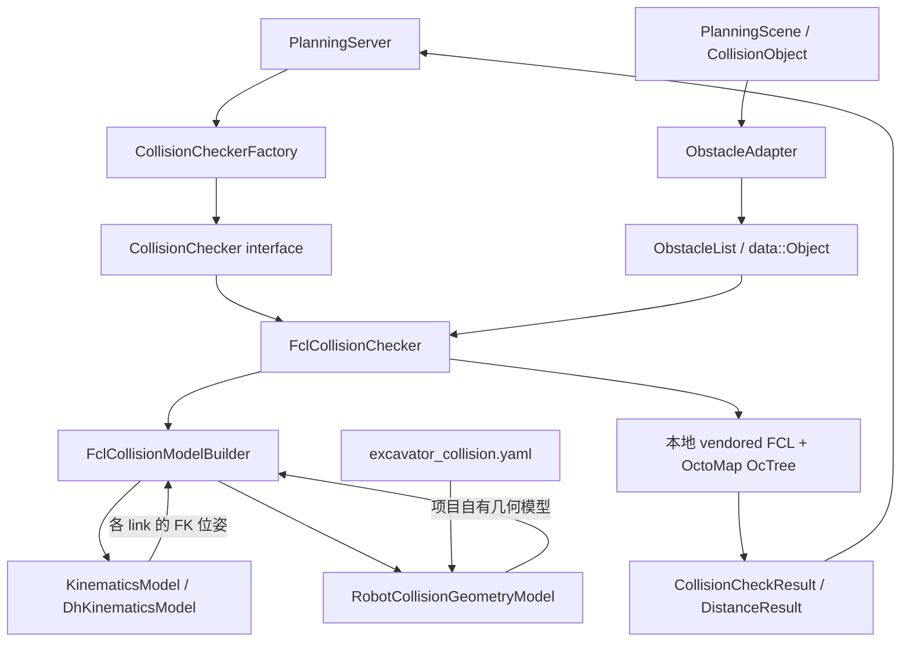
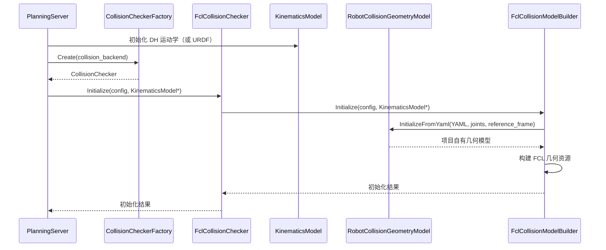
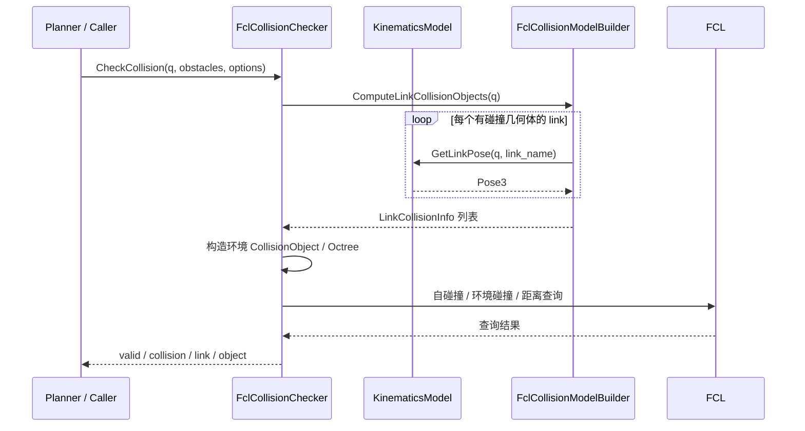
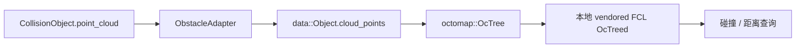

# 挖机碰撞检测方案

> 文档状态：第一版设计与当前代码实现对照  
> 所属软件包：`excavator_collision`  
> 运行环境：Ubuntu 22.04、ROS 2 Humble、C++17  
> 核心原则：项目定义稳定的碰撞检测接口和数据模型，第三方算法通过适配层接入，规划层不依赖 FCL。

## 1. 目标与范围

碰撞检测模块负责判断挖机在给定关节状态、路径或轨迹下，是否与自身结构或外部障碍物发生几何碰撞，并提供指定障碍物的距离查询能力。

第一版目标：

1. 从 YAML 中加载机器人碰撞几何体，包括 Box、Sphere、Cylinder、Capsule 和 STL Mesh；碰撞模块不再解析 URDF。
2. 与运动学模块解耦，通过统一的 `KinematicsModel` 获取连杆位姿；规划默认使用 Modified-DH 运动学。
3. 检测机器人自碰撞和机器人与环境障碍物之间的碰撞。
4. 支持单个关节状态、离散关节路径和关节轨迹检测。
5. 支持查询机器人与指定障碍物之间的最小距离。
6. 将 FCL 0.7.0 的核心算法移植到 `third_library/fcl/` 并构建为本地静态库，避免运行时依赖系统 FCL，同时不让 FCL 类型进入规划层的公共接口。
7. 支持几何障碍物与点云障碍物两种表示：几何体转换为保守 AABB，点云体素化为 OctoMap `OcTree` 后参与 FCL 查询。
8. 支持可选地收集全部碰撞连杆（`collect_all_collisions`），供可视化高亮使用；规划默认首次碰撞即返回。
9. 为后续自研碰撞算法保留替换入口，通过工厂注册和配置选择后端，不修改规划器的调用逻辑。

第一版不承担液压动力学、接触力计算、连续时间碰撞证明、动态障碍物预测或感知算法本身。碰撞检测只使用传入的几何描述、点云和位姿。

## 2. 总体架构

### 2.1 模块关系



这里有三个必须保持的边界：

- **KinematicsModel**：只负责运动学计算，输入关节位置，输出指定连杆的位姿。规划默认使用 Modified-DH 实现。
- **RobotCollisionGeometryModel**：从 YAML 读取机器人碰撞几何体、几何体相对连杆的固定局部位姿以及连杆关系，不计算 FK，也不包含 FCL 类型。
- **FclCollisionModelBuilder**：FCL 适配器，持有 `RobotCollisionGeometryModel` 和 `KinematicsModel`，把关节位置转换为连杆碰撞信息；不执行碰撞或距离查询。

`FclCollisionChecker` 是三者之间的协调层。规划服务只依赖 `CollisionChecker` 抽象接口，不直接调用 FCL。

### 2.2 目录结构

```text
src/excavator_collision/
├── include/excavator_collision/
│   ├── collision_checker_interface.hpp
│   ├── fcl_collision_checker.hpp
│   ├── collision_checker_factory.hpp
│   ├── obstacle_adapter.hpp
│   └── robot_collision_geometry_model.hpp
├── src/
│   ├── fcl_collision_checker.cpp
│   ├── robot_collision_geometry_model.cpp
│   ├── obstacle_adapter.cpp
│   ├── fcl_collision_model_builder.hpp   # 项目 FCL 适配层
│   ├── fcl_collision_model_builder.cpp
│   └── collision_checker_factory.cpp
├── third_library/
│   └── fcl/                      # 移植的 FCL 0.7.0 上游源码与 CMake
│       ├── include/fcl/          # 上游公共头文件
│       ├── src/                  # broadphase / narrowphase / geometry / math
│       ├── CMakeLists.txt        # 构建静态库 excavator_fcl
│       ├── LICENSE
│       └── README.md
├── README.md
└── test/
    ├── collision_checker_test.cpp
    ├── collision_checker_factory_test.cpp
    └── collision_benchmark_test.cpp
```

目录职责：

| 文件/目录 | 职责 |
| --- | --- |
| `collision_checker_interface.hpp` | 定义项目级碰撞查询接口、输入配置和结果类型 |
| `fcl_collision_checker.hpp` | YAML + 本地 FCL 后端的公开声明 |
| `collision_checker_factory.hpp/.cpp` | 注册并创建碰撞检测后端 |
| `obstacle_adapter.hpp/.cpp` | 将 `CollisionObject`/`PlanningScene` 转换为 `data::Object`，处理 ID、AABB 展开和点云解析 |
| `RobotCollisionGeometryModel` | 从 YAML 加载机器人碰撞几何描述 |
| `src/fcl_collision_checker.cpp` | 调用 FK、构建环境（含 OctoMap）、执行碰撞/距离查询、路径离散采样 |
| `src/fcl_collision_model_builder.*` | FCL 几何转换与连杆碰撞对象构建；不执行碰撞或距离查询 |
| `third_library/fcl/` | 移植的 FCL 0.7.0 核心算法，构建为 `excavator_fcl` 静态库并私有链接 |
| `test/` | 碰撞检测、工厂注册和性能测试 |

`src/fcl_collision_model_builder.*` 是项目自己的 FCL 适配代码；
`third_library/fcl/` 是移植的上游 FCL 源码，不要求系统安装 `libfcl-dev`。
FCL 静态库只链接进 `libexcavator_collision.so`，公共头文件不暴露 FCL 类型。

## 3. 模型职责与坐标变换

### 3.1 KinematicsModel

运动学模块通过统一接口提供 FK：

```cpp
ValidationResult GetLinkPose(
    const JointPositions& joint_positions,
    const std::string& link_name,
    Pose3* pose) const;
```

输入是当前规划关节组的关节位置，输出指定 `link_name` 的位姿。碰撞模块不应再次解析关节树并重复实现 FK。

当前运动学后端包括：

- `UrdfKinematicsModel`
- `DhKinematicsModel`

两者都实现项目自己的 `KinematicsModel` 接口。规划服务初始化碰撞检测器时，将已创建的运动学对象传入：

```cpp
collision_checker_->Initialize(collision_config, kinematics_.get());
```

该指针由碰撞检测器借用，不转移所有权；运动学对象必须比碰撞检测器活得更久。当前 `PlanningServer` 将二者作为成员持有，析构顺序也保证碰撞检测器先于运动学对象释放。

### 3.2 RobotCollisionGeometryModel

`RobotCollisionGeometryModel` 是项目自己的机器人碰撞模型，核心数据包括：

- `link_name`：碰撞几何体所属连杆名称；
- `parent_link_name`：可选的直接父连杆，仅用于自碰撞相邻连杆过滤；
- `CollisionGeometry`：项目自己的几何类型和参数；
- `link_to_collision`：碰撞几何体相对所属连杆的固定局部位姿。

模型层不包含 `fcl::CollisionObject`、`fcl::CollisionGeometry` 等类型。它只描述“机器人由哪些几何体构成，以及这些几何体固定在什么位置”。

第一版由 `InitializeFromYaml()` 解析机器人碰撞 YAML（默认
`excavator_collision.yaml`），不再读取 URDF：

```yaml
robot:
  name: excavator
  root_frame: base_link

links:
  - link_name: boom_link
    parent_link_name: swing_link
    geometries:
      - name: boom_body
        type: mesh
        resource: "package://excavator_description/meshes/pjjq03.STL"
        scale: [1.0, 1.0, 1.0]
        origin:
          xyz: [0.0, 0.0, 0.0]
          rpy: [0.0, 0.0, 0.0]
```

支持 `box`、`sphere`、`cylinder`、`capsule` 和 `mesh`。Mesh 资源支持
`package://`、绝对路径和相对 YAML 文件目录的路径，当前解析 ASCII/Binary STL。
默认挖机配置位于 `excavator_description/config/excavator_collision.yaml`，其几何
原点表达在**物理连杆坐标系**中，与 URDF/RViz 显示的连杆坐标系一致。

> 注意：`excavator_dh.yaml` 必须使 Modified-DH 正运动学输出与 URDF 物理连杆位姿
> 一致（`dh_kinematics_test` 会校验）。若 DH 参数存在平移偏差，碰撞几何会与
> RViz 中可见的挖机错位，拖动障碍物到挖机表面时可能无法触发碰撞。

### 3.3 FclCollisionModelBuilder

`FclCollisionModelBuilder` 是机器人模型的 FCL 适配器，内部持有 `RobotCollisionGeometryModel` 和
`KinematicsModel`：

1. 将项目几何类型转换成 `fcl::Boxd`、`fcl::Sphered`、`fcl::Cylinderd`、
   `fcl::Capsuled` 或三角网格 BVH。
2. 保存机器人几何资源、关节顺序和运动学模型指针。
3. `ComputeLinkCollisionObjects(q)` 调用 `GetLinkPose()` 计算 FK，结合连杆局部变换，
   直接返回每个碰撞几何体的 `LinkCollisionInfo`（连杆名、父连杆名、世界位姿下的
   FCL `CollisionObject`）。

`FclCollisionModelBuilder` 不构造环境障碍物，也不调用 `fcl::collide` 或 `fcl::distance`。
环境 Octree 构建、自碰撞/环境碰撞查询、距离查询和结果组装全部在
`FclCollisionChecker` 中实现。FCL 对象不暴露给 Planner 或其他业务层。

单状态查询（`CheckCollision` / `CheckEnvironmentCollision`）会为当前关节位置重新
计算连杆 FCL 对象；路径查询（`CheckPathCollision`）只在每个采样状态更新连杆对象，
环境对象（包括点云 Octree）在整条路径上只构建一次。

### 3.4 坐标系约定

脱离 URDF 后不再存在隐式 frame 树。YAML 的 `robot.root_frame` 同时定义：

- `KinematicsModel::GetLinkPose()` 返回位姿的参考坐标系；
- `data::Object` 障碍物的 `center`（由 `ObstacleAdapter` 从消息 pose 转换）的参考坐标系；
- 碰撞几何体最终位姿的根坐标系。

当前 DH 与 URDF 运动学后端都输出 `base_link` 下的位姿，因此默认：

```yaml
robot:
  root_frame: base_link
```

机器人碰撞几何体的最终位姿为：

```text
T_root_collision = T_root_link * T_link_collision
```

其中：

- `T_root_link`：由当前 `KinematicsModel::GetLinkPose()` 返回；
- `T_link_collision`：来自 YAML geometry 的 origin。

`CollisionModelConfig::kinematics_reference_frame` 默认是 `base_link`。初始化时若
YAML `root_frame` 与之不一致会直接报错，而不是猜测或执行隐式坐标变换。当前模块不主动
查询 TF；`ObstacleAdapter` 也不做 frame 转换，调用方需要保证障碍物位姿（以及点云坐标）
已经表达在 `root_frame` 下。可视化测试节点会先用 TF 把 RViz 点击点转换到 `base_link`，
再交给碰撞检查器。

## 4. 初始化与运行流程

### 4.1 初始化流程



当前初始化配置的含义：

| 配置项 | 当前值/用途 |
| --- | --- |
| `collision_backend` | 默认 `fcl`，选择碰撞算法实现 |
| `collision_model_file` | 启动参数，指向机器人碰撞 YAML；规划服务读取后写入 `model_source` |
| `model_format` | 当前为 `yaml`，表示碰撞几何来源是 YAML |
| `model_source` | 机器人碰撞 YAML 文本 |
| `model_base_directory` | 解析相对 mesh 路径时使用 |
| `joint_names` | 当前规划使用的主动关节顺序 |
| `kinematics_reference_frame` | 当前为 `base_link`，必须与 YAML `root_frame` 一致 |
| `KinematicsModel*` | 当前选择的 FK 实现（默认 DH），碰撞检查时查询连杆位姿 |

初始化时 `FclCollisionChecker` 把配置转交 `FclCollisionModelBuilder`；Builder 解析 YAML、
校验关节顺序并预先构建机器人 FCL 几何资源。环境障碍物不在此阶段创建，而是在每次
碰撞查询或每条路径查询开始时按需构建。

规划默认组合为 `kinematics_backend:=dh`、`collision_backend:=fcl`。碰撞几何完全由
YAML 提供，DH 运动学提供连杆位姿；碰撞后端不再需要或解析 URDF。URDF 仍用于
robot_state_publisher、RViz 和轨迹控制器中的可视化运动学。

### 4.2 单状态碰撞查询



当前为每次查询根据 FK 位姿构造 FCL `CollisionObject`，避免在多个并发查询之间共享带可变位姿的对象。机器人静态几何资源在初始化时构建；障碍物几何、环境对象以及所有碰撞/距离查询都在 `FclCollisionChecker` 中完成。

## 5. 对外接口设计

核心抽象为 `CollisionChecker`。接口返回的 `CollisionCheckResult` 中：

- `valid` 表示本次检查是否成功执行；
- `collision` 表示是否发现碰撞；
- `message` 给出成功或失败原因；
- `first_link` 与 `second_object` 描述首次碰撞：环境碰撞时 `second_object` 是障碍物
  的整数 ID 字符串，自碰撞时是第二个连杆名；
- `colliding_links` 在所有碰撞收集模式下保存全部发生碰撞的机器人连杆（去重）；
- `collision_positions` 记录发生碰撞时的关节位置；
- `checked_states` 记录路径检测实际检查的状态数量。

`CollisionDistanceResult::obstacle_id` 同样使用障碍物整数 ID 的字符串形式。

调用方必须区分“检查成功且无碰撞”和“检查本身失败”。`valid == false` 时不能把结果当作无碰撞。

`CollisionQueryOptions` 控制本次查询的障碍物解释方式：

| 字段 | 含义 |
| --- | --- |
| `obstacle_type` | `kGeometry`（默认）使用 `length/width/height/center` 组成的 AABB；`kPointCloud` 使用 `cloud_points` |
| `point_cloud_resolution` | 点云体素边长（米），仅 `kPointCloud` 使用，默认 0.05 |
| `collect_all_collisions` | 为 true 时继续扫描并填充 `colliding_links`；规划默认 false，首次碰撞即返回 |

### 5.1 单状态接口

| 接口 | 作用 |
| --- | --- |
| `CheckCollision(q, obstacles, options)` | 检查机器人自碰撞和环境碰撞 |
| `CheckSelfCollision(q)` | 只检查机器人自身连杆之间的碰撞（不含障碍物） |
| `CheckEnvironmentCollision(q, obstacles, options)` | 只检查机器人与障碍物列表的碰撞（不含自碰撞） |

`SetAllowedCollision(link_a, link_b, allowed)` 用于按无序连杆对增删允许碰撞规则；
规划服务从 `allowed_collision_pairs` 参数读取 `"link_a:link_b"` 字符串并调用该接口。

### 5.2 路径与轨迹接口

| 接口 | 作用 |
| --- | --- |
| `CheckPathCollision(path, obstacles, max_joint_step, options)` | 对关节路径分段采样，检查每个采样状态的自碰撞和环境碰撞 |
| `CheckPathCollision(path, obstacle, max_joint_step, options)` | 仅检查路径与单个障碍物之间的碰撞 |
| `CheckTrajectory(trajectory, obstacles, max_joint_step, options)` | 先校验轨迹结构，再按关节位置构造路径进行离散碰撞检查 |

路径的相邻路点按关节空间线性插值。对一段路径，当前采样数根据该段最大的关节变化量决定：

```text
N = max(1, ceil(max_i(abs(q_end[i] - q_start[i])) / max_joint_step))
```

每段按 `alpha = j / N` 生成中间状态，并在最后单独检查路径终点。当前 `max_joint_step` 对挖机四个转动关节以弧度解释。若未来把转动关节和移动关节混合进同一个规划组，应升级为逐关节步长或归一化距离度量，避免弧度和米使用同一个阈值。

该路径插值当前不做连续关节角的最短角差归一化；调用方需要确保路径路点已经按期望的关节角连续性表达。

### 5.3 距离查询接口

`ComputeDistance(q, obstacle, options)` 返回给定关节状态下，机器人全部碰撞几何体到
单个障碍物的最小距离，并记录对应的机器人连杆名称和障碍物整数 ID。
`options.obstacle_type` 可分别选择几何 AABB（`kGeometry`）或点云 Octree（`kPointCloud`）。

该接口面向单个障碍物。当前结果不提供距离梯度、最近点对的完整几何信息或连续轨迹安全证明。若需要用距离场做优化，应在后续接口中明确增加最近点、梯度和有效性语义。

## 6. 碰撞规则

### 6.1 自碰撞过滤

当前自碰撞检查默认跳过：

1. 同一连杆上的多个碰撞几何体之间的配对；
2. 直接父子连杆配对；
3. 调用方通过 `SetAllowedCollision()` 显式配置的连杆配对（规划服务从
   `allowed_collision_pairs` 参数解析）。

父子关系来自 YAML 的 `parent_link_name`（可选）。允许碰撞对按无序连杆对处理，因此
`A:B` 与 `B:A` 等价。

允许碰撞对只应排除结构上明确不需要检测的组合。不要为了让规划通过而随意增加过滤项，否则可能把真实的自碰撞隐藏掉。

当前规划服务和可视化测试节点默认**不额外配置允许碰撞对**，只依赖上述同一连杆和直接
父子连杆规则。原来的粗盒子模型曾默认放行：

```yaml
allowed_collision_pairs:
  - "base_link:boom_link"
  - "base_link:stick_link"
  - "base_link:bucket_link"
  - "swing_link:stick_link"
  - "swing_link:bucket_link"
```

切换到真实 Mesh/修正后的 Box 几何后，这些过滤项已从默认配置中移除。全工作空间采样表明
`base_link:bucket_link` 会在折叠姿态下真实发生（铲斗碰到履带底盘），继续放行会隐藏
真实自碰撞。需要结构性例外时仍可通过 `allowed_collision_pairs` 参数显式添加，例如：

```yaml
allowed_collision_pairs:
  - "link_a:link_b"
```

### 6.2 环境碰撞

环境碰撞对为每个机器人碰撞对象和每个启用的环境对象进行查询。禁用对象（`enabled: false`）
在消息转换阶段被跳过，不参与检测。

`data::Object.id` 必须非负且在单次查询内唯一（`BuildEnvironment` 会拒绝重复 ID）。
消息字符串 ID 由 `ObstacleAdapter::ObjectId()` 映射：纯数字 ID 原样保留，其他 ID 使用
FNV-1a 哈希并清除符号位。几何参数、中心点或位姿不合法，以及空点云或非法分辨率，
都会让检查返回失败，不会静默忽略不受支持的障碍物。

同一个查询只能选择一种表示（`kGeometry` 或 `kPointCloud`）。可视化测试节点会分别对
几何障碍物和点云障碍物执行查询，再合并碰撞结果。

## 7. 当前支持的模型与场景输入

### 7.1 机器人碰撞模型

从 YAML `links[].geometries[]` 加载：

| YAML 类型 | 参数 | 项目模型 | FCL 表示 |
| --- | --- | --- | --- |
| `box` | `size: [x,y,z]` | `kBox` | `fcl::Boxd` |
| `sphere` | `radius` | `kSphere` | `fcl::Sphered` |
| `cylinder` | `radius`, `length` | `kCylinder` | `fcl::Cylinderd` |
| `capsule` | `radius`, `length` | `kCapsule` | `fcl::Capsuled` |
| `mesh` | `resource`, `scale` | `kTriangleMesh` | `fcl::BVHModel<fcl::OBBRSSd>` |

当前 Mesh 文件加载器支持 ASCII STL 和 Binary STL；支持 `package://` URI、绝对路径和
相对 YAML 文件目录的路径。当前没有实现 DAE、OBJ 等其它网格格式的解析。

### 7.2 环境障碍物模型

当前 ROS 2 消息：

```text
# CollisionObject.msg
string id
geometry_msgs/Pose pose
shape_msgs/SolidPrimitive primitive
sensor_msgs/PointCloud2 point_cloud
bool enabled

# PlanningScene.msg
std_msgs/Header header
bool is_diff
CollisionObject[] objects
```

`ObstacleAdapter::Convert()` 负责把消息转换为碰撞后端使用的 `data::Object`：

| 消息字段 | 转换结果 |
| --- | --- |
| `pose.position` | `Object.center` |
| `primitive`（BOX） | `length/width/height = dimensions[0..2]` |
| `primitive`（SPHERE） | `length/width/height = 2 * radius` |
| `primitive`（CYLINDER） | `length/width = 2 * radius`，`height = dimensions[HEIGHT]` |
| `point_cloud` | `Object.cloud_points`（读取 float32 x/y/z，跳过非有限点） |
| `id` | 数字 ID 保留为整数；其他字符串用 FNV-1a 映射到非负整数 |
| `enabled=false` | 列表转换时跳过 |

几何障碍物的转换规则：

- `pose.orientation` 不保留为朝向，而是用于把旋转后的几何体**保守展开为轴对齐包围盒**
  （AABB）；`FclCollisionChecker` 使用该 AABB 构造 `fcl::Boxd`。
- 球体不需要展开；圆柱体按半径和高度展开。
- 空 `primitive.dimensions` 且没有点云时，几何查询会因尺寸非法而失败；
  只有点云的对象必须使用 `ObstacleType::kPointCloud` 查询。

点云规则：

- `point_cloud` 只有原始点，没有 Free/Unknown 语义；体素化时只把有点的体素标记为
  Occupied，不推断 Free 空间。
- 点云坐标按消息数值读取，`Object.center` 作为平移施加到点云对象；当前实现**不使用
  `pose.orientation` 旋转点云**。
- `point_cloud_resolution` 必须为有限正数；空点云或没有有效点会返回失败。
- 点云体素化为 `octomap::OcTree`，再包装为 `fcl::OcTreed` 参与碰撞/距离查询；路径查询
  只构建一次点云环境，避免逐采样点重复体素化。

### 7.3 场景同步约定

规划服务订阅 `/excavator/scene` 并保存完整场景快照。当前只接受 `is_diff == false` 的完整场景；增量场景会被拒绝，不会在碰撞检查器内自动合并。

规划请求携带非空对象或非空 frame 时，使用请求中的场景；请求未携带场景内容时，规划服务尝试使用最近保存的完整场景快照。

规划服务在每次请求开始时调用一次 `ObstacleAdapter::Convert(scene.objects, ...)`，
转换后的 `ObstacleList` 复用于起点、目标、规划搜索、路径后处理和最终轨迹检查。
当前规划调用未显式传入 `CollisionQueryOptions`，因此使用默认的 `kGeometry`：
`PlanningScene` 中的几何体障碍物会参与规划；仅有 `point_cloud` 的对象不会自动
转换为几何体，需要调用方显式选择 `kPointCloud`（目前由可视化测试节点使用）。

场景的障碍物 pose 必须已在碰撞模型 `root_frame`（当前为 `base_link`）下表达。当前没有
自动 TF 变换步骤，感知或场景适配层需要先完成坐标变换。

## 8. 点云、OctoMap 与动态障碍物

数据链路：



### 8.1 已实现

- `ObstacleAdapter` 读取 `sensor_msgs/PointCloud2` 的 float32 x/y/z 字段，写入
  `data::Object.cloud_points`。
- `CollisionQueryOptions::obstacle_type = kPointCloud` 时，`FclCollisionChecker` 按
  `point_cloud_resolution` 将点云体素化为 `octomap::OcTree`，并包装为 `fcl::OcTreed`。
- 支持点云环境碰撞、点云路径碰撞和点云距离查询；空点云、无有效点、非法分辨率均返回
  失败。
- 点云只标记 Occupied 体素，不推断 Free 空间。
- 本地 vendored FCL 编译时启用了 OctoMap 后端，构建需要系统 `octomap`。
- 可视化测试节点支持用 RViz `Publish Point` 逐点添加点云障碍物，并与几何障碍物
  分别查询后合并结果。

### 8.2 尚未实现

- **Free/Unknown 语义**：没有传感器原点和射线信息，不能做 free-space carving；
  “没有点”不等于 Free。
- **直接 OctoMap 输入**：当前只转换成 `OcTree`，没有定义项目级 OctoMap/占据地图消息。
- **环境三角网格**：当前仅有机器人 YAML Mesh，环境障碍物仍为几何体 AABB 或点云。
- **动态障碍物**：接口只接收单时刻场景，不处理速度、预测轨迹或时间相关查询。
- **连续碰撞检测**：路径接口仍是离散关节空间采样。
- **Broadphase 场景管理**：当前逐对象执行 FCL 查询，尚未引入 Broadphase manager。

## 9. 规划流程中的调用位置

当前规划服务在以下阶段使用碰撞检测：

1. **起点验证**：对规划起始关节状态执行 `CheckCollision`。
2. **目标验证**：对目标关节状态执行 `CheckCollision`。
3. **规划搜索**：通过状态有效性回调执行单状态碰撞检查；线段有效性回调使用 `CheckPathCollision`。
4. **路径后处理**：简化和平滑过程使用线段有效性检查，避免后处理引入碰撞。
5. **最终路径验证**：对处理后的完整路径执行 `CheckPathCollision`。
6. **时间参数化后验证**：对输出轨迹执行 `CheckTrajectory`。

规划服务中的 `max_collision_joint_step` 当前默认值为 `0.03`，控制路径和轨迹碰撞检查的采样密度。它不是连续碰撞检测的精度保证。

## 10. 第三方算法替换机制

### 10.1 当前工厂行为

`CollisionCheckerFactory` 是后端注册表：

- `Register(type, creator)` 注册一个实现；
- `Create(type)` 根据字符串创建一个新的 `CollisionChecker` 实例；
- `AvailableTypes()` 查询已经注册的类型。

当前实现的工厂注册表是单例，但 `Create()` 每次返回独立的 `std::unique_ptr`，不会缓存碰撞检查器实例。当前已注册的类型只有：

```yaml
collision_backend: fcl
```

### 10.2 新增自研后端

当自研碰撞算法完成后，推荐按以下顺序替换：

1. 新建自研实现类，继承 `CollisionChecker`。
2. 保持项目级输入、结果类型和接口语义一致，不把新算法的第三方类型泄漏到公共接口。
3. 实现单状态、自碰撞、环境碰撞、路径、轨迹和距离接口；不支持的操作必须明确返回失败，不能伪造“无碰撞”。
4. 在工厂注册表中注册新的类型字符串。
5. 通过启动参数或参数文件将 `collision_backend` 切换到新类型。
6. 使用同一组接口契约测试验证新旧实现的结果一致性和边界行为。

新增后端的注册形式：

```cpp
CollisionCheckerFactory::Instance().Register(
    "custom_collision",
    []() -> std::unique_ptr<CollisionChecker> {
      return std::make_unique<CustomCollisionChecker>();
    });
```

选择新实现时只需要修改类型配置：

```yaml
collision_backend: custom_collision
```

前提是新后端已经完成实现、注册、编译和测试。**仅修改字符串并不会自动产生新算法。** 替换过程中，Planner 的状态有效性回调、线段有效性回调和最终路径校验都不需要改动。

## 11. 测试策略

当前测试文件：

| 测试文件 | 覆盖内容 |
| --- | --- |
| `collision_checker_test.cpp` | 几何/点云环境碰撞、自碰撞、允许碰撞对、STL 加载、路径中间采样、点云路径、点云距离、空点云拒绝、ObstacleAdapter 转换、DH 运动学 + 挖机 YAML、frame 校验、距离查询（共 16 个用例） |
| `collision_checker_factory_test.cpp` | 默认 `fcl` 后端注册、未知类型、运行时注册 |
| `collision_benchmark_test.cpp` | 完整挖机模型的 `CheckCollision` 性能基准 |
| 可视化测试（无 gtest） | `demo.launch.py` + `collision_visual_test_node`：Box 拖动、点云点选取、多连杆亮红、手动 IK、TF 转换 |

建议后续继续补充：

- `collect_all_collisions` 的多连杆结果测试，以及默认模式下首次碰撞即返回的契约测试；
- 不支持的 YAML 几何类型、损坏网格、错误维度和非法四元数的失败测试；
- 不完整规划关节组和 FK 缺失连杆的初始化/查询失败测试；
- 多碰撞几何体、多个障碍物和重复 ID 测试；
- 障碍物带旋转时 AABB 保守展开的边界测试；
- 不同 FK 后端在相同关节状态下的碰撞结果一致性测试；
- 更密采样与较稀采样对路径检测结果及耗时的影响测试；
- 每个新后端必须复用同一套接口契约测试。

构建与测试：

```bash
source /opt/ros/humble/setup.bash
rosdep install --from-paths src --ignore-src -r -y
colcon build --symlink-install --packages-up-to excavator_collision excavator_planning
colcon test --packages-select excavator_collision
colcon test-result --verbose
```

### 11.1 可视化交互碰撞测试

`demo.launch.py` 默认启动 `collision_visual_test_node` 和 RViz 规划面板，可直接做交互测试：

```bash
ros2 launch excavator_sim_viz demo.launch.py
# 关闭交互测试节点：
ros2 launch excavator_sim_viz demo.launch.py start_collision_test:=false
```

操作步骤：

1. 在 RViz 左侧 `Excavator Planning` 面板的 **Box obstacle** 区域设置 id、x/y/z、yaw 和尺寸，点击 `Add / update`；场景通过 `/excavator/scene` 发布。
2. RViz 中出现红色半透明障碍物盒子（交互标记命名空间 `/excavator_obstacle`），按住并拖动即可任意移动障碍物；规划面板会在每帧拖动时发布完整场景快照。
3. 拖动青色小球 `bucket_tip_drag`（交互标记命名空间 `/excavator_collision_test`）。节点对 `bucket_tip` 做位置优先 IK，通过 `/excavator/manual_joint_state` 让轨迹控制器进入手动跟随模式，挖机爪可在工作空间内任意移动。
4. **点云障碍物**：选择 RViz 工具栏的 `Publish Point`，在场景中单击即可逐点添加点云障碍物。
   - 点击点使用 RViz 当前 Fixed Frame（默认 `world`），节点通过 TF 转换到 `base_link`；
   - 点显示为橙色小球；所有点累积为一个点云障碍物，按 `point_cloud_resolution`
     （默认 0.05 m）体素化为 OctoMap 后参与碰撞检测；
   - 与挖机碰撞时，点云和碰撞连杆变亮红；
   - 清除所有点：
     ```bash
     ros2 topic pub --once /excavator/clear_point_cloud std_msgs/msg/Empty "{}"
     ```
   - 点云与 Box 可以同时存在：节点分别用 `kPointCloud` 和 `kGeometry` 查询后合并结果。
5. 碰撞检测节点以 20 Hz 检查当前 `/joint_states` 与 `/excavator/scene`：
   - 发生环境碰撞时，高亮**所有与障碍物接触的连杆**的碰撞几何体与碰撞障碍物，按**亮红色**显示；
   - 发生自碰撞时，高亮发生碰撞的两个连杆的碰撞几何体；
   - 点云障碍物继续添加时，新接触的连杆会追加高亮，不会覆盖已有碰撞连杆；
   - 可视化节点设置 `CollisionQueryOptions::collect_all_collisions = true`，
     由检查器填充 `CollisionCheckResult::colliding_links`；规划默认仍为首次碰撞即返回；
   - 在碰撞连杆上方显示 `COLLISION: ...` 文本；
   - 碰撞解除后发布 `DELETEALL`，红色标记自动清除。

相关话题：

| 话题 | 方向 | 说明 |
| --- | --- | --- |
| `/excavator/scene` | 规划面板 → 碰撞测试节点 | 完整障碍物场景（`base_link`） |
| `/excavator/collision_test_markers` | 碰撞测试节点 → RViz | 亮红碰撞几何与文本标记（与规划服务的 `/excavator/collision_result` 分开） |
| `/excavator/manual_joint_state` | 碰撞测试节点 → 轨迹控制器 | 手动拖动 IK 关节目标 |
| `/excavator/manual_target_pose` | 外部 → 碰撞测试节点 | 可选，`PoseStamped` 自动化/脚本驱动 |
| `/clicked_point` | RViz Publish Point → 碰撞测试节点 | 逐点添加点云障碍物（自动转换到 `base_link`） |
| `/excavator/clear_point_cloud` | 外部 → 碰撞测试节点 | `std_msgs/Empty`，清除已添加的点云点 |

手动拖动会取消正在执行的轨迹。`manual_control_enabled`（轨迹控制器参数）可关闭该行为。碰撞测试节点同样适用于无界面验证：向 `/excavator/manual_target_pose` 发布 `base_link` 下的目标位姿，并观察 `/excavator/manual_joint_state` 与 `/excavator/collision_test_markers`。

## 12. 当前实现边界与后续优先级

| 能力 | 当前状态 |
| --- | --- |
| YAML 机器人碰撞模型加载（脱离 URDF） | 已实现 |
| Box / Sphere / Cylinder / Capsule / STL Mesh 机器人几何 | 已实现 |
| 本地移植 FCL 0.7.0（无系统 libfcl 依赖） | 已实现 |
| URDF FK / Modified-DH FK 注入 | 已接入统一 FK 接口，规划默认 DH |
| 自碰撞与允许碰撞对过滤 | 已实现（`SetAllowedCollision`） |
| Box / Sphere / Cylinder 环境障碍物 | 已实现（统一转换为保守 AABB） |
| 点云环境障碍物（PointCloud2 → OctoMap） | 已实现（`kPointCloud` + `point_cloud_resolution`） |
| 单状态、离散路径和轨迹碰撞查询 | 已实现 |
| 指定障碍物路径查询 | 已实现 |
| 指定障碍物距离查询（几何/点云） | 已实现 |
| 全部碰撞连杆收集 | 已实现（`collect_all_collisions`） |
| RViz Box 拖动 + 点云点选取 + 挖机爪手动 IK | 已实现（`collision_visual_test_node`） |
| 实时多连杆碰撞亮红可视化 | 已实现 |
| 环境三角网格 | 未实现 |
| 直接 OctoMap / 占据地图消息输入 | 未实现（当前仅 PointCloud2） |
| Free/Unknown 占据语义与射线 carving | 未实现 |
| 动态障碍物预测 | 未实现 |
| 连续碰撞检测 / 连续时间验证 | 未实现 |
| Broadphase 场景管理优化 | 尚未实现 |

推荐的下一步顺序：

1. 增加 `collect_all_collisions` 的单元测试和多障碍物/多连杆可视化回归。
2. 根据感知实际输出，定义项目自有的环境障碍物/占据地图消息，支持直接传入 OctoMap。
3. 增加 Free/Unknown 语义和传感器原点，支持可靠的 free-space carving。
4. 为动态障碍物增加时间相关场景接口。
5. 根据性能测试决定是否引入 Broadphase manager、缓存或更高效的距离查询结构。
6. 自研算法完成后，作为新的 `CollisionChecker` 后端接入，使用统一测试集完成替换。

## 13. 相关代码入口

- 碰撞检测接口：`src/excavator_collision/include/excavator_collision/collision_checker_interface.hpp`
- 当前 FCL 检查器：`src/excavator_collision/include/excavator_collision/fcl_collision_checker.hpp`
- 工厂：`src/excavator_collision/include/excavator_collision/collision_checker_factory.hpp`
- 机器人碰撞模型：`src/excavator_collision/include/excavator_collision/robot_collision_geometry_model.hpp`
- 碰撞检查协调层：`src/excavator_collision/src/fcl_collision_checker.cpp`
- 障碍物消息适配：`src/excavator_collision/include/excavator_collision/obstacle_adapter.hpp`、`src/excavator_collision/src/obstacle_adapter.cpp`
- 项目障碍物数据模型：`src/excavator_common/data/object/object.h`
- YAML 碰撞模型解析：`src/excavator_collision/src/robot_collision_geometry_model.cpp`
- 默认挖机碰撞 YAML：`src/excavator_description/config/excavator_collision.yaml`
- FCL 适配实现：`src/excavator_collision/src/fcl_collision_model_builder.*`
- 本地 FCL 源码与 CMake：`src/excavator_collision/third_library/fcl/`
- 规划服务接入：`src/excavator_planning/src/planning_server.cpp`
- 交互碰撞测试节点（Box/点云/多连杆高亮/手动 IK）：`src/excavator_visualization/src/collision_visual_test_node.cpp`
- 手动拖动接入：`src/excavator_sim_viz/src/trajectory_controller_node.cpp`
- 当前环境消息：`src/excavator_interfaces/msg/CollisionObject.msg`（含 `point_cloud`）、`PlanningScene.msg`
- 模块实现说明：`src/excavator_collision/README.md`
