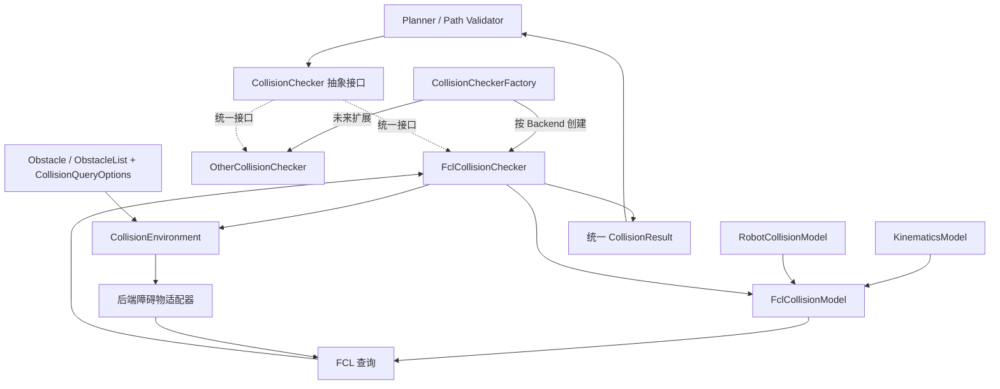
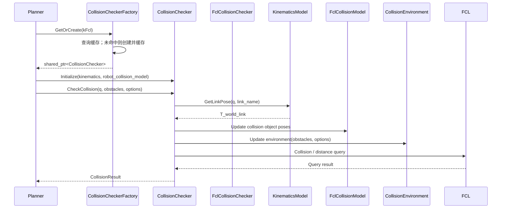

# 碰撞检测方案

## 机器人碰撞几何表达方式

| 方式 | 输入 | 适用情况 | 注意事项 |
| --- | --- | --- | --- |
| 多个基本几何体组合 | Box、Sphere、Cylinder 等尺寸与局部变换 | 第一版、缺少 CAD 网格 | 组合体应覆盖可能接触的外形，必要时保守膨胀 |
| 尺寸参数化近似 | 连杆长度、宽度、厚度、销轴位置等 | 有工程尺寸但没有网格 | 建议将参数和局部变换放配置文件，便于校准 |
| 三角网格 | CAD 导出的 STL/OBJ 等 | 需要更精细的外形 | 检查单位、坐标原点、网格质量和三角面数量；可制作简化 collision mesh |

## 碰撞检测架构


| 模块 | 主要职责 | 是否依赖 FCL |
| --- | --- | --- |
| KinematicsModel 运动学模型 | 运动学结构、FK | 否 |
| RobotCollisionModel机器人碰撞模型 | 碰撞几何配置和局部位姿 | 否 |
| FclCollisionModel | 创建和更新 FCL 对象 | 是 |
| CollisionEnvironment 碰撞环境 | 管理环境障碍物及其后端表示 | 由具体后端适配层决定 |
| CollisionChecker 碰撞检查器 | 对外提供统一碰撞查询接口 | 抽象接口不依赖；FCL 实现依赖 |

`KinematicsModel + RobotCollisionModel → FclCollisionModel → CollisionChecker`

运动学模型和机器人碰撞模型分别从 `kinematics_model.yaml`、`robot_collision_model.yaml` 加载参数。KinematicsModel 负责根据关节位置计算 Link 世界位姿；RobotCollisionModel 负责提供各 Link 的碰撞几何体及局部位姿；FclCollisionModel 只负责将两者组合并创建、更新 FCL 碰撞对象，不负责定义运动学或碰撞几何参数。

## 运动学模型与碰撞模型

运动学模型（KinematicsModel）与机器人碰撞模型（RobotCollisionModel）是两个独立的数据模型，分别描述机器人“如何运动”和“占据什么空间”。两者通过 `link_name` 关联，不相互依赖，也不直接依赖 FCL。

### 1. 运动学模型（KinematicsModel）

**作用：** 描述机器人连杆、关节及其运动学关系，根据输入的关节位置计算各 Link 相对于世界坐标系的位姿。

主要包含：

- Link / Joint 拓扑关系：连杆名称、关节名称、父子 Link 关系。
- Joint 类型及运动参数：固定、旋转、移动关节，关节轴、关节原点和关节限位。
- 基坐标系及必要的末端参考坐标系。
- 正运动学查询能力，例如 `GetLinkPose(q, link_name)`。

KinematicsModel 不保存碰撞几何体，也不负责碰撞检测。其输出是各 Link 的世界位姿 `T_world_link`，可供可视化、碰撞检测等模块复用。

建议将运动学参数放在独立的 `kinematics_model.yaml` 中：

```yaml
robot:
  name: excavator
  base_link: base_link

links:
  - name: base_link
  - name: boom_link
  - name: arm_link
  - name: bucket_link

joints:
  - name: boom_joint
    type: revolute
    parent: base_link
    child: boom_link
    origin:
      xyz: [0.0, 0.0, 1.2]
      rpy: [0.0, 0.0, 0.0]
    axis: [0.0, 1.0, 0.0]
    limit:
      lower: -0.5
      upper: 1.0

  - name: arm_joint
    type: revolute
    parent: boom_link
    child: arm_link
    origin:
      xyz: [0.0, 0.0, 3.0]
      rpy: [0.0, 0.0, 0.0]
    axis: [0.0, 1.0, 0.0]
    limit:
      lower: -1.0
      upper: 1.2
```

以上仅展示配置字段和组织方式，尺寸、关节轴、原点及限位需要以实际挖机模型参数为准。当前方案将 `kinematics_model.yaml` 作为运动学模型参数配置入口，将 `robot_collision_model.yaml` 作为碰撞几何参数配置入口。若需要从 URDF 导入参数，应通过加载/转换流程生成模型数据，并明确唯一数据源，避免 YAML 与 URDF 两边维护出相互冲突的参数。无论参数来源如何，运行时 KinematicsModel 与 RobotCollisionModel 仍保持职责独立。

### 2. 机器人碰撞模型（RobotCollisionModel）

**作用：** 描述机器人每个 Link 使用哪些碰撞几何体，以及这些几何体相对于所属 Link 坐标系的固定局部位姿。

主要包含：

- Link 名称：通过 `link_name` 与 KinematicsModel 中的 Link 对应。
- 几何体类型和几何参数：Box、Sphere、Cylinder、Capsule 或 Mesh。
- 碰撞几何体相对于 Link 的局部位姿 `T_link_collision`。
- 必要的网格资源路径及缩放参数。

RobotCollisionModel 不计算 FK，也不保存关节运动关系；它只提供几何形状和局部位姿。一个 Link 可以配置一个或多个碰撞几何体。碰撞几何参数建议放在独立的 `robot_collision_model.yaml` 中：

```yaml
links:
  - link_name: boom_link
    geometries:
      - name: boom_collision
        type: box
        size: [0.35, 0.35, 3.0]
        origin:
          xyz: [0.0, 0.0, 1.5]
          rpy: [0.0, 0.0, 0.0]

  - link_name: bucket_link
    geometries:
      - name: bucket_collision
        type: mesh
        resource: "package://excavator_description/meshes/bucket_collision.stl"
        scale: [1.0, 1.0, 1.0]
        origin:
          xyz: [0.0, 0.0, 0.0]
          rpy: [0.0, 0.0, 0.0]
```

其中 Box 的 `size` 表示长、宽、高；`origin` 表示碰撞几何体相对于 Link 坐标系的局部位姿。配置中的 RPY 仅用于表达和加载，内部建议统一转换为刚体变换矩阵或四元数进行计算。

### 3. 两个模型如何协同

FclCollisionModel 在初始化时根据 RobotCollisionModel 创建并持有 FCL 几何对象；运行时根据 KinematicsModel 的 FK 结果更新每个碰撞对象的世界位姿：

$$
T_{world}^{collision}=T_{world}^{link}\cdot T_{link}^{collision}
$$

- `T_world_link`：由 KinematicsModel 根据当前关节位置计算。
- `T_link_collision`：由 RobotCollisionModel 的 YAML 配置加载，通常是固定的局部变换。
- `T_world_collision`：两者组合后得到，传递给 FCL CollisionObject。

因此，运动学参数变化由 KinematicsModel 负责，碰撞形状或局部偏置变化由 RobotCollisionModel 负责。FclCollisionModel 只负责把这两类数据组合成 FCL 可查询对象，不应把 FK 或机器人模型定义反向塞入 FCL。

## 障碍物模型

障碍物属于环境场景数据，与机器人运动模型、机器人碰撞模型分开管理。障碍物输入和表示方式可能由感知模块、场景管理模块或项目已有的障碍物定义提供；因此本节只规定碰撞检测模块需要的最小数据语义，不重新定义或替换项目已有的障碍物消息和数据结构。

碰撞查询至少需要能够获得：

- 稳定且唯一的 `obstacle_id`，用于定位碰撞结果对应的障碍物。
- 障碍物表示类型，例如点云/占据地图或几何体。
- 障碍物几何数据，以及世界坐标系下的位姿；动态障碍物还需要能够获取更新后的位姿。
- 对点云射线投射有要求时，提供传感器原点/位姿及有效观测信息。

常见环境表示及后端处理方式：

| 障碍物来源 | 输入/内部表示 | FCL 后端处理 |
| --- | --- | --- |
| 点云或占据地图 | PointCloud、OctoMap | 点云可体素化为 occupied-only OcTree；若要推断 Free 空间，还需要传感器原点和射线观测信息 |
| 参数化障碍物 | Box、Sphere、Cylinder、Capsule | 转换为对应 FCL 几何对象，并更新世界位姿 |
| 网格环境 | STL、OBJ 等 Mesh | 转换为 FCL BVH 几何模型 |

点云只有离散障碍点时，可以将点所在体素标记为 Occupied；没有点的体素不能因此直接认定为 Free，应视为未观测区域。障碍物的数据结构、消息类型和场景更新机制优先复用项目既有定义，碰撞检测模块通过适配器转换为具体算法后端需要的表示。

当前第一版可以先支持点云/占据表示和参数化几何体。障碍物类型属于单次查询的输入选择，不应与碰撞算法后端类型混为一谈；同一个 FCL 后端可以处理不同类型的环境输入。

## CollisionChecker主要功能

CollisionChecker 是碰撞检测模块统一对外提供的查询接口。调用者只需要提供关节位置、路径点及障碍物信息，不需要直接操作 FCL 的 CollisionObject。CollisionChecker 内部通过 KinematicsModel 获取 Link 的世界位姿，调用 FclCollisionModel 更新机器人碰撞对象，再执行相应的碰撞或距离查询。

### 1. 指定关节位置进行完整碰撞检测

**接口功能：** 给定一组关节位置和所有障碍物，同时检测机器人自碰撞以及机器人与环境障碍物之间的碰撞。

**输入：**

- 当前关节位置（JointPositions）。
- 障碍物列表（ObstacleList），包含障碍物 ID、几何类型、尺寸及世界坐标系下的位姿等信息。

**返回：**

- 是否发生碰撞（in_collision）。
- 是否发生自碰撞（self_[collision.in](http://collision.in)_collision）。
- 是否发生环境碰撞（environment_[collision.in](http://collision.in)_collision）。
- 自碰撞的连杆对，例如 link_a、link_b。
- 环境碰撞的连杆及障碍物 ID，例如 link_name、obstacle_id。

建议结果结构：

```cpp
struct CollisionResult {
  bool in_collision{false};
  SelfCollisionResult self_collision;
  EnvironmentCollisionResult environment_collision;
};
```

### 2. 指定关节位置进行自碰撞检测

**接口功能：** 只检测机器人自身各连杆之间是否发生碰撞，不检测环境障碍物。

**输入：**

- 当前关节位置（JointPositions）。

**返回：**

- 是否发生自碰撞。
- 发生碰撞的连杆对（link_a、link_b）。

相邻连杆或其他指定连杆对可以通过 AllowedCollisionMatrix 配置为允许碰撞，从而跳过这些连杆对的自碰撞检测。允许碰撞规则应按连杆对配置，不应简单地默认忽略所有相邻连杆。

建议接口：

```cpp
SelfCollisionResult CheckSelfCollision(
    const JointPositions& positions);
```

### 3. 指定关节位置进行环境碰撞检测

**接口功能：** 检测机器人在指定关节位置下，是否与输入的环境障碍物发生碰撞，不执行机器人自碰撞检测。

**输入：**

- 当前关节位置（JointPositions）。
- 障碍物列表（ObstacleList）。

**返回：**

- 是否发生环境碰撞。
- 发生碰撞的机器人连杆名称（link_name）。
- 与之发生碰撞的障碍物 ID（obstacle_id）。

建议接口：

```cpp
EnvironmentCollisionResult CheckEnvironmentCollision(
    const JointPositions& positions,
    const ObstacleList& obstacles);
```

### 4. 离散路径点与所有障碍物进行碰撞检测

**接口功能：** 依次检查离散路径中的每个关节位置，判断机器人在各路径点是否与环境障碍物发生碰撞。

**输入：**

- 离散关节路径（JointPath）。
- 所有障碍物列表（ObstacleList）。

**返回：**

- 是否发生碰撞。
- 发生碰撞的路径点索引（path_index），必要时同时返回对应的路径参数或时间。
- 发生碰撞的机器人连杆名称（link_name）。
- 对应的障碍物 ID（obstacle_id）。

建议返回所有发生碰撞的路径点信息，便于后续定位和处理路径问题，而不只返回首次碰撞点。

### 5. 离散路径点与单个障碍物进行碰撞检测

**接口功能：** 检查离散路径中的每个关节位置是否与指定的单个障碍物发生碰撞。

**输入：**

- 离散关节路径（JointPath）。
- 单个障碍物（Obstacle）。

**返回：**

- 是否发生碰撞。
- 发生碰撞的路径点索引（path_index）。
- 发生碰撞的机器人连杆名称（link_name）。

该接口可以复用第 4 项的内部路径检测逻辑，只将单个障碍物作为一个元素传入内部检测流程，避免重复实现。

### 6. 指定关节位置与单个障碍物之间的距离检测

**接口功能：** 计算机器人处于指定关节位置时，与某一个障碍物之间的最小距离。

**输入：**

- 当前关节位置（JointPositions）。
- 单个障碍物（Obstacle）。

**返回：**

- 机器人与障碍物之间的最小距离（min_distance）。
- 对应的机器人连杆名称（link_name）。
- 障碍物 ID（obstacle_id）。
- 是否发生碰撞（in_collision）。

这里的最小距离指机器人所有参与检测的碰撞几何体与指定障碍物之间的最小距离。

### 推荐的对外接口

```cpp
class CollisionChecker {
 public:
  bool Initialize(
      const KinematicsModel& kinematics_model,
      const RobotCollisionModel& robot_collision_model);

  // 1. 完整碰撞检测：自碰撞 + 环境碰撞。
  CollisionResult CheckCollision(
      const JointPositions& positions,
      const ObstacleList& obstacles);

  // 2. 自碰撞检测。
  SelfCollisionResult CheckSelfCollision(
      const JointPositions& positions);

  // 3. 环境碰撞检测。
  EnvironmentCollisionResult CheckEnvironmentCollision(
      const JointPositions& positions,
      const ObstacleList& obstacles);

  // 4. 路径与所有障碍物碰撞检测。
  PathCollisionResult CheckPathCollision(
      const JointPath& path,
      const ObstacleList& obstacles);

  // 5. 路径与单个障碍物碰撞检测。
  PathCollisionResult CheckPathCollision(
      const JointPath& path,
      const Obstacle& obstacle);

  // 6. 指定关节位置与单个障碍物的最小距离。
  DistanceResult ComputeDistance(
      const JointPositions& positions,
      const Obstacle& obstacle);

  // 配置允许碰撞的连杆对。
  void SetAllowedCollision(
      const std::string& link_a,
      const std::string& link_b,
      bool allowed);
};
```

### 结果结构建议

- `SelfCollisionResult`：包含自碰撞标志及碰撞连杆对列表。
- `EnvironmentCollisionResult`：包含环境碰撞标志及碰撞连杆、障碍物 ID 列表。
- `PathCollisionResult`：包含路径碰撞标志及发生碰撞的路径点索引、连杆名称和障碍物 ID。
- `DistanceResult`：包含最小距离、对应连杆名称、障碍物 ID 及碰撞标志。

### 实现约定与注意事项

1. 障碍物应具有稳定且唯一的 ID，以便碰撞结果能够定位具体障碍物。
2. 机器人碰撞几何体在初始化时构建；关节位置变化时，通过 FK 更新 Link 位姿，再更新 FCL CollisionObject 的 Transform 和 AABB，不应在每个路径点重复创建几何体。
3. 障碍物几何体可以按 ID 缓存；障碍物位姿变化时更新 Transform，几何形状变化时再重建对应几何体。
4. 第 4、5 项属于离散路径点检测。所有离散点均无碰撞，并不能严格保证相邻采样点之间没有碰撞；后续可增加自适应采样或连续碰撞检测。
5. CollisionChecker 对外返回统一的数据结构，不向 Planner 暴露 FCL 类型，以便未来替换底层碰撞检测实现。

## 可插拔碰撞检测算法架构

### 设计目标

在不改变前文六项碰撞检测能力的前提下，将碰撞算法实现与规划调用方解耦。Planner 只依赖抽象基类 CollisionChecker；具体算法由 CollisionCheckerFactory 在初始化阶段创建。障碍物表达类型是另一独立维度，不应与算法后端类型混为一谈。

1. **算法可替换**：FclCollisionChecker 是当前 FCL 实现，未来可增加其他派生类。
2. **工厂负责创建**：CollisionCheckerFactory 根据 CollisionBackendType 创建具体实现，不参与实际碰撞查询。
3. **障碍物输入保持统一**：公共接口沿用项目的 `Obstacle` / `ObstacleList` 业务类型；`CollisionQueryOptions` 仅用于选择本次查询的障碍物表达方式，不再额外定义一套重复的障碍物输入容器。
4. **后端类型不泄漏**：公共接口不暴露 FCL、OctoMap 的对象、指针或头文件。

### 总体架构



| 模块 | 职责 |
| --- | --- |
| Planner / Path Validator | 调用统一接口，处理碰撞结果 |
| CollisionChecker | 定义六项检测能力及通用输入输出 |
| CollisionCheckerFactory | 根据算法类型创建具体实现 |
| FclCollisionChecker | 编排模型更新、环境更新和 FCL 查询 |
| FclCollisionModel | 根据 FK 和局部碰撞位姿更新机器人碰撞对象 |
| CollisionEnvironment / Adapter | 管理障碍物，并转换为具体后端可查询的表示 |
| KinematicsModel | 提供 Link 世界位姿，不依赖 FCL |
| RobotCollisionModel | 提供碰撞几何和局部位姿，不依赖 FCL |

### 公共输入与查询选项

障碍物字段和来源见前文“障碍物模型”。接口层直接复用项目已有的 `Obstacle`、`ObstacleList` 类型；若项目已有消息或数据结构，应优先适配已有定义。查询选项只表达本次查询采用的障碍物表示：

```cpp
enum class ObstacleType {
  kPointCloud,
  kGeometry,
};

struct CollisionQueryOptions {
  ObstacleType obstacle_type{ObstacleType::kPointCloud};
};
```

当前一次查询选择一种障碍物表示。点云体素化、OctoMap 构建以及几何体转换均属于具体后端或 Adapter 的职责；若未来需要同一次查询混合多种障碍物表示，再扩展输入容器即可。

### CollisionChecker 抽象接口

抽象接口保持前文已经确定的六项能力，环境相关方法通过 `CollisionQueryOptions` 指定本次查询的障碍物表示：

```cpp
class CollisionChecker {
 public:
  virtual ~CollisionChecker() = default;

  virtual bool Initialize(
      const KinematicsModel& kinematics_model,
      const RobotCollisionModel& robot_collision_model) = 0;

  virtual CollisionResult CheckCollision(
      const JointPositions& positions,
      const ObstacleList& obstacles,
      const CollisionQueryOptions& options = {}) = 0;

  virtual SelfCollisionResult CheckSelfCollision(
      const JointPositions& positions) = 0;

  virtual EnvironmentCollisionResult CheckEnvironmentCollision(
      const JointPositions& positions,
      const ObstacleList& obstacles,
      const CollisionQueryOptions& options = {}) = 0;

  virtual PathCollisionResult CheckPathCollision(
      const JointPath& path,
      const ObstacleList& obstacles,
      const CollisionQueryOptions& options = {}) = 0;

  virtual PathCollisionResult CheckPathCollision(
      const JointPath& path,
      const Obstacle& obstacle,
      const CollisionQueryOptions& options = {}) = 0;

  virtual DistanceResult ComputeDistance(
      const JointPositions& positions,
      const Obstacle& obstacle,
      const CollisionQueryOptions& options = {}) = 0;

  virtual void SetAllowedCollision(
      const std::string& link_a,
      const std::string& link_b,
      bool allowed) = 0;
};
```

说明：路径与单个障碍物使用 `Obstacle` 参数，与障碍物列表接口构成重载；障碍物业务类型仍由项目数据结构承载，查询选项只负责选择当前后端解释输入的方式。若项目最终采用每个 Obstacle 自带类型的形式，可以移除查询级类型选项，但不要同时维护两套互相矛盾的类型来源。

### FclCollisionChecker 与工厂

FclCollisionChecker 实现 CollisionChecker 的全部接口，内部组合以下模块：

- KinematicsModel：根据关节位置计算各 Link 世界位姿。
- RobotCollisionModel：提供 Link 对应的碰撞几何体及局部位姿。
- FclCollisionModel：持有机器人侧 FCL Geometry / CollisionObject，并按 `T_world_collision = T_world_link * T_link_collision` 更新对象位姿。
- CollisionEnvironment / Adapter：将点云或几何障碍物转换为 FCL 可查询的环境表示，并维护障碍物缓存。
- FclCollisionChecker：执行自碰撞、环境碰撞、路径碰撞和距离查询，并将 FCL 结果转换为公共结果结构。

工厂根据碰撞检测算法类型获取对应的算法实例。新增的 `GetOrCreate` 采用按需创建（Lazy Initialization）方式：首次请求某种后端时创建实例并缓存；后续使用相同类型请求时，直接返回已创建的实例，避免重复创建。

```cpp
enum class CollisionBackendType {
  kFcl,
  // 后续可扩展其他后端。
};

class CollisionCheckerFactory {
 public:
  // 获取指定类型的碰撞检测器；不存在时创建并缓存。
  std::shared_ptr<CollisionChecker> GetOrCreate(
      CollisionBackendType backend_type);

 private:
  // 根据类型创建具体实现，由 GetOrCreate 在缓存未命中时调用。
  std::shared_ptr<CollisionChecker> Create(
      CollisionBackendType backend_type);

  std::unordered_map<
      CollisionBackendType,
      std::shared_ptr<CollisionChecker>> checkers_;
};
```

调用示例：

```cpp
CollisionCheckerFactory factory;

// 首次获取 kFcl：工厂创建 FclCollisionChecker 并缓存。
std::shared_ptr<CollisionChecker> checker =
    factory.GetOrCreate(CollisionBackendType::kFcl);

// 再次获取 kFcl：返回缓存中的同一个实例，不会重复创建。
std::shared_ptr<CollisionChecker> same_checker =
    factory.GetOrCreate(CollisionBackendType::kFcl);
```

这里使用 `std::shared_ptr`，是因为工厂需要缓存实例并允许调用方持有返回对象；如果使用 `std::unique_ptr`，实例所有权转移给调用方后，工厂就无法继续缓存并再次返回同一实例。工厂应对缓存访问和创建过程提供线程安全保护，避免并发首次请求同一类型时创建出多个实例。不同算法类型分别缓存各自的实例。

Planner 只持有 `std::shared_ptr<CollisionChecker>` 或基类引用，不应包含 FCL 头文件，也不应在每次查询时判断当前使用哪种算法。未知后端或后端不支持的障碍物类型应返回明确错误，不能静默当作无碰撞。

### 调用时序



### 设计约束

1. **公共接口稳定**：六项检测 API 和通用结果类型属于抽象层；FCL 对象、缓存和查询参数只放在 FCL 实现内部。
2. **依赖方向清晰**：Planner → CollisionChecker；FclCollisionChecker → FclCollisionModel / CollisionEnvironment / FCL；KinematicsModel 与 RobotCollisionModel 不依赖 FCL。
3. **算法类型与障碍物类型分离**：CollisionBackendType 选择算法；ObstacleType / CollisionQueryOptions 描述本次环境输入。
4. **错误状态明确**：区分无碰撞、输入无效、模型未初始化和后端不支持，不能将检测失败当作无碰撞。
5. **线程安全**：FCL CollisionObject 位姿更新属于可变状态；并发查询应使用独立实例、工作副本或明确的同步策略。
6. **离散路径语义不变**：当前路径接口检测离散路径点；若需覆盖采样点之间的碰撞，后续再增加自适应采样或连续碰撞检测。