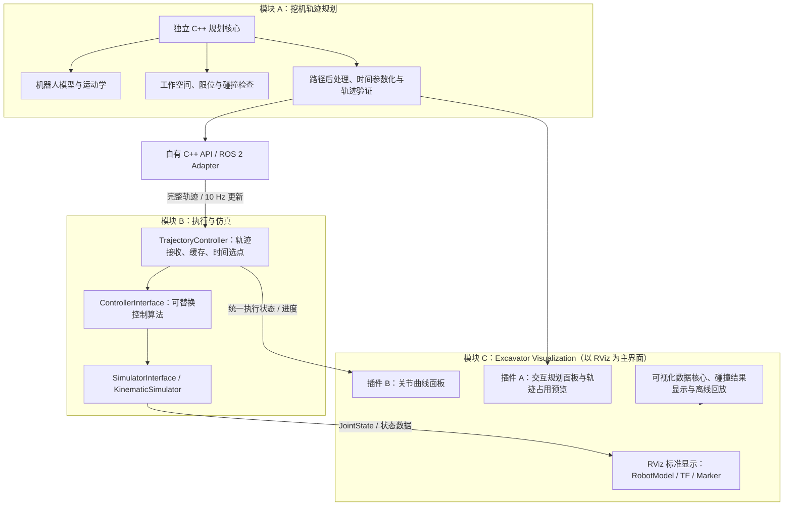
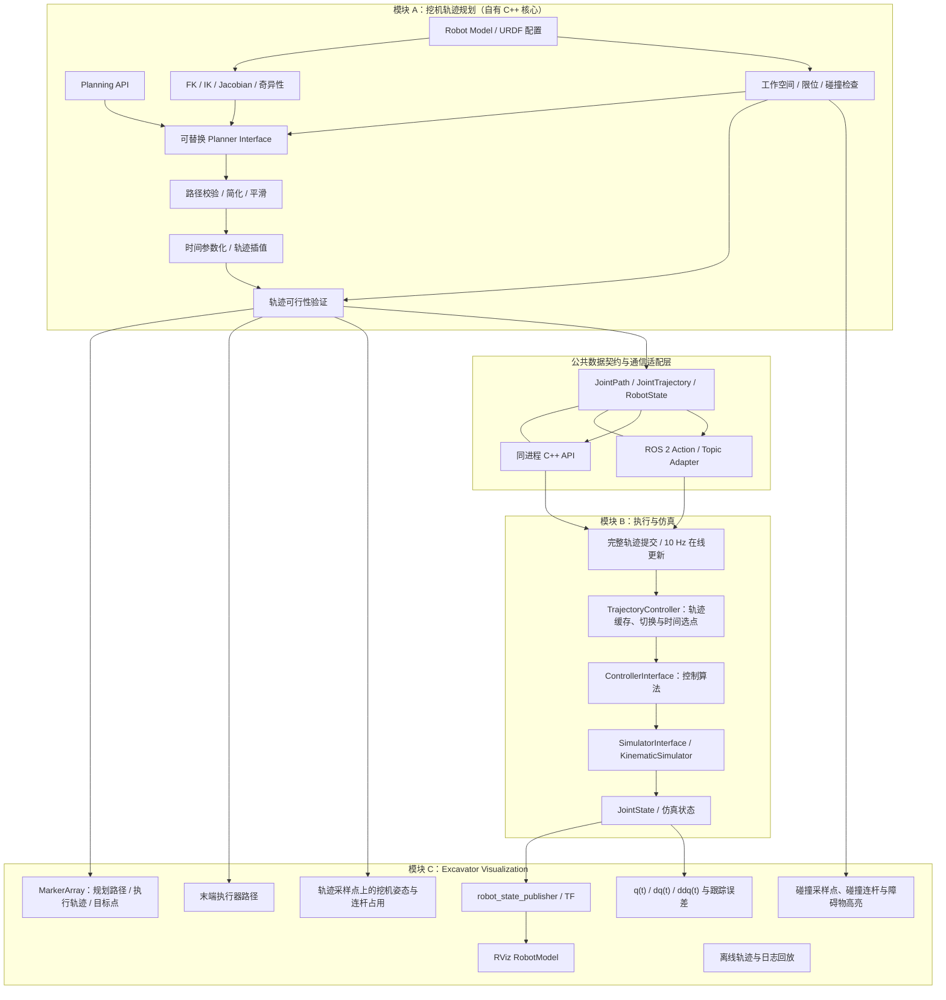

# 挖机基础框架的实现文档


> 版本：V2.0（架构重整版）
> 

> 目标环境：Ubuntu 22.04、ROS 2 Humble、C++17、colcon
> 

> 设计原则：规划算法内核自主实现、仿真可视化独立、MoveIt 2 可选借鉴、所有核心 C++ 类统一放在 `tramcar::planning` 命名空间。
> 

> 本文是可执行的工程设计与开发任务书，不代表代码已经实现或通过编译。
> 

## 1. 目标与边界

本项目开发一套面向挖掘机工作装置的轨迹规划、运动学计算、轨迹执行、运动学仿真和可视化框架。系统划分为三个可独立启动、独立测试的模块：

1. **规划模块**：机器人模型、运动学、工作空间、碰撞检查、规划器接口、路径后处理、时间参数化、轨迹验证。
2. **执行与仿真模块**：轨迹控制器、可替换控制算法、仿真器和执行状态反馈。轨迹控制器接收完整轨迹或 10 Hz 在线更新，在内部控制循环中选点并调用控制算法；仿真器根据控制输出更新状态。
3. **Excavator Visualization（独立可视化模块）**：挖机模型、TF、规划路径、末端路径、关节轨迹曲线和离线回放。可视化通过 ROS 2 数据接口订阅状态，不依赖执行与仿真模块的内部 C++ 类；没有仿真器运行时，也能显示静态模型、规划结果或离线日志。

ROS 2 是通信与集成层；核心数学库应尽可能不依赖 ROS 消息。MoveIt 2 只作为设计参考或可选适配器，不作为规划核心的必需依赖。不得为了使用 RViz、URDF、TF2 或 FCL 而引入整个 MoveIt 运行时。

### 1.1 第一版明确实现什么

- 自有 C++ 公共数据结构与机器人模型配置。
- 根据 URDF 关节轴、原点、类型和限位实现 FK、几何雅可比、阻尼伪逆、奇异性指标、关节限位校验。
- 定义并实现可替换的 IK、规划器、时间参数化器、碰撞检测器接口；IK、碰撞检测和基础路径规划均提供可测试的基线实现。
- 第一版实现完整规划 pipeline：请求检查、基础路径搜索、路径校验/简化/基础平滑、时间参数化、统一轨迹插值和轨迹可行性验证；几何路径与带时间戳轨迹分离。
- 实现纯运动学仿真后端、默认跟踪控制器、完整轨迹执行、10 Hz 在线轨迹更新。
- RViz 显示挖机模型、路径点、末端路径、目标点；显示开关可在 RViz 中控制。
- 绘制每个关节的位置、速度、加速度随时间变化曲线。
- 为每个核心库提供单元测试和最小演示程序。

### 1.2 第一版不承诺什么

- 第一版实现可运行的基础规划器，但不承诺 RRT、RRT*、PRM 等正式搜索算法，也不宣称基础规划器具有完备性。Mock Planner 仅用于接口和单元测试，不作为实际规划能力的替代品。后续算法通过抽象基类、继承和注册/工厂机制替换，不应修改规划流程和公共数据契约。
- 不将纯运动学仿真描述为真实液压动力学仿真。液压压力、流量、重力、惯性、负载、土壤接触应作为后续物理仿真阶段。
- 不把 AABB/OBB 近似碰撞当作完整安全认证；真实执行前必须使用准确碰撞几何、足够保守的连续或自适应路径检查，并由独立安全层兜底。
- 不将 RViz 的显示能力等同于仿真器；RViz 负责显示，状态推进和控制逻辑由仿真/执行核心负责。

## 2. 新方案整体架构

本项目采用“自有 C++ 规划核心 + ROS 2 通信适配层 + 独立执行与仿真模块 + 独立可视化模块”的整体架构。规划核心不依赖 MoveIt 2；URDF、RViz、TF2、robot_state_publisher 等 ROS 2 通用能力可以直接使用。规划、执行与仿真、可视化均可独立启动和测试。规划模块通过同进程 C++ API 或 ROS 2 接口提交轨迹；可视化通过 ROS 2 Topic 或离线文件获取数据，不直接调用执行器、控制器或仿真器的内部对象。

### 2.1 总览架构图（规划 / 执行与仿真 / 可视化）

下图展示三个独立模块。初版不单独设置执行管理器；轨迹控制器负责接收、缓存和切换当前轨迹，并在固定频率控制循环中选点和计算控制输出。可视化模块独立运行，只消费规划结果和状态数据。



### 2.2 详细数据流与组件关系



### 2.1 模块边界

- **规划模块**负责生成几何路径、路径后处理、时间参数化和轨迹验证，不直接操作 RViz、Qt 窗口或仿真器内部状态。
- **执行与仿真模块**由轨迹控制器、可替换控制算法和可替换仿真器组成。轨迹控制器负责轨迹接收、缓存、时间选点、更新切换和基本执行状态；控制算法根据参考状态与当前状态计算控制命令；仿真器只推进和维护仿真状态。
- **Excavator Visualization（独立可视化模块）**以 RViz 为主界面，包含两个独立的 RViz Panel 插件：插件 A 负责交互规划操作，插件 B 负责关节曲线显示。基础模型、TF 和三维 Marker 优先使用 RViz 标准显示能力；场景管理、规划请求、曲线数据处理和离线回放由普通 C++ 类承担，ROS 2 Adapter 负责跨进程通信。该模块通过 ROS 2 Topic、项目自有数据适配层或离线文件消费模型状态、规划轨迹和执行状态；不依赖执行与仿真模块的内部 C++ 类，不能反向修改控制器或仿真器状态。
- **模型可视化数据链路**：实时模式下由仿真后端发布关节状态，`robot_state_publisher` 根据 URDF 生成 TF，RViz `RobotModel` 根据 URDF 与 TF 显示挖机。可视化独立调试时可使用静态/测试关节状态发布器或离线回放数据。
- **三维路径显示**由规划轨迹经过 FK 转换得到刀尖坐标，再通过 `MarkerArray` 或 `nav_msgs/Path` 发布；规划路径、执行轨迹、目标点和模型显示开关相互独立。
- **时间曲线**由独立 RViz Panel 插件显示参考轨迹与实际状态的关节位置、速度、加速度及跟踪误差；曲线数据处理、缓存和时间对齐由普通 C++ 类完成，数据来自统一的轨迹与状态记录，不在可视化侧重新规划或驱动仿真。
- 规划模块可通过同进程 C++ API 或跨进程 ROS 2 Action/Topic 提交完整轨迹或在线更新，两种入口最终调用同一个轨迹控制器；可视化使用独立 ROS 2 数据接口或离线文件。
- 核心 C++ API 使用 Eigen 和项目自有类型；ROS 消息转换集中在 adapter 层。MoveIt 2 不进入核心依赖链。
- 核心类统一放在 `tramcar::planning`；可按子命名空间分层，例如 `tramcar::planning::kinematics`、`tramcar::planning::trajectory`、`tramcar::planning::simulation`、`tramcar::planning::visualization`。禁止把类散落在全局命名空间。

## 3. 现有方案需要改进的地方

1. **包命名与目录一致性**：公共工具包统一命名为 `excavator_common`；目录、ROS 2 包名、CMake target、依赖声明和 include 路径必须保持一致，避免拼写错误和路径分裂。
2. **规划模块与通用功能的责任边界不够明确**：规划器应只输出几何路径，统一由公共后处理生成时间参数化轨迹，避免每种算法各自实现速度曲线。
3. **数据类型契约**：必须明确关节顺序、单位、坐标系、起始状态、速度和加速度维度；核心轨迹类型不携带版本字段，ROS 适配层负责校验消息关节顺序，避免只传无法确认含义的裸 `VectorXd`。
4. **IK 与可达性表述过于绝对**：数值 IK 未收敛不代表目标绝对不可达；应区分输入无效、求解未收敛、超限、碰撞和确认不可达。
5. **雅可比病态处理需要定量化**：输出最小奇异值、条件数或 manipulability 指标，并采用阻尼伪逆；条件数无穷大时不能直接传播 NaN/Inf。
6. **碰撞检查不能只看路径点**：必须检查路径段中间状态；碰撞几何应从 URDF collision 或独立配置读取，并管理相邻连杆允许碰撞对。
7. **时间参数化不能只按路径点距离简单分配时间**：要考虑每个关节的速度/加速度限制、起终点速度、停顿点、路径段插值以及 jerk 限制的扩展接口。时间参数化后必须重新做限位、碰撞和偏差验证。
8. **10 Hz 更新与控制频率混淆**：在线轨迹输入频率为 10 Hz；内部仿真/跟踪循环建议 100 Hz 起步，后续按硬件确定。新轨迹不能直接跳变，也不能在控制线程内做耗时规划。
9. **控制器接口缺少明确语义**：必须规定控制器输入为当前状态、参考状态和 dt，输出为受限的关节命令；控制器不可直接绕过限位与安全检查。
10. **仿真状态与 RViz 状态来源必须唯一**：由仿真后端发布 JointState，robot_state_publisher 负责 TF，RViz 只订阅状态，不另造一套关节状态。
11. **三维显示与时间曲线的实现边界**：三维模型、TF、路径和目标点优先使用 RViz 标准显示能力；自定义交互操作与关节曲线分别实现为两个独立 RViz Panel 插件。规划请求、场景管理、曲线数据处理和离线回放保留为普通 C++ 类，插件只负责界面交互和展示，二者读取一致的轨迹、场景和状态数据。
12. **工程验证缺少阶段门槛**：每个阶段必须先通过自动化测试和可复现 demo，再继续增加功能；文档中的示例接口不能误认为已经可编译的完整实现。

## 4. 推荐工程目录

```
~/excavator_ws/
└── src/
    ├── planner/
    │   ├── excavator_description/
    │   │   ├── CMakeLists.txt
    │   │   ├── package.xml
    │   │   ├── urdf/
    │   │   ├── meshes/
    │   │   ├── config/
    │   │   └── launch/
    │   ├── excavator_interfaces/
    │   │   ├── msg/
    │   │   │   ├── TrajectoryUpdate.msg
    │   │   │   ├── ExecutionStatus.msg
    │   │   │   ├── PlanningScene.msg
    │   │   │   └── CollisionObject.msg
    │   │   ├── action/
    │   │   │   ├── PlanTrajectory.action
    │   │   │   └── ExecuteTrajectory.action
    │   │   ├── srv/
    │   │   ├── CMakeLists.txt
    │   │   └── package.xml
    │   ├── excavator_common/              # 公共类型与通用工具
    │   │   ├── types.hpp
    │   │   ├── result.hpp
    │   │   ├── joint_limits.hpp
    │   │   ├── robot_model_config.hpp
    │   │   ├── validation_result.hpp
    │   │   ├── types.cpp
    │   │   ├── result.cpp
    │   │   ├── test/
    │   │   ├── CMakeLists.txt
    │   │   └── package.xml
    │   ├── kinematics/                     # 运动学模块
    │   │   ├── robot_model.hpp
    │   │   ├── forward_kinematics.hpp
    │   │   ├── inverse_kinematics.hpp
    │   │   ├── jacobian.hpp
    │   │   ├── singularity_checker.hpp
    │   │   ├── robot_model.cpp
    │   │   ├── forward_kinematics.cpp
    │   │   ├── inverse_kinematics.cpp
    │   │   ├── jacobian.cpp
    │   │   ├── singularity_checker.cpp
    │   │   ├── test/
    │   │   ├── CMakeLists.txt
    │   │   └── package.xml
    │   ├── tramcar_collision/              # 碰撞检测模块
    │   │   ├── collision_checker.hpp
    │   │   ├── collision_checker.cpp
    │   │   ├── test/
    │   │   ├── CMakeLists.txt
    │   │   └── package.xml
    │   ├── tramcar_trajectory/
    │   │   ├── include/tramcar_trajectory/
    │   │   │   ├── joint_path.hpp
    │   │   │   ├── joint_trajectory.hpp
    │   │   │   ├── path_interpolator.hpp
    │   │   │   ├── time_parameterizer.hpp
    │   │   │   ├── trajectory_interpolator.hpp
    │   │   │   └── trajectory_validator.hpp
    │   │   ├── joint_path.cpp
    │   │   ├── joint_trajectory.cpp
    │   │   ├── path_interpolator.cpp
    │   │   ├── time_parameterizer.cpp
    │   │   ├── trajectory_interpolator.cpp
    │   │   ├── trajectory_validator.cpp
    │   │   ├── test/
    │   │   ├── CMakeLists.txt
    │   │   └── package.xml
    │   └── tramcar_planning/
    │       ├── include/tramcar_planning/
    │       │   ├── planner_interface.hpp
    │       │   ├── simple_path_planner.hpp
    │       │   ├── planning_pipeline.hpp
    │       │   ├── planning_request.hpp
    │       │   └── planning_result.hpp
    │       ├── src/
    │       ├── test/
    │       ├── CMakeLists.txt
    │       └── package.xml
    ├── excavator_sim_viz/          # 轨迹控制器、控制算法与仿真器
    │   ├── include/excavator_sim_viz/
    │   │   ├── trajectory_controller.hpp
    │   │   ├── trajectory_buffer.hpp
    │   │   ├── controller_interface.hpp
    │   │   ├── velocity_tracking_controller.hpp
    │   │   ├── simulator_interface.hpp
    │   │   ├── kinematic_simulator.hpp
    │   │   └── simulation_state.hpp
    │   ├── src/
    │   ├── launch/
    │   ├── config/
    │   ├── test/
    │   ├── CMakeLists.txt
    │   └── package.xml
    └── excavator_visualization/     # 以 RViz 为主界面的独立可视化与离线回放
        ├── include/excavator_visualization/
        │   ├── planning_request_client.hpp     # 规划 Action 客户端与反馈处理
        │   ├── planning_scene_manager.hpp      # PlanningScene 与障碍物集合管理
        │   ├── collision_object_editor.hpp     # 障碍物数据编辑与同步
        │   ├── trajectory_visualizer.hpp       # 三维规划路径与末端路径数据
        │   ├── trajectory_sample_manager.hpp   # 轨迹采样与关键点管理
        │   ├── trajectory_occupancy_visualizer.hpp # 采样姿态与连杆占用显示
        │   ├── collision_result_visualizer.hpp # 碰撞采样点、连杆和障碍物高亮
        │   ├── trajectory_plot_data.hpp        # 曲线缓存、时间对齐与采样
        │   ├── state_visualizer.hpp            # 状态显示数据处理
        │   └── replay_manager.hpp               # 离线轨迹与日志回放
        ├── src/                               # 普通 C++ 核心与 ROS 2 Adapter
        ├── rviz_plugins/
        │   ├── planning_panel.hpp              # 插件 A：交互规划面板
        │   ├── planning_panel.cpp
        │   ├── joint_plot_panel.hpp             # 插件 B：关节曲线面板
        │   ├── joint_plot_panel.cpp
        │   └── plugin_description.xml           # 注册两个 RViz Panel 插件
        ├── launch/
        ├── config/
        │   └── visualization.rviz
        ├── test/
        ├── CMakeLists.txt
        └── package.xml
```

`planner/` 是普通目录，不是 ROS 2 软件包。只有独立功能模块才设置为独立 ROS 2 包：`excavator_description`、`excavator_interfaces`、`excavator_common`、`kinematics`、`tramcar_collision`、`tramcar_trajectory`、`tramcar_planning`、`excavator_sim_viz` 和 `excavator_visualization`；这些包都必须包含各自的 `package.xml` 与 `CMakeLists.txt`。公共工具包统一命名为 `excavator_common`，目录名、包名、依赖声明、CMake target 与 include 路径必须一致，避免拼写错误。`excavator_common`、`kinematics`、`tramcar_collision` 均不设置 `src/` 或统一的 `include/` 子目录，头文件和源文件直接放在模块目录下；`tramcar_trajectory` 不设置 `src/`，头文件放在 `include/tramcar_trajectory/`，源文件直接放在包目录下。`tramcar_planning` 及独立的仿真/可视化包保留各自的 `include/` 与 `src/` 目录。`excavator_sim_viz` 负责轨迹控制器、控制算法与仿真器；`excavator_visualization` 以 RViz 为主界面，包含交互规划 Panel 插件和关节曲线 Panel 插件。插件只负责界面交互与显示，场景管理、规划请求、曲线数据处理、状态适配和离线回放由普通 C++ 类承担；标准模型、TF 和三维 Marker 尽量使用 RViz 已有能力。该包可单独启动并通过 Topic 或离线文件读取数据，不依赖前者的内部 C++ 类。所有 ROS 2 包均使用 C++17、ament_cmake 与 colcon。

## 5. 数据契约与公共类型

### 5.1 机器人模型

模型配置至少包括：

- 关节名称及固定顺序；核心轨迹按 `RobotModel` 的固定顺序存储，ROS 消息入口负责校验 `joint_names`。
- 关节类型、父子连杆、关节原点变换、运动轴、硬限位、软限位、速度和加速度上限。
- 基坐标系名称、末端执行器 link、铲斗刀尖相对末端 link 的固定变换。
- 每个 link 的视觉几何和碰撞几何；二者不可混用。
- 参数来源和单位。角度使用 rad，长度使用 m，时间使用 s；运行时通过当前加载的模型配置进行校验，不用版本号控制结果有效性。

挖机的 swing、boom、arm、bucket 只是默认命名建议，不得在运动学代码中硬编码假定其轴方向或连杆长度。模型应由 URDF 与明确的配置共同定义。

### 5.2 JointTrajectory

`JointTrajectory` 的核心数据结构以当前 C++ 定义为准，只保存按时间排序的轨迹点，不在结构体内重复封装轨迹 ID、版本、关节名称、模型/场景版本、来源或验证状态。关节顺序由 `RobotModel` 统一定义，调用方在入口处校验顺序和维度；通信层需要的消息头、请求标识及验证结果由对应的 ROS 2 消息或规划结果对象承载。

- `JointPath` 表示只含关节位置的几何路径。
- `JointTrajectory` 表示带相对时间 `t`、位置、速度和加速度的轨迹。
- `RobotState` 表示某一时刻的测量或仿真机器人状态。
- 轨迹点时间必须从 0 开始并严格递增；所有关节向量维度一致且数值有限。

不要用同一类型表达这三种语义。

#### `JointPath` 与 `JointTrajectory` C++ 结构定义

公共类型统一放在 `tramcar::planning` 命名空间，使用 Eigen 表示关节向量。`JointPath` 不重复保存路径 ID、版本、模型版本或关节名称；关节数量与顺序由 `RobotModel` 统一管理，校验时传入关节数量。`JointTrajectory` 基于 `JointPathPoint` 保存位置，并扩展相对时间 `t`、速度和加速度。

`joint_path.hpp`：

```cpp
#pragma once

#include <vector>

#include <Eigen/Core>

namespace tramcar {
namespace planning {

// 单个关节空间路径点。
struct JointPathPoint {
  Eigen::VectorXd positions;
};

// 关节空间几何路径，不包含时间、速度和加速度。
struct JointPath {
  std::vector<JointPathPoint> waypoints;

  bool IsStructurallyValid(Eigen::Index joint_count) const {
    if (joint_count <= 0 || waypoints.empty()) {
      return false;
    }

    for (const auto& point : waypoints) {
      if (point.positions.size() != joint_count ||
          !point.positions.allFinite()) {
        return false;
      }
    }
    return true;
  }
};

}  // namespace planning
}  // namespace tramcar
```

`joint_trajectory.hpp`（位于 `tramcar_trajectory/include/tramcar_trajectory/`）：

```cpp
#pragma once

#include <cmath>
#include <vector>

#include <Eigen/Core>

#include "tramcar_trajectory/joint_path.hpp"

namespace tramcar {
namespace planning {

struct JointTrajectoryPoint {
  JointPathPoint path_point;
  double t{0.0};  // 相对于轨迹起点的时间，单位 s。
  Eigen::VectorXd velocities;     // rad/s 或 m/s。
  Eigen::VectorXd accelerations;  // rad/s^2 或 m/s^2。
};

struct JointTrajectory {
  std::vector<JointTrajectoryPoint> points;

  bool IsStructurallyValid(Eigen::Index joint_count) const {
    if (joint_count <= 0 || points.size() < 2) {
      return false;
    }

    double previous_t = -1.0;
    for (const auto& point : points) {
      if (point.path_point.positions.size() != joint_count ||
          point.velocities.size() != joint_count ||
          point.accelerations.size() != joint_count) {
        return false;
      }

      if (!point.path_point.positions.allFinite() ||
          !point.velocities.allFinite() ||
          !point.accelerations.allFinite() || !std::isfinite(point.t)) {
        return false;
      }

      if (point.t < 0.0 || point.t <= previous_t) {
        return false;
      }
      previous_t = point.t;
    }

    return points.front().t == 0.0;
  }
};

}  // namespace planning
}  // namespace tramcar
```

结构校验只检查数据完整性、维度、有限值和时间顺序；关节限位、速度/加速度上限及路径碰撞由独立验证模块负责。`joint_path.hpp` 与 `joint_trajectory.hpp` 均属于 `tramcar_trajectory` 包，统一通过 `tramcar_trajectory/...` include 路径引用，避免轨迹数据类型反向依赖规划包。

### 5.3 错误与结果

所有公共接口返回明确状态和错误消息，不以空向量、NaN 或默认零值暗示失败。建议状态至少区分：成功、输入无效、模型不匹配、无解/未收敛、超时、取消、越限、碰撞、时间参数化失败、执行器拒绝更新、内部错误。

## 6. 运动学与几何公共能力

### 6.1 运动学接口组织

运动学查询采用统一入口类与独立算法函数相结合的设计。`RobotKinematics` 关联已加载的 `RobotModel`，负责提供统一的 FK、IK 和 Jacobian 查询接口；它不保存当前关节位置 `q`，每次调用都显式传入所需关节配置，避免通过 `SetJointPositions()` 修改内部状态。

FK、IK、Jacobian 的具体计算分别作为独立普通函数实现，不要求为每种算法创建对象。函数显式接收 `RobotModel`，不使用隐藏的全局模型；模型由上层加载一次，并由 `RobotKinematics` 通过常量引用关联。模型对象的生命周期必须长于 `RobotKinematics`。

建议接口如下，作为设计约定而非已实现代码：

```cpp
namespace tramcar::planning {

class RobotKinematics {
 public:
  explicit RobotKinematics(const RobotModel& model);

  Pose GetLinkPose(const JointVector& q,
                   const std::string& target_link) const;

  IKResult SolveIK(const Pose& target_pose,
                   const JointVector& seed,
                   const std::string& target_link) const;

  JacobianMatrix GetJacobian(const JointVector& q,
                             const std::string& target_link) const;

 private:
  const RobotModel& model_;
};

Pose ForwardKinematics(const RobotModel& model,
                       const JointVector& q,
                       const std::string& target_link);

IKResult InverseKinematics(const RobotModel& model,
                           const Pose& target_pose,
                           const JointVector& seed,
                           const std::string& target_link);

JacobianMatrix ComputeJacobian(const RobotModel& model,
                               const JointVector& q,
                               const std::string& target_link);

}  // namespace tramcar::planning
```

调用示例：`kinematics.GetLinkPose(q, "bucket_tip")`、`kinematics.GetJacobian(q, "bucket_tip")`。`q` 是按 `RobotModel` 规定的关节顺序排列的关节位置向量，不是单个整数。`SolveIK()` 使用 `seed` 作为初始关节配置；求解成功后通过 `IKResult` 返回结果，不隐式修改 `RobotKinematics` 内部状态。

### 6.2 正运动学 ForwardKinematics

输入：关节位置向量 `q`、机器人模型 `RobotModel`、目标连杆 `target_link`。统一入口 `RobotKinematics::GetLinkPose(q, target_link)` 内部调用普通函数 `ForwardKinematics(model, q, target_link)`。

输出：目标连杆或刀尖在指定参考坐标系下的位姿。默认明确以模型根坐标系（例如 `base_link`）表达；若需要 `world` 坐标系结果，必须显式组合 `world` 到模型根坐标系的变换。需要展示时再转换为 xyz + roll/pitch/yaw。

计算链由 URDF 的固定变换和关节运动变换按运动链组合。姿态内部使用旋转矩阵或四元数，避免把 Euler 角作为核心表示。明确区分 `base_link`、`world`、`tool0` 与 `bucket_tip`。模型固定只表示无需每次重新加载，并不意味着可以省略函数实现所依赖的模型数据。

### 6.3 逆运动学、雅可比矩阵与奇异性

**逆运动学**通过普通函数 `InverseKinematics(model, target_pose, seed, target_link)` 实现，由统一入口 `RobotKinematics::SolveIK()` 转发调用。输入目标位姿、初始关节配置、目标连杆及模型中定义的限位；容差、迭代上限和超时由配置或求解选项提供。输出 `IKResult`，包含解、残差、迭代次数和状态。首个实现可采用阻尼最小二乘数值法：

- 姿态误差采用一致的 SE(3) 或位置加旋转误差定义。
- 对更新步长限幅，并处理硬限位与软限位。
- 支持多个初始种子，但设置总时间预算。
- 无解结果应说明是未收敛、超限还是碰撞，不把单次迭代失败当作绝对不可达。

**雅可比矩阵**通过普通函数 `ComputeJacobian(model, q, target_link)` 实现，由统一入口 `RobotKinematics::GetJacobian()` 转发调用。统一采用 6×N 几何雅可比，明确线速度在前、角速度在后。转动关节列为 `[axis × (p_tip - p_joint); axis]`，移动关节列为 `[axis; 0]`，所有量必须在同一坐标系中表达。

使用 Eigen SVD 计算奇异值、最小奇异值和条件数；阻尼伪逆可采用 `J# = Jᵀ (J Jᵀ + λ² I)⁻¹`，阻尼参数根据最小奇异值或配置阈值调整。输出奇异风险等级，不只输出 bool。接近伸直、收回等退化构型时，可向规划器提供代价或降速建议。

### 6.4 关节限位

实现位置、速度、加速度、可选 jerk 校验。软限位应在硬限位之前触发降速或拒绝新轨迹，不允许简单饱和位置后继续执行，因为饱和会改变轨迹几何形状。所有控制输出也必须经过独立限幅和安全检查。

### 6.5 工作空间检查

工作空间不是简单的固定 xyz 盒子。第一版可提供配置定义的边界、禁入区域与余量查询；可达性估计与 IK 结果应分开。返回是否在边界内、到最近边界的距离、失败原因。末端在工作空间内不代表整条机械臂无碰撞。

### 6.6 碰撞检测

定义 `CollisionChecker` 接口，输入关节状态和当前一致的障碍物集合，输出碰撞对、最小距离、接触/碰撞状态；结果应能关联到轨迹采样点、发生碰撞的连杆和对应障碍物，以供 RViz 高亮显示。推荐实现层次：

1. Broad phase：AABB 快速排除。
2. Narrow phase：优先使用独立 FCL 与配置的 collision geometry；OBB 可用于简化或粗筛。
3. Motion check：对路径段自适应细分或采用连续碰撞检测；不得只检查稀疏路径点。
4. Self-collision：通过允许碰撞矩阵排除合理的相邻连杆对。
5. Scene consistency：碰撞查询和规划验证必须读取一致的场景快照；场景更新后，相关路径/轨迹应重新检查，不以版本号代替碰撞验证。

MoveIt Planning Scene 不纳入核心依赖；可用其做对照验证，但项目碰撞接口必须能在不启动 MoveIt 的情况下工作。

## 7. 路径规划与轨迹处理

### 7.1 规划器接口

定义可替换的 `Planner`（或 `PathPlanner`）抽象基类，具体算法通过继承实现。输入为 `PlanningRequest` 与 `PlanningContext`，包含起始状态、目标、约束、超时、取消令牌、机器人模型、一致的场景快照和碰撞查询能力；输出结构化 `PlanResult`，成功时包含 `JointPath`，并提供状态码、耗时、反馈和失败原因。第一版实现可运行的基础路径规划器：生成直接候选路径并采样检查碰撞；若直接路径被阻挡，可尝试有限数量的中间关节配置或绕行候选。该基线不保证完备性；Mock Planner 仅用于测试。后续通过新增 `Planner` 子类并在注册表/工厂中注册，即可替换为自研算法，不应修改规划 pipeline、轨迹数据契约、控制器或可视化模块。

规划器不能直接调用仿真器。规划完成后由统一 pipeline 执行路径检查、简化/平滑、时间参数化、最终轨迹验证，最终才交给执行器。

### 7.2 路径后处理

- 校验路径点维度、有限值、关节限位。
- 对相邻点做插值采样并检查碰撞，防止点与点之间穿过障碍物。
- 路径平滑只能在约束范围内进行；平滑后必须重做碰撞和路径偏差检查。
- 路径简化与时间参数化分开，方便替换算法和测试。

### 7.3 时间参数化 `TimeParameterizer`

定义可替换的 `TimeParameterizer` 基类，输入几何路径、关节速度/加速度约束、缩放系数、起终点速度和可选 jerk 上限，输出完整 `JointTrajectory`。首版实现可验证的关节空间限速时间参数化，接口应允许后续接入 TOPPRA 等独立库。该模块只生成时间、速度和加速度，不负责轨迹执行时刻采样。

不能只用欧氏距离除以速度得到时间。每段运动的时长必须满足所有关节约束；路径有拐点时应按停止点处理或使用可验证的连续速度规划。若时间参数化器改变了路径形状，必须重新进行碰撞检查。

### 7.4 轨迹插值 `TrajectoryInterpolator`

定义执行时使用的统一 `TrajectoryInterpolator` 接口：输入 `JointTrajectory` 与相对时间 `t`，返回参考位置、速度和加速度。第一版采用分段五次 Hermite 多项式，以相邻轨迹点的位置、速度和加速度作为边界条件；插值速度与加速度分别由位置函数对时间求一阶、二阶导数得到，不能对三类字段独立插值。轨迹时间 `t` 为相对于轨迹起点的秒数，首点时间为 0，后续时间严格递增。插值器明确处理 `t < 0`、`t` 超过总时长、轨迹为空和时间戳重复等边界条件。五次插值能匹配端点位置、速度和加速度，但不自动保证段内速度、加速度或 jerk 不超限；仍须由验证器检查。控制循环内只做有界插值；最终碰撞验证必须调用同一接口。

### 7.5 轨迹可行性校验

至少检查：

- ROS 适配层校验 `joint_names` 并转换为 RobotModel 固定关节顺序；核心轨迹向量维度一致且所有数值有限。
- 时间戳严格递增，起点与当前状态连续。
- 位置、速度、加速度和可选 jerk 不超限。
- 插值段的极值或自适应采样也满足限制。
- 整条轨迹及插值中间状态均需进行碰撞检查；必须规定最大采样间隔、自适应细分条件和计算预算，无法确认安全时拒绝执行。
- 当前机器人状态、场景快照、轨迹结构和有效期（如启用）均通过实时校验。

返回第一个违规点以及所有可定位的违规指标，方便日志、曲线和 RViz 标注。

## 8. 仿真、控制器与执行器

### 8.1 仿真器接口与后端

首版提供 `SimulatorInterface` 与 `KinematicSimulator`：仿真器接收控制命令并更新关节位置、速度等状态，执行位置、速度、加速度限制并提供状态快照。支持实时循环与单步推进 `Step(dt)`，方便自动化测试和问题复现。它只模拟运动学，不模拟液压动力学。安全边界统一规定：控制命令若包含 NaN/Inf、维度错误或超出硬限位，直接拒绝该命令并进入明确故障/安全停止流程；接近软限位或超出速度/加速度约束时可按配置限幅，但必须报告限幅状态，不能静默夹紧掩盖控制器错误。状态过期、仿真步长无效或执行器返回失败时，不继续使用上一周期的危险命令。

仿真器不负责轨迹缓存、轨迹时间选点、控制算法或 RViz 绘图；轨迹接收和更新切换由轨迹控制器负责。其接口应允许未来替换为 Gazebo、ros2_control 或真实硬件 adapter，而不改规划器和轨迹数据类型。实际液压执行时必须增加独立硬件安全、急停和故障处理。

### 8.2 轨迹控制器与可替换控制算法

第一版不单独实现执行管理器。由 `TrajectoryController` 统一负责轨迹接收、缓存、当前轨迹管理、时间选点和基本执行状态，并在每个控制周期调用可替换的 `ControllerInterface` 计算控制命令。

`ControllerInterface` 输入当前 `RobotState`、参考 `TrajectoryPoint`、控制周期 dt 和控制器配置，输出 `ControlCommand`。默认控制算法可采用速度前馈 + PD 误差反馈，输出速度命令，并经过速度、加速度、软限位和安全检查。控制算法本身不推进仿真状态，也不负责轨迹缓存和 ROS 2 可视化发布。

`TrajectoryController` 必须处理无效 dt、状态维度不匹配、无效轨迹、跟踪误差超阈值和跟踪超时；控制算法切换时需定义是否重置内部状态。仿真器与控制器通过明确接口协作。

### 8.3 轨迹控制器状态与接口

核心 C++ API 遵循 Google C++ Style Guide，建议包括：

- `SubmitTrajectory(trajectory)`：检查轨迹结构、关节顺序、维度、时间和基本约束；通过后保存为待执行候选轨迹，不启动执行，也不代表已获得最终执行许可。
- `UpdateTrajectory(trajectory)`：接收在线更新候选，验证通过后在控制周期边界安全切换。
- `ExecuteTrajectory(trajectory)`：供 RViz“确认执行”按钮调用的原子入口；检查控制器与状态源就绪、当前状态与轨迹起点连续性，获取最新可用且一致的场景/状态快照，使用实际执行插值器完成最终限位和碰撞验证；通过后再提交活动轨迹并启动执行。任一步失败都不得启动，并返回错误码、失败阶段及验证摘要。
- `Pause()`、`Resume()`、`Cancel()`、`Stop()`：控制当前执行状态。
- `Update(current_state, dt)`：由固定频率控制循环调用，按当前有效轨迹选取参考点，调用控制算法并返回控制命令。
- `GetState()`、`GetStatus()`：读取执行状态和当前执行信息。控制器内部区分待执行候选轨迹与当前活动轨迹，验证失败不得覆盖活动轨迹。

统一状态枚举为 `IDLE`、`VALIDATING`、`READY`、`RUNNING`、`PAUSED`、`COMPLETED`、`CANCELLED`、`SAFETY_STOP`、`ERROR`。其中 `READY` 表示存在已接收且满足提交条件的待执行轨迹，不代表环境未来不会变化。`ExecutionStatus.msg` 必须用同一组数值常量表达这些状态。停止策略必须区分立即停止与受限减速停止；出现越限、状态过期或跟踪误差超阈值时进入安全停止，不继续输出过期或不安全命令。

### 8.4 模式 A：一次提交整条轨迹

1. 规划模块生成路径并完成时间参数化和可行性验证。
2. 通过同进程 C++ API `SubmitTrajectory()` 或 ROS 2 接口将完整轨迹提交给 `TrajectoryController`；该操作只接收和验证，不启动执行。
3. 轨迹控制器检查关节顺序、维度、时间戳、限位、碰撞验证结果和起点连续性。
4. 只有 RViz 用户点击“确认执行”后调用 `ExecuteTrajectory()`，才再次检查控制器/状态源就绪、起点连续性及最终轨迹碰撞；全部通过后才开始执行。控制循环按实际执行时间调用统一的 `TrajectoryInterpolator` 采样参考点，再调用控制算法计算控制命令。
5. 仿真器根据控制命令更新关节状态，再将状态反馈给轨迹控制器。到达终点且误差在容差内后报告 COMPLETED；超时或安全条件触发时进入相应状态。

### 8.5 模式 B：10 Hz 在线轨迹更新

10 Hz 是规划模块的轨迹更新频率，不是内部控制频率。建议控制器与仿真器的闭环从 100 Hz 起步；真实硬件频率以驱动器和实时要求为准。

- 新轨迹先进入待验证缓冲区；完成结构、状态连续性、限位和必要碰撞检查后，才在安全的控制周期边界切换为活动轨迹。
- 每次更新均依据当前机器人状态和最新可用且一致的场景重新验证，不用轨迹标识或递增版本替代安全检查。
- 明确轨迹的生效时间与起点状态；切换前检查新轨迹与当前执行状态的位置连续性，并按需求检查速度连续性。
- 不得在每次更新时无条件把轨迹时间归零、跳到新轨迹首点或重置控制算法内部状态。
- 更新失败时保留当前活动轨迹；若当前活动轨迹因状态或场景变化已无法确认安全，则取消/重新验证，必要时受控减速或进入安全停止。
- 规划和碰撞检查不得在高频控制循环中执行。轨迹更新缓冲应使用线程安全交换机制，避免控制循环读取到不完整轨迹。

### 8.6 仿真测试启动流程与轨迹提交

规划完成不代表自动执行。规划模块只负责生成路径、时间参数化并验证轨迹，不负责启动 `TrajectoryController`、`KinematicSimulator` 或 `excavator_visualization`。需要进行仿真测试时，应先启动轨迹控制器、运动学仿真器和独立可视化模块，再由 RViz“确认执行”按钮调用 `ExecuteTrajectory()`；该原子操作在最终复核通过后才提交轨迹并开始执行。单独调用 `SubmitTrajectory()` 只接收和验证，不会启动执行。

整体数据流为：

`Planner → TrajectoryController → KinematicSimulator → excavator_visualization`

其中，`TrajectoryController` 内部通过 `ControllerInterface` 调用跟踪控制算法，并通过 `SimulatorInterface` 向 `KinematicSimulator` 提交控制命令；`KinematicSimulator` 更新关节状态并发布状态数据，`excavator_visualization` 订阅这些数据进行显示。可视化模块只显示状态，不负责推进仿真。

仿真测试时的启动顺序：

1. 启动 `TrajectoryController`，使其进入可接收轨迹的状态。
2. 启动 `KinematicSimulator`，准备仿真状态更新与状态发布。
3. 启动 `excavator_visualization`，订阅关节状态、规划轨迹和执行状态；它也可以独立启动，不要求规划模块或仿真器由它拉起。
4. 启动或调用 `Planner` 完成规划、时间参数化和最终轨迹验证，结果显示在 RViz 中等待用户确认。
5. 用户点击“确认执行”后，RViz 调用 `ExecuteTrajectory()`；控制器复核当前状态、轨迹起点、限位和碰撞结果，全部通过后才开始执行。仿真器发布更新后的机器人状态，供规划器、控制器和可视化模块订阅。

同进程 C++ API 与跨进程 ROS 2 adapter 都遵循上述流程。同进程调用可以直接提交项目自有的 `JointTrajectory`；跨进程时由 ROS 2 adapter 将消息转换为项目自有类型后交给同一个控制器。两种入口共用相同的轨迹验证、缓冲切换与控制逻辑。轨迹提交接口只负责接收和验证，不应隐式启动未启动的仿真/可视化模块。

## 9. 独立可视化与轨迹曲线

`excavator_visualization` 是独立 ROS 2 软件包，不属于 `excavator_sim_viz` 的内部子模块。它通过 ROS 2 Topic、稳定的数据适配接口或离线文件获取数据，不依赖轨迹控制器和仿真器的内部 C++ 类。即使仿真器没有运行，也应能独立显示静态模型、规划轨迹或离线日志。

可视化模块订阅当前模式的权威机器人状态，并将**规划结果、执行状态和机器人当前姿态分开管理**。RViz 负责三维模型与空间路径展示；关节曲线固定由 `ExcavatorJointPlotPanel` RViz Panel 插件展示，Qt 绘图控件仅作为 Panel 内部组件。所有可视化组件只读取规划轨迹和执行状态，不反向修改执行器、控制器或仿真器内部状态。

### 9.1 数据来源与模型状态

- 使用 URDF/Xacro 与 meshes 描述挖机，启动 `robot_state_publisher`；RViz 使用 `RobotModel` 显示机器人模型。
- `excavator_visualization` 是独立 ROS 2 软件包，不属于 `excavator_sim_viz` 的内部子模块。它通过 ROS 2 Topic、稳定的数据适配接口或离线文件获取数据，不依赖轨迹控制器和仿真器的内部 C++ 类。即使仿真器没有运行，也应能独立显示静态模型、规划轨迹或离线日志。
- 系统配置三种互斥运行模式，并保证每种模式只有一个权威状态源：①仿真模式由 `KinematicSimulator` 更新并发布 `sensor_msgs/msg/JointState`；②硬件模式由真实硬件驱动发布 `JointState`；③离线/规划调试模式由回放器或测试状态发布器提供状态。模式通过 launch 参数或配置文件选择，不允许多个状态源同时发布同一机器人实例的权威状态。
- 关节状态是 `RobotState` 的组成部分。仿真模式下，运动学仿真器负责生成并发布机器人状态，`robot_state_publisher` 根据该状态和 URDF 发布 TF；规划器、控制器、曲线面板和 RViz 通过订阅状态接口获取数据。RViz 不自行推进关节，也不另行维护一份机器人状态。
- 规划结果由规划模块输出的同一份 `JointPath` / `JointTrajectory` 提供；执行状态由 `TrajectoryController` 或其 ROS 2 adapter 发布，使用统一状态枚举，不在状态消息中强制携带轨迹/模型版本。
- 所有空间显示使用明确且一致的固定参考坐标系。模型根坐标系、`world`、末端 link 与 `bucket_tip`（铲斗刀尖）应保持区分；需要显示刀尖轨迹时，通过 FK 将关节路径点转换到所选固定坐标系。
- 第一版采用运动学仿真即可；若后续需要液压、惯性、重力或土壤接触等物理动力学，再接入 Gazebo 或其他物理引擎，不改变规划轨迹的数据契约。

### 9.2 RViz 三维显示内容

使用 RViz 的 `RobotModel` 和 `TF` 显示挖机模型、连杆坐标系与当前姿态；使用 `visualization_msgs/msg/MarkerArray` 显示规划空间信息。多姿态占用预览不直接复用单一 `RobotModel` 显示实例：第一版由 `TrajectoryOccupancyVisualizer` 根据 URDF/`RobotModel` 的视觉几何生成每个采样姿态对应的 `MarkerArray`，为每个姿态和连杆分配稳定 namespace/ID，并设置透明度；只对预览姿态发布独立 Marker，不修改权威 `/joint_states` 或 TF。该实现应先用最小原型验证 mesh 资源解析、坐标变换、Marker 清理和渲染开销。建议显示内容包括：

- **路径点与路径线**：显示规划路径采样点及连接线；关节空间路径与刀尖笛卡尔轨迹属于不同数据，刀尖轨迹必须先对路径点执行 FK。
- **轨迹占用预览**：对 `JointTrajectory` 按可配置的时间间隔或采样数量进行采样，将每个采样时刻的关节位置通过 `RobotModel` 与 FK/模型状态更新映射为整机姿态，并在同一 RViz 场景中叠加显示多个半透明挖机模型/连杆姿态，用于直观观察挖机沿轨迹运动时各连杆扫过的空间范围。支持只显示选中采样点、显示多个采样姿态，或只显示用户选中的轨迹区间；可调整采样密度，以平衡预览连续性与 RViz 渲染开销。该功能是轨迹空间占用的可视化近似，不代表连续时间上的完整扫掠体，也不能单凭透明模型是否重叠来判定无碰撞。
- **碰撞结果高亮**：碰撞检测器应返回可定位的采样点/轨迹时刻、发生碰撞的连杆和对应障碍物；可视化层将这些对象以醒目的颜色或 Marker 单独高亮，并可定位到相关采样姿态。实际碰撞判断由 `tramcar_collision` 完成，RViz 只展示结果，不负责执行碰撞检测。
- **目标与起终点**：分别标记目标位姿、路径起点和终点，并可显示当前执行点或刀尖当前位置。
- **执行与验证反馈**：可选显示当前轨迹进度、路径验证失败点及其说明；规划路径和实际执行轨迹应采用不同的命名空间或 ID，避免混淆。
- **轨迹更新与清理**：每次发布应带有稳定的 namespace/ID 管理策略；轨迹被替换或清除时删除旧 Marker，避免 RViz 留下过期路径。
- **参考系和时间戳**：Marker 的 `header.frame_id` 必须与点坐标所属的参考系一致，时间戳应与发布策略匹配，避免 TF 无法变换或显示漂移。

路径显示应可独立开关。第一版通过 RViz Display 的启用/禁用属性分别控制规划路径、刀尖轨迹、目标点等显示项；规划交互与关节曲线统一由 `ExcavatorPlanningPanel` 和 `ExcavatorJointPlotPanel` 两个 RViz Panel 插件承载，不创建独立 Qt 顶层曲线窗口。

### 9.3 关节时间曲线

绘制每个关节的：

- 位置曲线：`q(t)`
- 速度曲线：`dq(t)`
- 加速度曲线：`ddq(t)`

后续可增加 jerk、关节位置/速度/加速度限位线、当前执行时间游标、实际状态与参考状态对比、跟踪误差、轨迹在线更新的切换点及规划/执行异常标记。

第一版明确采用 RViz Panel 插件，不单独创建 Qt 顶层窗口。`ExcavatorJointPlotPanel` 内部可使用 Qt 绘图控件及 QCustomPlot 或其他合适的绘图库。曲线模块读取同一份 `JointTrajectory` 和执行状态：参考曲线由执行时使用的轨迹插值器采样得到，实际曲线来自当前模式的权威机器人状态源。不得在可视化模块中重新规划、修改轨迹或驱动仿真器，以免显示结果与实际执行不一致。

### 9.4 显示控制、独立启动与模块边界

- 可视化模块至少支持三种数据来源：实时模式（订阅仿真状态）、规划调试模式（只加载规划路径/轨迹，不执行）、离线回放模式（读取已保存的轨迹与状态日志）。
- 提供独立的 `visualization.launch.py`；启动可视化时不得默认拉起轨迹控制器、控制算法或仿真器。无实时状态发布者时，可选择静态/测试关节状态发布器或离线回放源。
- 模型当前姿态、规划路径、执行轨迹、目标位姿和时间曲线应分开管理，避免把“规划成功”误显示为“执行完成”。
- 三维显示通过 RViz Display 配置和 Marker topic 控制；关节曲线由 `ExcavatorJointPlotPanel` 订阅轨迹与权威状态源。所有规划交互与曲线显示都采用 RViz Panel 插件方案，不另设独立 Qt 顶层窗口。
- 规划模块不依赖 RViz/Qt；可视化模块不依赖具体规划算法。所有显示均通过稳定的项目自有数据类型或 ROS 2 adapter 获取数据，ROS 消息转换集中在 adapter 层。

### 9.5 交互式规划面板、起终点设置与障碍物编辑

交互界面参考 MoveIt 2 RViz MotionPlanning 的使用流程，但只借鉴交互方式，不依赖 MoveIt 的 PlanningScene、PlannerManager 或 PlanningContext。建议以 RViz 为主界面，在 `excavator_visualization` 中分别实现两个独立的 RViz Panel 插件：插件 A `ExcavatorPlanningPanel` 负责起终点编辑、障碍物编辑、规划请求、结果预览和用户确认执行；插件 B `ExcavatorJointPlotPanel` 专门负责关节曲线显示。目标点交互优先使用 ROS 2 Interactive Markers 与 RViz 标准显示机制，不必为每种交互单独开发 RViz 插件。规划请求、场景管理、障碍物数据、曲线处理与回放逻辑由普通 C++ 类实现，ROS 2 Adapter 负责消息订阅、发布和类型转换。

- **起点设置**：第一版默认取仿真器当前发布的 `RobotState`，以保证规划起点与当前状态一致；提供“保存当前状态为规划起点”的操作。后续可增加手动指定关节角或第二个交互标记。手动规划起点与真实仿真状态必须明确区分，执行前必须检查起点连续性。
- **终点设置**：默认在 RViz 三维视图中拖动 `bucket_tip` 交互标记设置末端目标位置和姿态，也可在插件 A 的面板中输入目标坐标与姿态。优先使用 ROS 2 Interactive Markers 机制和 RViz 现有显示能力，不将交互标记本身等同于自定义 RViz 插件。规划模块通过 IK 求解目标关节配置；IK 失败、关节超限或目标碰撞时返回明确错误，不进入执行流程。
- **规划操作**：提供“规划轨迹”“预览轨迹”“确认执行”等独立操作。预览除显示规划路径、末端路径、目标姿态和验证信息外，还应提供“轨迹占用预览”：按采样时刻叠加显示多个半透明挖机姿态/连杆占用，可选择单个采样点、多个采样姿态或指定轨迹区间，并调整采样密度；碰撞结果应能高亮对应采样点、碰撞连杆和障碍物。规划只生成并验证结果，预览只负责显示。用户点击“确认执行”后，由一个 `ExecuteTrajectory()` 请求完成最终状态检查、基于执行插值器的轨迹碰撞复核、轨迹提交和启动执行；任一步失败均不启动。此按钮不启动控制器/仿真器进程，相关节点必须已运行且就绪。
- **障碍物编辑**：首版支持 Box 障碍物的新增、选择、拖动、旋转、尺寸修改和删除；后续可扩展 Cylinder 与 Mesh。每个障碍物记录唯一 ID、几何类型、位姿、尺寸/网格资源和参考坐标系。RViz 中的障碍物显示与规划场景必须来自同一份场景数据，不能只显示而不参与碰撞检查。
- **规划场景与避障**：用项目自有的 `PlanningScene` 管理当前障碍物集合。规划请求读取同一时刻的一致场景快照；场景变化后，规划/验证流程立即重新检查相关结果，不依赖版本号判断安全性。规划器通过 `tramcar_collision` 的碰撞查询检查挖机自碰撞、环境碰撞和路径段中间状态；时间参数化后必须基于执行时实际使用的轨迹插值器再次采样并完成最终碰撞验证。第一版采用可配置的离散采样，后续再评估自适应细分或连续碰撞检测。
- **结果有效性处理**：规划期间若目标、起点或障碍物变化，应取消正在进行的请求或对当前结果重新规划/验证；执行前再次检查当前机器人状态与轨迹起点的连续性、轨迹限位、碰撞结果及控制器就绪状态，不通过则拒绝执行。
- **失败和可用性**：目标不可达、规划超时、碰撞、越限、模型不匹配或仿真器未启动均须在插件 A 中显示明确状态。插件 B 独立负责曲线展示，不能因规划面板关闭或操作失败而承担规划/控制职责。仿真器未启动时仍允许设置场景、规划和预览，但执行操作应被拒绝并提示原因。可视化包仍须支持独立启动和离线规划结果显示。

## 10. ROS 2 接口约定

ROS 2 只承担跨进程通信、状态发布和工具集成；同进程调用直接使用项目自有 C++ 类型。所有 ROS 消息转换集中在 excavator_interfaces 或相应 adapter 中。第一版保持接口精简，话题名统一使用 /excavator/... 前缀，避免沿用 /tramcar/... 与挖机项目命名不一致。

### 10.1 核心接口

| 名称 | 类型 | 发布方 / 使用方 | 用途 |
| --- | --- | --- | --- |
| /joint_states | sensor_msgs/msg/JointState | 仿真器或硬件驱动 → robot_state_publisher、可视化 | 当前关节状态；机器人姿态的实时数据源 |
| /excavator/plan_trajectory | excavator_interfaces/action/PlanTrajectory | 规划服务端 / 调用方 | 请求规划、反馈进度、返回结果并支持取消；第一版可先通过同进程 API 调用规划核心 |
| /excavator/execute_trajectory | 建议新增 `ExecuteTrajectory.action` | TrajectoryController / RViz 调用方 | 用户确认执行后进行最终验证、启动执行并反馈结果；失败时不得启动 |
| /excavator/scene | excavator_interfaces/msg/PlanningScene（建议新增） | 感知模块 → 规划模块场景管理器 | 发布完整场景快照；规划模块校验后原子替换当前场景 |
| /excavator/trajectory_update | excavator_interfaces/msg/TrajectoryUpdate | 规划模块 → TrajectoryController | 唯一约定的在线轨迹更新 Topic；只承载完整替换候选，不与标准轨迹 Topic 并行竞争控制器输入 |
| /excavator/execution_status | excavator_interfaces/msg/ExecutionStatus | TrajectoryController → 可视化 / 监控 | 统一执行状态、当前执行时间/进度、跟踪误差及故障 |
| /excavator/planned_path | visualization_msgs/msg/MarkerArray | 规划结果适配器 → 可视化 | 显示规划路径、起终点、目标点及验证信息 |
| /excavator/end_effector_path | nav_msgs/msg/Path 或 MarkerArray | 规划结果适配器 → 可视化 | 显示通过 FK 计算得到的铲斗刀尖空间路径 |
| /excavator/trajectory | trajectory_msgs/msg/JointTrajectory（可选适配） | 规划模块 → 控制器 / 记录工具 | 仅作为标准 ROS 轨迹格式的导出或记录接口，不与在线更新 Topic 同时作为控制器权威输入；进入核心前转换为自有 JointTrajectory |

上述名称是项目约定，不要求所有接口在第一阶段同时实现。/joint_states 由当前状态源发布；RViz 和 robot_state_publisher 不得各自维护另一套机器人关节状态。规划调试和离线回放模式可以从文件或测试数据加载规划轨迹，不要求仿真器运行。

### 10.2 TrajectoryUpdate 与执行状态语义

`TrajectoryUpdate.msg` 只承载轨迹更新所需的传输字段，不复制核心结构中不存在的版本元数据：

- `std_msgs/Header header`：`stamp` 表示消息生成/发布时刻，`frame_id` 表示空间数据参考坐标系；轨迹点中的 `t` 始终表示相对轨迹起点的秒数。
- `uint8 update_mode`：第一版只支持 `REPLACE`；未知模式必须拒绝。
- `string[] joint_names` 显式表达轨迹关节顺序；轨迹点数组包含相对时间 `t`、关节位置、速度和加速度，进入核心前转换为 `tramcar::planning::JointTrajectory`。
- 固定关节顺序由 `RobotModel` 定义，ROS 适配层必须校验消息中的 `joint_names` 与模型顺序一致。

`ExecutionStatus.msg` 包含统一状态枚举、当前执行时间/进度、跟踪误差摘要和错误码/说明。消息中固定定义常量：`uint8 IDLE=0`、`uint8 VALIDATING=1`、`uint8 READY=2`、`uint8 RUNNING=3`、`uint8 PAUSED=4`、`uint8 COMPLETED=5`、`uint8 CANCELLED=6`、`uint8 SAFETY_STOP=7`、`uint8 ERROR=8`。核心 C++ enum 严格遵循 Google C++ Style Guide，分别使用 `kIdle`、`kValidating`、`kReady`、`kRunning`、`kPaused`、`kCompleted`、`kCancelled`、`kSafetyStop`、`kError`，并与消息常量逐项映射；状态语义在控制器、ROS adapter 和 UI 中保持一致。轨迹 ID、版本、模型版本、场景版本不作为控制逻辑必需条件。

所有输入在进入控制循环前必须检查关节顺序、维度、有限值、时间单调性、限位、起点连续性和有效期（若传输层配置了有效期）。第一版在线更新只做完整轨迹替换；追加、局部拼接等模式待需求明确后扩展。

### 10.3 交互规划、场景与避障接口

- `/excavator/plan_trajectory` 使用 ROS 2 Action 承载耗时规划请求，支持反馈、取消和结构化结果。请求包含请求 ID、起始 `RobotState` 或起始关节配置、目标类型（末端位姿或关节配置）、目标数据、参考坐标系、规划约束和超时，不包含模型/场景版本号。
- `PlanningScene` 与 `CollisionObject` 是项目自有类型；ROS 2 消息仅用于跨进程传输。第一版的场景 Topic 传输完整快照，障碍物 ID、几何类型、位姿、尺寸或网格资源及参考坐标系均属于场景数据；不设置场景版本字段。后续若改用增量消息，必须另行定义丢包恢复和重新同步机制。
- 感知模块检测到环境变化后发布完整场景快照，规划模块通过 ROS 2 Topic 订阅并保存；规划请求必须读取一致的场景快照。规划模块先校验并在独立对象中构建新场景，成功后通过原子替换或读写锁更新当前场景；构建失败时保留原有有效场景。规划期间不读取正在被修改的对象。规划结果回传请求 ID、规划状态、轨迹、验证摘要和失败原因。场景更新后，后续规划使用已接收并成功应用的新场景；第一版取消仍基于旧场景的规划任务。执行前使用最新可用且一致的场景重新验证。版本号不作为安全判据，但仍须通过快照和同步机制处理并发访问。
- 同进程 C++ API 与 ROS 2 Action adapter 必须调用同一个规划核心，不能形成两套不同的规划/碰撞逻辑。模块之间可通过 ROS 2 Topic、Action 或 Service 通信；核心规划器不直接依赖 ROS 消息、节点或具体传输方式。用户确认执行时，RViz 只调用 `ExecuteTrajectory()` 原子接口，由控制器完成最终复核、提交轨迹和启动执行；可视化不直接驱动仿真器。

## 11. MoveIt 2 复用策略

本项目以自主 C++ 核心为目标，不实现对 MoveIt 2 的强运行时依赖。可以使用 ROS 2 通用生态和独立库，但不让核心类型、核心接口或主要构建链依赖 MoveIt 类型。

| 能力 | 第一版方案 | 约束 |
| --- | --- | --- |
| URDF/Xacro、robot_state_publisher、TF2、RViz | 直接使用 ROS 2 通用组件 | 不需要 MoveIt 规划运行时 |
| 向量、矩阵、变换 | Eigen3 | 核心数学接口使用项目自有类型与 Eigen |
| URDF 解析 | urdfdom 或 ROS 2 URDF 相关包 | 将解析结果转换为自有 RobotModelConfig |
| FK、Jacobian、奇异性 | 自行实现并测试 | 可用独立参考实现做数值对照，不把参考实现作为运行时必需依赖 |
| IK | 自有接口和基线实现 | 可选 KDL adapter；不绑定 MoveIt IK 插件类型 |
| 碰撞检测 | 自有接口 + 独立 FCL | 碰撞场景和结果由本项目数据契约管理 |
| 时间参数化 | 自有接口，后续评估独立时间参数化库 | 引入前检查许可证、实时性和依赖 |
| RRT / RRT* / PRM 等规划器 | 自有 PlannerInterface | 第一版实现可运行的基础规划器；后续算法通过继承和注册机制替换，Mock Planner 仅用于测试 |
| PlannerManager / PlanningContext、MotionPlanning 插件 | 暂不实现 | 只有明确需要在 MoveIt RViz MotionPlanning 面板内调用时，再新增可选 adapter 包 |

未来 MoveIt 适配应位于独立边界包中，完成项目自有类型与 MoveIt 类型的双向转换。复用或移植源码前，核对目标分支 API、许可证、版权声明和依赖链；不能为了使用 RViz、URDF、TF2 或 FCL 而引入完整 MoveIt 运行时。

## 12. 编译、依赖与代码规范

### 12.1 构建与依赖

- 目标环境：Ubuntu 22.04、ROS 2 Humble、C++17、ament_cmake、colcon。
- 数学库：Eigen3；模型描述：URDF/Xacro 与 urdfdom / ROS 2 URDF 组件；碰撞：FCL；可视化主界面：RViz、robot_state_publisher。自定义界面使用两个独立 RViz Panel 插件（交互规划面板、关节曲线面板）；曲线绘图控件可采用 Qt，但作为插件内部实现，不额外要求独立 Qt 窗口。
- excavator_visualization 必须能在不启动 excavator_sim_viz 的情况下启动；规划核心和公共类型库的单元测试不要求启动 ROS 节点或 RViz。
- `planner/` 是普通目录，不是 ROS 包；只有独立功能模块目录才作为独立 ROS 2 包。公共工具包统一使用 `excavator_common`，目录名、包名、依赖声明、CMake target、include 路径和文档均保持一致。
- 不把 Qt、RViz、MoveIt 或仿真节点依赖传递到纯公共数学库；通过包依赖和 adapter 层隔离可选组件。

建议构建流程：

```bash
cd ~/excavator_ws
source /opt/ros/humble/setup.bash
rosdep install --from-paths src --ignore-src -r -y
colcon build --symlink-install --cmake-args -DCMAKE_BUILD_TYPE=RelWithDebInfo
source install/setup.bash
```

### 12.2 C++ 规范与实时性约束

- 严格遵循 Google C++ Style Guide：类型名和函数名使用 `UpperCamelCase`，变量名使用 `snake_case`，常量使用 `kConstantName`，枚举值使用 `kUpperCamelCase`，头文件使用 `#pragma once`。因此核心 C++ 方法统一使用 `SubmitTrajectory()`、`UpdateTrajectory()`、`GetState()` 等命名，不使用 snake_case 函数名；ROS 2 消息字段和 Topic 名按 ROS 2 约定使用 snake_case。
- 所有核心 C++ 类统一位于 tramcar::planning，可按功能划分子命名空间；ROS 生成消息仍保留 excavator_interfaces::msg 等生成命名空间。
- 公共 API 明确单位、坐标系、线程安全、对象所有权、失败状态及返回值语义；失败不得用零向量、NaN 或空结果静默表示。
- 高频控制循环避免阻塞 I/O、同步服务调用、无界等待和大规模碰撞查询；轨迹解析、规划和复杂验证在控制循环之外完成。
- 参数必须校验范围并提供明确默认值；核心接口及数据结构要有自动化测试和可复现示例。

## 13. 分阶段实施计划与验收门槛

### 阶段 0：模型与接口冻结（包含模型可视化）

- 完成 `excavator_description` 的 URDF/Xacro、mesh、关节顺序、坐标系、限位和必要的模型配置。
- 配置 `robot_state_publisher`、测试 `JointState` 发布器、`display.launch.py` 和 RViz 配置，确认模型完整、活动关节方向正确、TF 树连通、`bucket_tip` 位置合理。
- 冻结 `RobotModelConfig`、`RobotState`、`JointPath`、`JointTrajectory`、单位、关节顺序、时间语义、错误码和统一执行状态枚举；不引入模型、场景或轨迹版本控制机制。
- 验收：干净工作空间构建成功；模型可独立显示；测试关节状态可驱动至少一个活动关节；接口约定形成文档。

### 阶段 1：运动学基础

- 实现模型加载、FK、Jacobian、SVD 奇异性指标、关节限位，以及 IK 接口和基线数值实现。
- 验收：FK 对照测试通过；Jacobian 与有限差分结果一致；FK→IK→FK 在容差内；输入无效和未收敛状态可区分。

### 阶段 2：工作空间与碰撞

- 实现工作空间边界、AABB 粗筛、FCL 碰撞接口、允许碰撞对和路径段中间状态检查。
- 验收：无碰撞、接触、相交、相邻连杆过滤及路径中间碰撞均有自动测试。

### 阶段 3：路径与轨迹 pipeline

- 实现 `JointPath`、路径校验/简化/平滑接口、轨迹插值器基类、时间参数化器基类和轨迹验证器；用简单测试路径验证全流程。
- 明确职责边界：`PathInterpolator` 负责几何路径上的关节位置插值；`TimeParameterizer` 根据路径和关节速度/加速度约束生成带时间、速度和加速度的 `JointTrajectory`；`TrajectoryInterpolator` 只负责按执行时间从已参数化轨迹中采样参考状态；`TrajectoryController` 在控制周期调用该插值器，不自行实现另一套插值逻辑。在线更新只负责接收、验证并在控制周期边界切换轨迹，不承担时间参数化。
- 最终轨迹安全验证必须调用与执行阶段相同的 `TrajectoryInterpolator` 进行采样，并对每个采样状态及必要的区间中间状态执行限位和碰撞检查。路径阶段碰撞检查用于规划搜索与后处理，不替代最终轨迹验证。
- 验收：时间戳严格递增，维度与有限值检查通过；位置、速度、加速度限制及路径碰撞验证能定位到具体失败点；验证采样与执行采样使用同一插值规则。

### 阶段 4：轨迹控制器与运动学仿真闭环

- 分别实现 TrajectoryController、ControllerInterface、默认跟踪控制算法、SimulatorInterface 和 KinematicSimulator。
- 控制器负责轨迹缓存、时间选点、执行状态与在线替换；控制算法只计算命令；仿真器只更新和维护仿真状态。仿真器支持实时循环与 Step(dt) 单步模式。
- 验收：不启动 RViz 的自动测试可完成轨迹；三个组件可分别单元测试；终点误差、限位和执行状态满足阈值。

### 阶段 5：在线轨迹更新

- 支持 10 Hz 轨迹更新输入与建议从 100 Hz 起步的控制循环；实现待验证/当前轨迹缓冲、控制周期边界切换和起点位置/速度连续性检查。
- 不使用轨迹版本号过滤更新；每次更新都根据当前机器人状态、轨迹结构、限位和碰撞结果实时验证。无效更新不得覆盖当前有效轨迹；若场景或机器人状态变化影响当前结果，应重新验证或拒绝更新。
- 验收：无效更新不会覆盖有效轨迹；更新期间无非预期的位置跳变；控制循环不执行规划或完整碰撞搜索任务。

### 阶段 6：RViz 可视化基础与离线回放

- 完成独立 `excavator_visualization` 包的基础能力，以 RViz 为主界面，支持实时订阅、规划调试和离线回放三种模式；模型、规划路径、执行轨迹、目标点及时间曲线可分别控制。本阶段先完成数据链路和显示，不依赖完整交互规划链路。
- 先完成插件 B `ExcavatorJointPlotPanel` 的基础曲线显示，以及 `TrajectoryPlotData` 的缓存、时间对齐、采样和规划/实际状态对比。插件 A `ExcavatorPlanningPanel` 在本阶段只建立界面骨架与数据接口，完整交互规划放到阶段 8。
- 完成曲线面板的显示开关、图例、关节选择和错误提示；具体曲线缓存、时间对齐与采样由 `TrajectoryPlotData` 普通 C++ 类承担。
- 两个插件通过 ROS 2 接口和可视化核心共享轨迹、场景及状态数据，不直接依赖对方内部类。场景管理、规划请求客户端、轨迹采样、三维路径/占用显示、碰撞结果显示、曲线数据和离线回放均由普通 C++ 类承担；标准 RobotModel、TF 和三维 Marker 优先使用 RViz 现有显示功能。
- 完成 `TrajectoryOccupancyVisualizer` 的最小原型：根据 `RobotModel`/URDF 视觉几何生成采样姿态对应的 `MarkerArray`，验证连杆变换、透明度、namespace/ID 管理、旧 Marker 清理和渲染开销。完整占用预览交互与碰撞结果高亮在阶段 8 集成。
- 本阶段不实现障碍物交互编辑与完整规划操作；先建立场景数据接口及普通 C++ 场景管理类的单元测试。
- 验收：不运行仿真器也能显示静态模型、规划结果或日志；两个 Panel 插件可独立启用/关闭；三种数据模式工作；实时模式下模型状态与 `/joint_states` 一致；曲线时间对齐正确；多姿态 Marker 原型无状态源冲突且可正确清理。

### 阶段 7：规划接口、可替换简单规划器与最终轨迹验证

- 完成 `PlannerInterface`、注册/工厂机制、取消、超时、反馈及结构化规划结果；提供可替换的 `PathPlanner` 基类和 `TimeParameterizer` 基类。首版实现简单基线规划器，在起点与目标关节配置之间生成候选路径，并通过路径段采样和碰撞查询筛选；必要时尝试有限次数的简单中间点/绕行候选，用于打通交互式避障流程，不宣称具备 RRT、RRT* 或 PRM 的完备搜索能力。
- 将起点、目标、规划约束和一致的 `PlanningScene` 快照纳入规划请求；由 `tramcar_collision` 为路径搜索和最终轨迹验证提供碰撞查询。时间参数化后必须使用执行阶段同一 `TrajectoryInterpolator` 采样并做最终碰撞检查。
- 检查路径节点、路径段中间状态及时间参数化后的轨迹；规划或验证期间若起点、目标、场景或当前机器人状态变化，应取消当前请求或重新验证，不依赖 model/scene/path version 做安全控制。对不可达目标、碰撞、越限、超时和取消返回明确结果。
- 验收：替换规划器不需要修改轨迹数据契约、控制器、仿真器或可视化包；障碍物变化后必须重新验证相关结果，未通过验证不得执行；具体 RRT/RRT\*/PRM 算法另立开发任务。

### 阶段 8：交互式规划面板与执行确认集成

- 在阶段 6 的 RViz 可视化基础上完成 `ExcavatorPlanningPanel`：起点/终点设置、规划/取消、障碍物 Box 新增/移动/旋转/尺寸修改/删除、规划结果预览、碰撞高亮和轨迹占用预览。
- 将规划面板接入阶段 7 的 `PlannerInterface` 与简单基线规划器；清楚显示规划中、规划成功、验证失败、等待确认、执行中、完成、取消、安全停止和错误等状态。
- 用户点击“确认执行”时，单次 `ExecuteTrajectory()` 操作按顺序执行：检查控制器与状态源就绪；检查当前状态与轨迹起点连续性；使用执行时实际插值器复采样并做最终限位/碰撞验证；提交轨迹并启动执行。任何检查失败均不得启动。该按钮不负责启动节点或仿真进程。
- 验收：起终点交互、障碍物编辑和规划请求可复现；规划成功不会自动执行；只有确认执行并通过最终复核才启动；场景/状态变化会触发重新验证或拒绝执行；执行状态和规划状态不会混淆。

## 14. 测试策略与质量门槛

### 14.1 单元测试

- 模型与运动学：模型加载错误、FK、IK 收敛/未收敛、Jacobian 有限差分、奇异性指标、关节限位。
- 轨迹与几何：空路径、维度不匹配、时间戳重复、NaN/Inf、速度/加速度超限、路径段中间碰撞、允许碰撞对过滤。
- 控制器：轨迹接收/拒绝、时间选点、完成、取消、暂停/恢复（若第一版实现）、控制算法异常、超时、跟踪误差过大和安全停止。
- 仿真器：Step(dt) 的确定性、实时循环与单步模式一致性、状态维度与限位。
- 可视化数据处理：轨迹与状态时间对齐、坐标系转换、轨迹替换后旧 Marker 清理、日志读写与回放；插件 A 的规划请求/场景交互与插件 B 的曲线数据处理分别测试，验证关闭任一插件不影响另一插件的数据处理。

### 14.2 在线更新与集成测试

- 模拟 10 Hz 更新输入和 100 Hz 执行循环，覆盖无效更新、状态/场景变化、起点不连续及更新时状态连续性。
- 运行无 GUI 的控制器—仿真器闭环，验证完成状态、误差阈值和异常停止行为。
- 验证可视化可以单独启动：实时模式订阅状态，规划调试模式仅显示规划输出，离线模式无需任何实时节点；验证两个 RViz Panel 插件可独立启用/关闭，交互规划插件不直接驱动仿真，曲线插件不承担规划或控制职责。
- 集成验证规划输出、控制器接受的轨迹、执行状态与可视化数据使用一致的轨迹点、关节顺序和时间语义。
- 交互规划测试覆盖：当前状态作为起点、末端目标 IK 成功/失败、障碍物添加/移动/删除、路径段中间碰撞、场景/状态变化触发重新验证、规划取消/超时、仿真器未就绪时拒绝执行，以及用户确认后才提交并启动轨迹。
- 执行前验证覆盖：当前状态与规划起点连续性、当前模型与场景下的最终轨迹限位和碰撞复核；任何一项失败均不得执行。

### 14.3 发布门槛

- 干净工作空间 colcon build 通过，自动化测试全部通过。
- 关键流程不存在未处理异常、NaN/Inf、静默失败或未经验证的轨迹切换。
- 所有 ROS 2 Topic、Action、消息字段、单位、坐标系和执行状态语义有文档及测试覆盖。
- 核心库在不启动 RViz 的条件下可独立测试；可视化在执行/仿真模块未运行时仍可通过测试数据或日志工作。

## 15. 最终决策

1. **总体结构**：三个独立模块——规划核心、轨迹控制器与运动学仿真、独立可视化。模块间通过自有 C++ API、ROS 2 接口或离线文件交换数据。
2. **主执行链路**：Planner → TrajectoryController → ControllerInterface / 跟踪控制算法 → SimulatorInterface / KinematicSimulator。第一版不单独增加执行管理器；轨迹接收、候选轨迹与活动轨迹管理、最终状态和场景复核、安全切换及基本执行状态由 TrajectoryController 负责。
3. **规划范围**：第一版实现完整规划 pipeline 和可运行的基础规划器；具体算法通过 `Planner` 抽象基类、继承和注册/工厂机制替换。RRT、RRT*、PRM 等高级搜索算法可后续新增，Mock Planner 仅用于测试。
4. **数据契约**：核心统一使用 RobotState、JointPath、JointTrajectory；关节顺序、单位、坐标系和时间语义必须明确。轨迹数据结构不包含模型/场景/轨迹版本字段；感知模块发布完整场景快照，规划模块订阅并一致更新，执行前基于最新可用场景和当前状态复核。安全性由场景同步、状态检查和碰撞验证共同保障。
5. **仿真定位**：第一版是可实时运行、可 Step(dt) 单步测试的运动学仿真，不宣称具有液压或真实动力学精度。
6. **可视化定位**：`excavator_visualization` 独立启动，以 RViz 为主界面，包含两个独立 Panel 插件：插件 A 负责交互规划操作，插件 B 负责关节曲线显示。模型、TF 和三维 Marker 优先使用 RViz 标准能力；规划请求、场景管理、曲线数据处理和离线回放由普通 C++ 类承担。RViz 只负责交互入口与显示，不推进仿真，也不直接修改执行状态。
7. **依赖策略**：ROS 2 Humble、Eigen、URDF/TF、RViz 和独立 FCL 可使用；MoveIt 2 不进入核心依赖链，未来如有需要再增加独立适配器。
8. **开发顺序**：先完成模型可视化与接口冻结，再依次完成运动学、碰撞/工作空间、轨迹 pipeline、控制器—仿真闭环、在线更新、RViz 可视化基础与离线回放、可替换简单规划器与最终轨迹验证，最后完成交互规划面板与“确认执行”闭环。
9. **质量原则**：每阶段以自动化测试、干净构建和可复现演示作为验收门槛；不得把设计接口或演示代码描述为已经实现的生产能力。
10. **交互式避障规划、轨迹占用预览与 RViz 插件划分**：`excavator_visualization` 以 RViz 为主界面，采用两个独立 Panel 插件：`ExcavatorPlanningPanel` 负责起终点设置、障碍物编辑、规划请求、结果预览、轨迹采样姿态/连杆占用显示、碰撞结果高亮和用户确认；`ExcavatorJointPlotPanel` 专门负责关节位置、速度、加速度及规划/实际值对比。标准模型、TF、三维路径和目标点尽量使用 RViz 现有能力；轨迹采样、占用显示、碰撞结果可视化、场景管理、规划请求、曲线数据处理和离线回放由普通 C++ 类承担。`tramcar_planning` 接收起终点与一致场景快照并完成规划和验证；`tramcar_collision` 负责自碰撞及环境碰撞检查，并返回可定位到采样点、连杆和障碍物的结构化结果。首版使用可替换的简单基线规划器和时间参数化接口；规划完成不自动执行，只有用户点击“确认执行”并通过基于实际执行插值器的最终复核后，`ExecuteTrajectory()` 才提交并启动轨迹。场景、目标或当前机器人状态变化后应取消规划或重新验证。RViz 中的几何重叠仅用于观察，不能替代碰撞检测；离散采样不能证明采样点之间连续无碰撞，后续应支持自适应细分或连续碰撞检测。

[URDF 与 RobotModel：模型描述、加载流程与项目约定](https://app.notion.com/p/URDF-RobotModel-3fac117791f2810d83e1c142f04ae7fe?pvs=21)

[首版实施任务拆分：挖机运动学仿真框架](https://app.notion.com/p/3fdc117791f281af96c4e68c06e40b70?pvs=21)